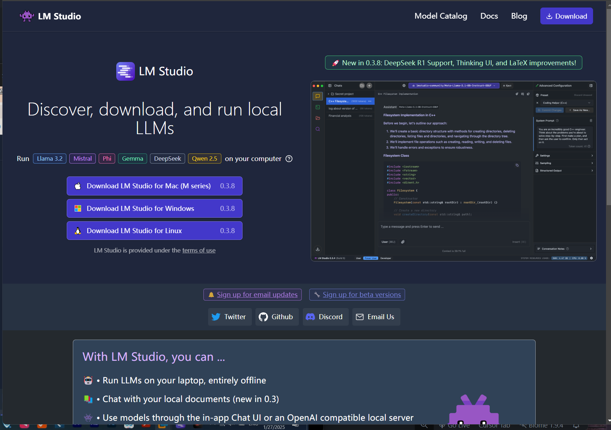
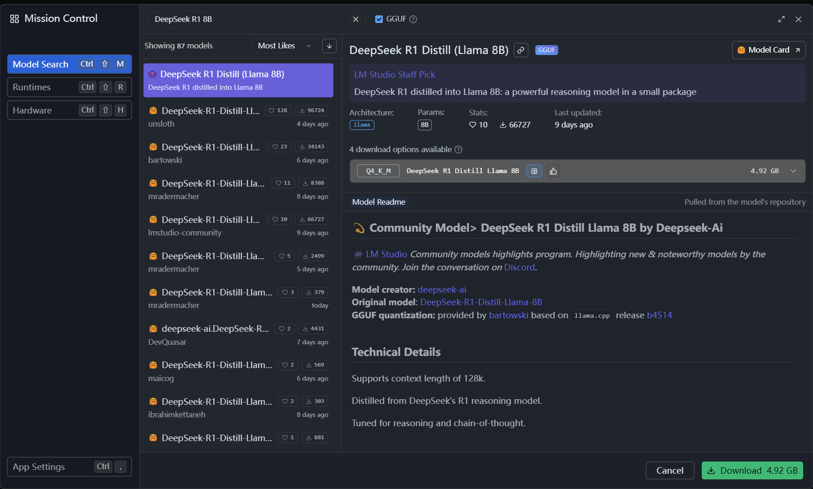
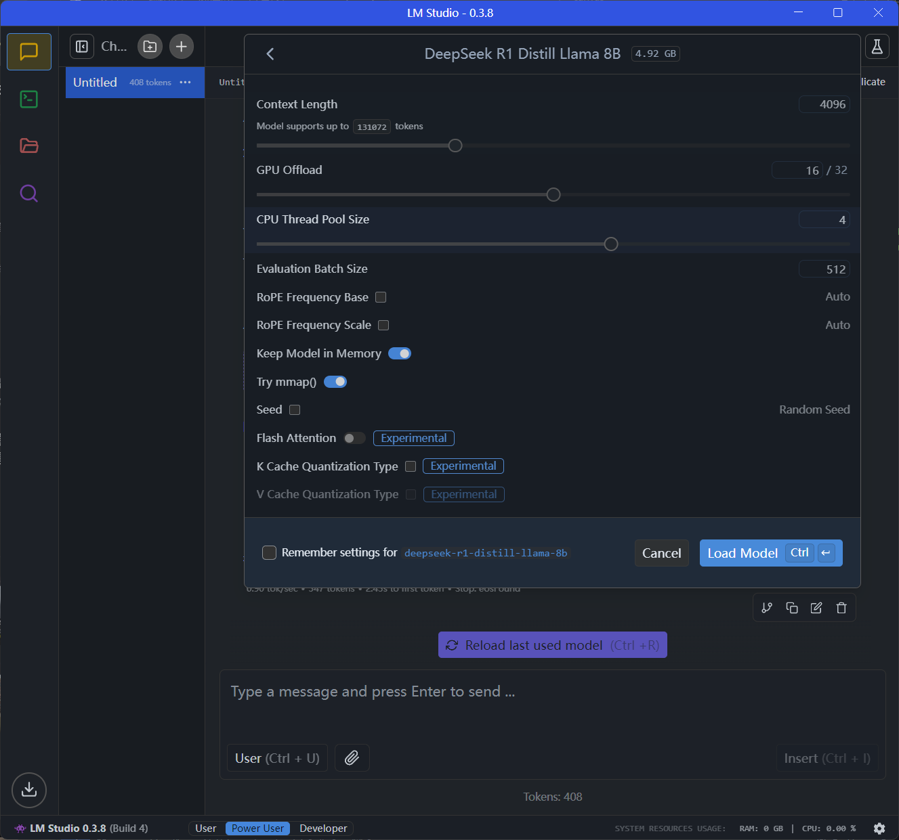
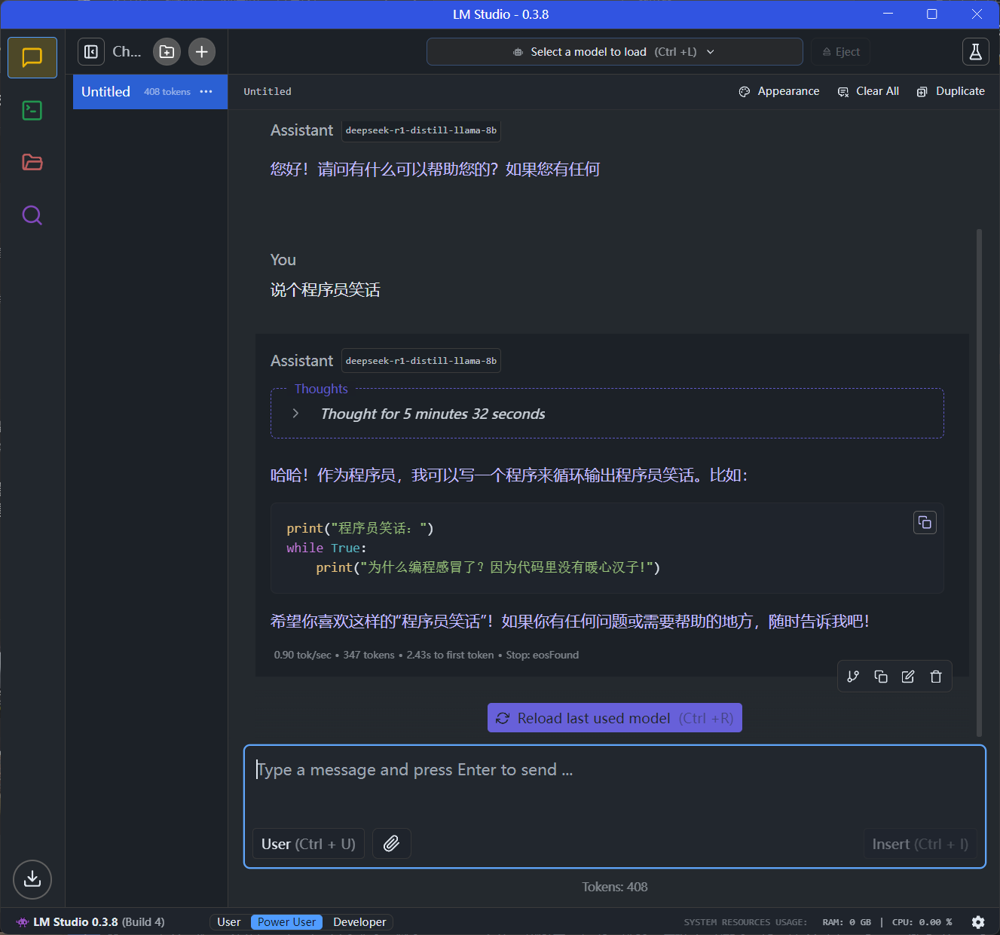

export const metadata = {
  title: "DeepSeek本地部署",
  description: "DeepSeek本地部署",
  date: "2024-08-16",
  category: "AI 调用",
  readingTime: "1 分钟",
  alternates: { canonical: "/ai调用/DeepSeek本地部署" },
  openGraph: { type: 'article', title: "DeepSeek本地部署", description: "DeepSeek本地部署", url: "/ai调用/DeepSeek本地部署" },
  twitter: { card: 'summary', title: "DeepSeek本地部署", description: "DeepSeek本地部署" }
}

## 1. 使用该平台可以调用任何mml模型

## 2.下载模型

## 3.选择模型和配置cpu和gpu

## 4.直接可以使用   

