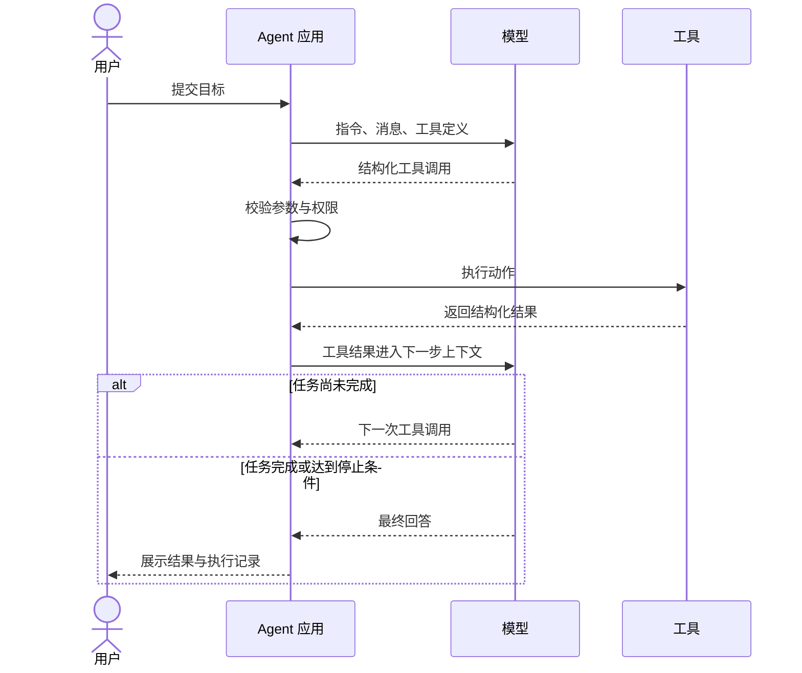

export const metadata = {
  title: 'Agent 不是更长的 Prompt：从工具调用到受控执行循环',
  description: '从工具定义、消息状态、执行循环、MCP 到人工审批，理解 AI Agent 如何可靠地完成真实任务。',
  date: '2026-08-19',
  category: 'AI 工程',
  readingTime: '12 分钟',
  alternates: { canonical: '/posts/agent-fundamentals' },
  openGraph: { type: 'article', title: 'Agent 不是更长的 Prompt：从工具调用到受控执行循环', description: '从工具定义、消息状态、执行循环、MCP 到人工审批，理解 AI Agent 如何可靠地完成真实任务。', url: '/posts/agent-fundamentals' },
  twitter: { card: 'summary', title: 'Agent 不是更长的 Prompt：从工具调用到受控执行循环', description: '从工具定义、消息状态、执行循环、MCP 到人工审批，理解 AI Agent 如何可靠地完成真实任务。' }
}

普通聊天模型只能生成内容。你让它“创建一个 `todo.md` 文件”，它最多返回一段 Markdown；文件是否真的出现在磁盘上，模型既不知道，也做不到。

Agent 的变化并不是提示词更长，而是模型被放进了一个执行循环：它可以选择工具，应用负责执行工具，执行结果回到上下文，模型再决定下一步。只要任务尚未完成，循环就可以继续。AI SDK 的[Agent 概览](https://ai-sdk.dev/docs/agents/overview)也把 Agent 概括为模型、工具与循环三部分。

## 读完你能做什么

- 解释“模型提出动作”和“应用执行动作”的权限边界。
- 写出带 schema、结果回传和停止条件的最小工具循环。
- 判断什么时候该用 MCP，什么时候内部函数已经足够。
- 为高风险工具设计预算、可见状态和人工审批。



这个循环让模型从“会说”变成“能做”，也引入了新的工程问题：工具参数如何校验，循环何时停止，前端如何展示中间状态，外部能力如何接入，以及哪些动作必须先让人确认。

## 工具调用：模型提出动作，应用掌握执行权

工具通常由三部分构成：给模型看的描述、约束输入的 schema，以及真正运行代码的 `execute`。下面是一个最小的文件写入工具：

```ts
import { tool } from 'ai';
import { z } from 'zod';

const writeFile = tool({
  description: 'Write text content to a file in the sandbox',
  inputSchema: z.object({
    path: z.string().describe('Path relative to the sandbox root'),
    content: z.string().describe('Complete text to write'),
  }),
  execute: async ({ path, content }) => {
    return fileSystem.writeFile(path, content);
  },
});
```

描述和 schema 会进入模型上下文。模型不会直接调用 JavaScript 函数，而是生成类似这样的结构化意图：

```json
{
  "toolName": "writeFile",
  "input": {
    "path": "todo.md",
    "content": "# Today\n\n- [ ] Review pull request\n- [ ] Write release notes"
  }
}
```

应用先用 schema 校验输入，再调用 `execute`。因此，工具调用并没有把控制权交给模型；模型只有提议权，真正的权限、路径限制和副作用仍由应用代码决定。

这也是为什么工具描述必须具体。`description: 'Manage files'` 无法告诉模型应该在何时写入、何时读取。把能力拆成 `writeFile`、`readFile`、`listDirectory`、`deletePath`，并为参数写清含义，模型更容易选择正确动作，应用也能对不同副作用设置不同策略。

工具返回值同样是接口的一部分。与其只返回 `true`，不如返回模型下一步需要的信息：

```ts
return {
  success: true,
  message: 'File written successfully: todo.md',
  path: 'todo.md',
};
```

模型拿到路径和状态后，可以直接向用户确认结果，也可以继续调用 `readFile` 检查内容。返回一大段内部日志通常没有帮助，只会浪费上下文。

## Agent 的核心是循环，而不是一次工具调用

一次模型调用只能完成一次决策。假设用户说：“检查项目目录，如果没有 `todo.md` 就创建它，然后读回来确认内容。”模型至少可能经历四步：列出目录、写入文件、读取文件、生成最终回答。

AI SDK 可以用 `streamText` 配合 `stopWhen` 运行这个循环：

```ts
import { stepCountIs, streamText } from 'ai';

const result = streamText({
  model,
  system: 'Use the sandboxed file tools to manage Markdown notes.',
  messages,
  tools: {
    writeFile,
    readFile,
    listDirectory,
    deletePath,
  },
  stopWhen: [stepCountIs(10)],
});
```

第一步可能产生 `listDirectory` 调用；工具结果回到模型后，第二步产生 `writeFile`；下一步再读取文件。只要模型生成最终文本或满足停止条件，循环结束。

`stepCountIs(10)` 不是任务规划，它是保险丝。没有最大步数，模型可能在失败工具、互相矛盾的结果或糟糕指令中反复尝试。生产环境通常还需要时间、Token、费用和工具调用次数等预算，因为“最多十步”并不能限制某一步调用一个昂贵的外部服务。

AI SDK 也提供 `ToolLoopAgent`，把 Agent 的定义与每次调用分离：

```ts
import {
  createAgentUIStreamResponse,
  InferAgentUIMessage,
  stepCountIs,
  ToolLoopAgent,
} from 'ai';

const agent = new ToolLoopAgent({
  model,
  instructions: 'Manage Markdown notes in the sandbox.',
  tools: { writeFile, readFile, listDirectory, deletePath },
  stopWhen: [stepCountIs(10)],
});

export type FileAgentMessage = InferAgentUIMessage<typeof agent>;

export const POST = async (req: Request) => {
  const { messages }: { messages: FileAgentMessage[] } = await req.json();

  return createAgentUIStreamResponse({
    agent,
    uiMessages: messages,
  });
};
```

这层封装的价值不是让 Agent 更聪明，而是让模型、instructions、工具集和停止条件成为一个可复用定义。它可以被 HTTP 路由调用，也可以通过 `agent.generate()` 或 `agent.stream()` 在后台任务中使用。练习中的 `ToolLoopAgent` 默认最多运行 20 步，而 `streamText` 默认只运行一步；无论使用哪种接口，都应显式设置符合任务风险的停止条件，而不是依赖默认值。

## 中间状态也是产品的一部分

Agent 的回答不再只有一段文本。一次工具调用会经历输入开始、输入流式生成、输入可用、等待执行、结果可用等状态。AI SDK 的 `UIMessage` 用 `parts` 保存这些结构化内容：

```ts
{
  role: 'assistant',
  parts: [
    { type: 'step-start' },
    {
      type: 'tool-writeFile',
      toolCallId: 'call_123',
      state: 'output-available',
      input: {
        path: 'todo.md',
        content: '# Today\n\n- [ ] Review pull request',
      },
      output: {
        success: true,
        path: 'todo.md',
      },
    },
    { type: 'step-start' },
    {
      type: 'text',
      state: 'done',
      text: 'Created `todo.md` and verified its contents.',
    },
  ],
}
```

如果前端只渲染 `text`，用户在工具执行期间会看到长时间空白，失败时也不知道问题发生在哪里。更完整的界面应根据 part 的类型与状态显示“正在准备文件”“正在写入”“已完成”或具体错误，并把关键参数呈现给用户。

```tsx
if (part.type === 'tool-writeFile') {
  if (part.state === 'input-streaming') {
    return <p>正在准备文件...</p>;
  }

  if (part.state === 'input-available') {
    return <p>正在写入 {part.input.path}...</p>;
  }

  if (part.state === 'output-available') {
    return <p>已创建 {part.output.path}</p>;
  }
}
```

这里有一个容易忽略的设计原则：最终文本是模型对结果的解释，tool part 才是动作本身的结构化记录。需要持久化对话、恢复页面或审计操作时，不应把“我已经创建文件”这句话当作执行成功的证据；应保存工具调用 ID、参数、状态和输出。

类型也可以从工具或 Agent 定义中推导。`InferAgentUIMessage<typeof agent>` 让后端工具 schema 与前端 part 类型保持一致，工具参数改变后，相关 UI 会在编译期暴露不匹配，而不是等用户触发某个少见分支才崩溃。

## MCP：复用外部世界的工具集

自己定义工具适合应用内部能力，但 GitHub、数据库、浏览器或企业服务往往已经拥有大量操作。MCP（Model Context Protocol）提供了一种统一方式，让应用连接 MCP server，获取它暴露的工具，再交给 Agent 使用。

本地 MCP server 可以通过 stdio transport 启动。练习使用 Docker 运行 GitHub MCP server，并通过标准输入输出通信：

```ts
import { experimental_createMCPClient as createMCPClient } from '@ai-sdk/mcp';
import { Experimental_StdioMCPTransport as StdioMCPTransport } from '@ai-sdk/mcp/mcp-stdio';

const transport = new StdioMCPTransport({
  command: 'docker',
  args: [
    'run',
    '-i',
    '--rm',
    '-e',
    'GITHUB_PERSONAL_ACCESS_TOKEN',
    'ghcr.io/github/github-mcp-server',
  ],
  env: {
    GITHUB_PERSONAL_ACCESS_TOKEN: process.env.GITHUB_PERSONAL_ACCESS_TOKEN!,
  },
});

const mcpClient = await createMCPClient({ transport });
const tools = await mcpClient.tools();
```

这些工具可以直接传给 `streamText`，但本地进程需要管理生命周期。练习在流结束时调用 `mcpClient.close()`；真实服务还要考虑异常退出、并发请求和连接复用，否则每次请求启动一个容器会带来明显开销。

远程 MCP server 则可以通过 HTTP 连接：

```ts
const mcpClient = await createMCPClient({
  transport: {
    type: 'http',
    url: 'https://api.githubcopilot.com/mcp',
    headers: {
      Authorization: `Bearer ${process.env.GITHUB_PERSONAL_ACCESS_TOKEN}`,
    },
  },
});
```

stdio 的优点是工具运行环境在自己控制之下，代价是必须执行和维护本地进程；HTTP 不需要在应用服务器上运行第三方代码，但会依赖远程服务的可用性、认证和网络延迟。两者给模型暴露的都可以是同一组工具，差别主要发生在应用与 MCP server 之间。

MCP 解决的是工具发现和通信协议，不会自动解决权限问题。拿到 GitHub MCP server 的全部工具，不代表每个用户都应该拥有创建仓库、关闭 Issue 或合并 PR 的能力。应用仍然需要限制可用工具、缩小凭证权限、校验参数，并记录每次外部操作。

MCP 官方的[架构说明](https://modelcontextprotocol.io/specification/2025-06-18/architecture)把 host、client 与 server 的职责分开：host 负责权限、生命周期和用户授权，server 只暴露约定的能力。这个边界解释了为什么“接入 MCP”不能替代应用自己的授权系统。

## Approval：在不可逆动作前暂停循环

文件助手在沙箱里写一份 Markdown，失败后通常可以重试；发送邮件、付款、删除生产数据则可能无法撤销。Agent 越有用，潜在副作用越大。可靠系统不能只靠提示词里的“请小心”，而应在执行层插入人工审批。

AI SDK 的工具可以声明 `needsApproval: true`：

```ts
const sendEmail = tool({
  description: 'Send an email to a recipient',
  inputSchema: z.object({
    to: z.string(),
    subject: z.string(),
    body: z.string(),
  }),
  needsApproval: true,
  execute: async ({ to, subject, body }) => {
    return emailService.send({ to, subject, body });
  },
});
```

当模型生成邮件参数后，工具不会立刻执行，消息 part 会进入 `approval-requested` 状态。前端可以把收件人、主题和正文完整展示出来：

```tsx
if (
  part.type === 'tool-sendEmail' &&
  part.state === 'approval-requested'
) {
  return (
    <EmailApproval
      email={part.input}
      onApprove={() =>
        addToolApprovalResponse({
          id: part.approval.id,
          approved: true,
        })
      }
      onReject={() =>
        addToolApprovalResponse({
          id: part.approval.id,
          approved: false,
        })
      }
    />
  );
}
```

审批结果也是 Agent 循环中的一个消息。使用 `lastAssistantMessageIsCompleteWithApprovalResponses` 后，所有审批都有结果时，客户端可以自动把结果发回模型：批准后继续执行，拒绝后由模型解释、修改方案或询问用户，而不是让整个对话卡死。

```ts
const {
  messages,
  sendMessage,
  addToolApprovalResponse,
} = useChat<FileAgentMessage>({
  sendAutomaticallyWhen:
    lastAssistantMessageIsCompleteWithApprovalResponses,
});
```

并不是每个工具都需要审批。最好的规则通常与副作用相关：只读查询可以自动执行；可恢复的沙箱写入可以在明确范围内自动执行；对外发送、花费资金、改变权限和删除重要数据则应要求确认。审批界面还必须展示用户真正需要判断的信息，只有一个脱离上下文的“允许 / 拒绝”按钮并不构成有效监督。

## 一个可靠 Agent 的边界

把这些练习连起来，Agent 可以被理解为五个部分：模型负责决策，工具提供能力，循环组织多步执行，消息状态让过程可见，审批与预算限制副作用。MCP 可以扩大工具来源，却不会改变这个基本结构。

因此，评估 Agent 不能只看它是否完成了一次精彩演示。还要观察它是否选对工具、参数是否有效、失败后是否合理恢复、循环能否按预算停止、UI 是否如实展示动作，以及高风险操作是否真的被执行层拦截。

最值得坚持的一条原则是：**让模型决定意图，让代码决定权限。** 模型可以判断“下一步应该发送邮件”，但收件人格式由 schema 校验，是否允许发送由权限系统和用户审批决定，真正的发送由应用执行并返回可审计结果。这样构建出来的 Agent 不只是会调用更多工具，而是在清楚的边界内，把一个目标可靠地推进到完成。

## 自检：你是否掌握了执行边界

<details>
  <summary>模型生成了合法的 deletePath 参数，是否应该立刻执行？</summary>
  <p><strong>不应该只凭参数合法就执行。</strong>Schema 只能证明结构正确；应用还要检查路径范围、用户权限、可恢复性与审批策略。</p>
</details>

<details>
  <summary>设置最多 10 步，是否已经限制了全部成本？</summary>
  <p><strong>没有。</strong>还应限制总时间、Token、费用与高成本工具调用次数，并允许外部取消。</p>
</details>

<details>
  <summary>MCP server 提供了工具，谁决定当前用户能否调用？</summary>
  <p><strong>Host 应用。</strong>它负责选择暴露哪些工具、使用什么凭证、何时审批，并保存审计记录。</p>
</details>

## 延伸阅读

- [AI SDK：Agents overview](https://ai-sdk.dev/docs/agents/overview)
- [AI SDK：Loop control](https://ai-sdk.dev/docs/agents/loop-control)
- [AI SDK：Tools and tool calling](https://ai-sdk.dev/docs/ai-sdk-core/tools-and-tool-calling)
- [Model Context Protocol：Architecture](https://modelcontextprotocol.io/specification/2025-06-18/architecture)
