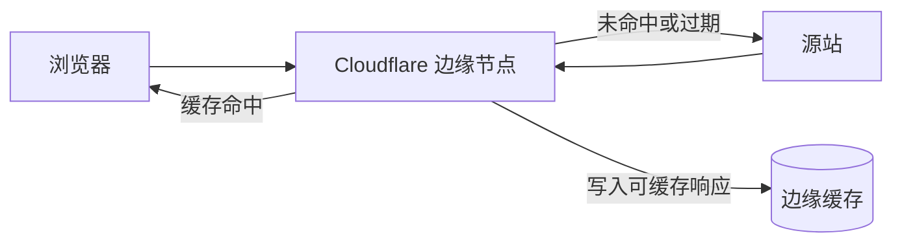

export const metadata = {
  title: 'CDN 边缘缓存原理与 Cloudflare Cache Rules 配置实践',
  description: '梳理 CDN Anycast 路由与边缘分层缓存机制，配合 Cloudflare Cache Rules 配置静态资源与 HTML 缓存，以及 CI/CD 自动清除缓存。',
  date: '2025-02-11',
  category: '网络与运维',
  readingTime: '8 分钟',
  alternates: { canonical: '/posts/cloudflare-cdn-acceleration' },
  openGraph: {
    type: 'article',
    title: 'CDN 边缘缓存原理与 Cloudflare Cache Rules 配置实践',
    description: '梳理 CDN Anycast 路由与边缘分层缓存机制，配合 Cloudflare Cache Rules 配置静态资源与 HTML 缓存，以及 CI/CD 自动清除缓存。',
    url: '/posts/cloudflare-cdn-acceleration', images: ['/og-image.png'] },
  twitter: {
    card: 'summary_large_image',
    title: 'CDN 边缘缓存原理与 Cloudflare Cache Rules 配置实践',
    description: '梳理 CDN Anycast 路由与边缘分层缓存机制，配合 Cloudflare Cache Rules 配置静态资源与 HTML 缓存，以及 CI/CD 自动清除缓存。', images: ['/og-image.png'] },
}

## 读完你能做什么

- 画出一次请求在浏览器、Cloudflare 边缘节点与源站之间的路径。
- 根据资源是否可公开复用，设计 Cache Rule 与缓存键，而不是盲目“缓存所有内容”。
- 用响应头定位命中、回源和过期问题，并安全地执行精准清除。



CDN 优化的核心不是“离用户更近”这一句话，而是让**可复用响应在正确的缓存键下命中，同时让私有或动态响应继续回源**。

在 Web 站点的访问优化中，内容分发网络（CDN）常用于降低网络延迟、削减源站带宽负载。将域名接入 Cloudflare 后，请求会先到达就近的边缘 PoP 节点。

本文梳理 CDN 边缘缓存的命中机理，以及如何通过 Cache Rules 与源站缓存头配合避免旧资源残留或非预期缓存。

---

## CDN 底层加速机理：Anycast 与分层缓存

```text
用户 (全球各地)
  │
  ▼ BGP Anycast (智能路由到地理最近的边缘机房)
Cloudflare 边缘 PoP 节点 (Edge Cache)
  │
  ├── [命中缓存 (HIT)] ──────► 毫秒级直接向客户端响应 (0 源站流量)
  │
  └── [未命中缓存 (MISS)]
        │
        ▼ 分层缓存 (Tiered Cache / Argo 智能路由)
      区域核心节点 (Regional Upper Tier)
        │
        ▼ 回源请求 (Origin Fetch)
      源站服务器 (Origin Server: Nginx / Docker)
```

1. **Anycast 任播路由**：全球所有边缘节点共享相同的公共 IP 地址，BGP 路由协议会自动引导用户的数据包走物理距离最近、网络跳数最少的边缘节点。
2. **边缘缓存拦截**：静态资源（JS、CSS、图片、字体）首次被加载后会被保存在边缘节点内存与 SSD 中，后续附近用户的请求将在几毫秒内直接响应（`cf-cache-status: HIT`）。
3. **分层缓存（Tiered Cache）**：未命中的请求不会全部直接压向源站，而是先汇总到区域核心节点，进一步降低回源率。

---

## 核心配置实战：Cloudflare Cache Rules 精细化控制

默认情况下，Cloudflare 仅对特定扩展名（`.jpg`、`.css`、`.js` 等）进行简单缓存，并不缓存 HTML 页面。为了提升静态站点或 SPA 的首屏响应与离线命中率，我们可以按路由维度配置 **Cache Rules**。

### 1. 静态资源长效缓存规则

为打包产物（文件名带哈希的 `_next/static/*`）设置极长缓存时间：

```text
匹配条件:
  (http.request.uri.path starts_with "/_next/static/")

缓存配置:
  - Edge Cache TTL: 1 年 (31536000 秒)
  - Browser Cache TTL: 1 年
  - Cache Deception Armor: 开启
```

### 2. HTML 页面边缘缓存与源站 `Cache-Control` 配合

在源站（如 Nginx 或 Next.js 导出响应头）中，建议结合现代 HTTP 缓存标头：

```http
Cache-Control: public, max-age=0, s-maxage=86400, stale-while-revalidate=600
```

* `max-age=0`：要求浏览器每次导航时向边缘节点发起协商请求（确保获取最新内容）。
* `s-maxage=86400`：指示 Cloudflare 边缘节点将 HTML 缓存 24 小时。
* `stale-while-revalidate=600`：即使边缘缓存过期，在后台异步向源站刷新内容的同时，先将陈旧缓存（Stale Cache）返回给用户，避免用户感知到等待。

---

## 缓存状态与排错：识别 `cf-cache-status` 响应头

在浏览器 DevTools Network 面板中，检查 Cloudflare 注入的响应标头：

| 状态值 | 含义与解析 |
| :--- | :--- |
| **`HIT`** | 边缘节点命中有效缓存，直接由离用户最近的 CDN 机房返回。 |
| **`MISS`** | 边缘节点未找到缓存，已向源站拉取并填充至当前边缘节点。 |
| **`DYNAMIC`** | 资源未配置缓存规则（或被绕过），请求直接穿透至源站。 |
| **`EXPIRED`** | 缓存已过 TTL 有效期，边缘节点正重新向源站验证。 |
| **`STALE`** | 因配置了 `stale-while-revalidate`，当前返回的是陈旧缓存，后台正在异步更新。 |

---

## 生产环境自动化缓存清除（Cache Purge）

当发布新内容或部署新版本时，可以通过 Cloudflare API 清除特定 URL 或全站缓存：

```bash
# 通过 cURL 调用 Cloudflare Purge API 清除首页缓存
curl -X POST "https://api.cloudflare.com/client/v4/zones/{ZONE_ID}/purge_cache" \
     -H "Authorization: Bearer {API_TOKEN}" \
     -H "Content-Type: application/json" \
     --data '{"files":["https://example.com/","https://example.com/posts"]}'
```

在 GitHub Actions CI/CD 流水线末尾调用该接口，发布后能及时刷新边缘缓存，避免用户访问到旧版本静态页面。

---

## 官方资料

- [Cloudflare：Cache Rules](https://developers.cloudflare.com/cache/how-to/cache-rules/)

## 工程经验小结

缓存策略的核心在于区分不变资产与易变入口。

带内容哈希的静态 JS/CSS 适合直接配置一年以上的长效缓存；而 HTML 页面虽然也可以在边缘缓存，但必须配合合理的 `s-maxage` 与主动 Purge 机制。如果只配边缘缓存却缺少自动清理机制，发布新版本时容易出现用户请求到旧 HTML、进而找不到对应哈希 chunk 的 404 故障。
