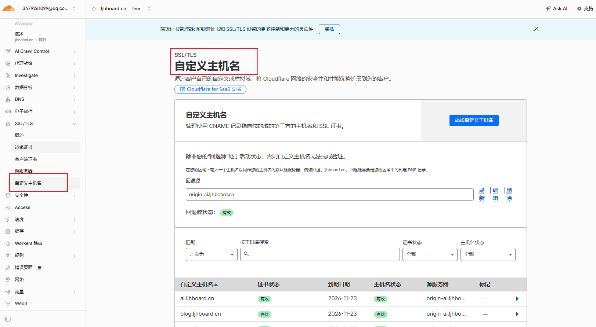
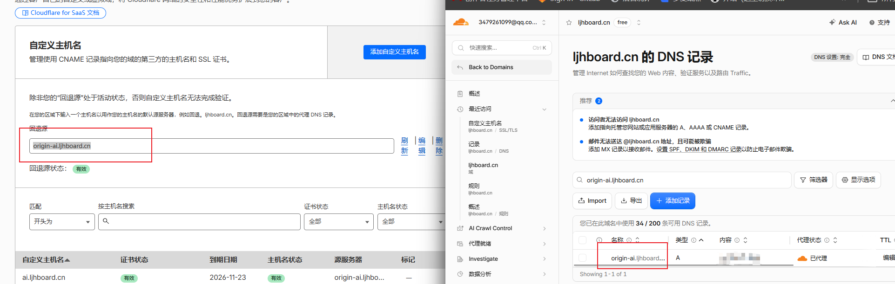
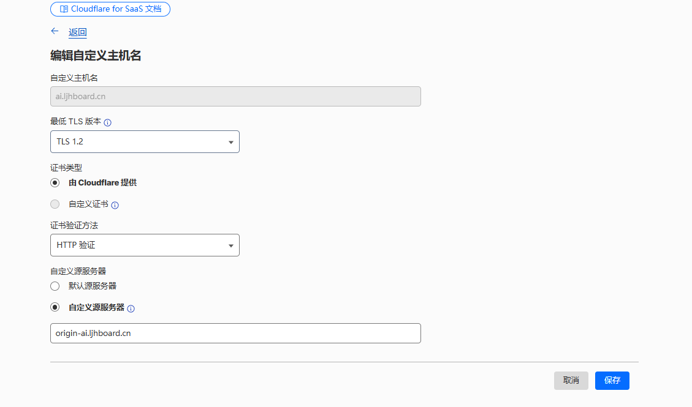
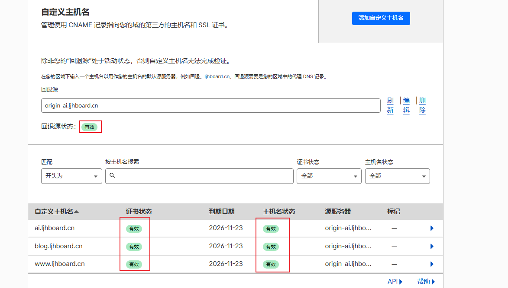
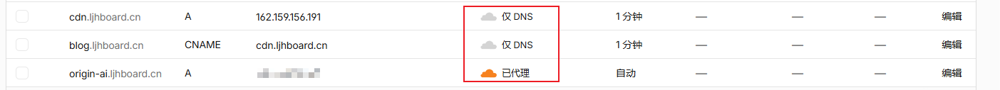
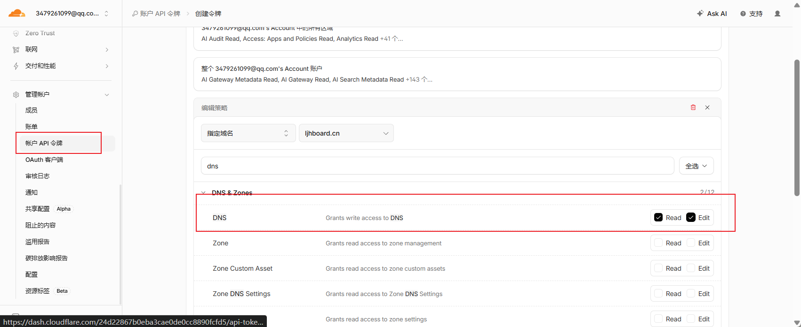
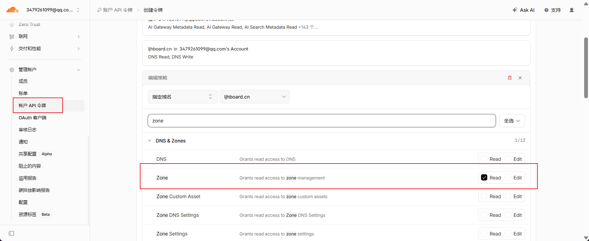
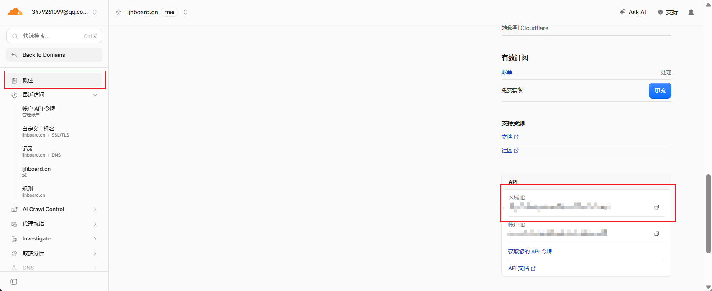
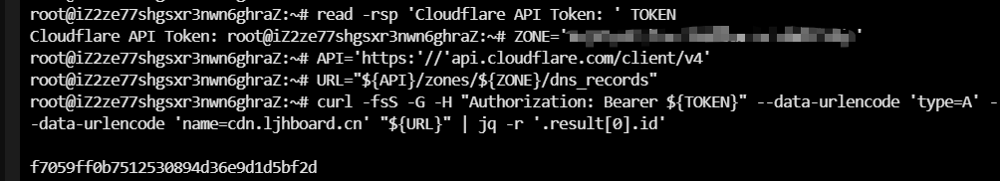
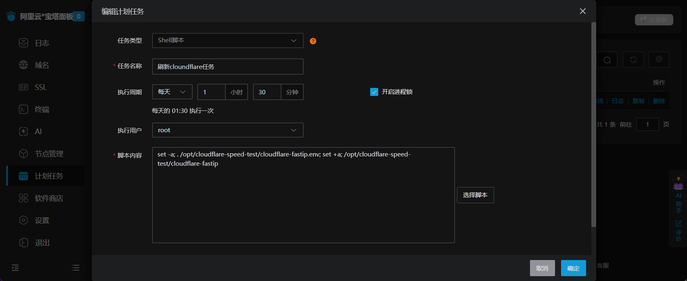

export const metadata = {
  title: 'Cloudflare 的优选 IP 优化',
  description: '用 Cloudflare for SaaS、CloudflareSpeedTest 和宝塔计划任务，为同一域名下的博客入口自动选择 Cloudflare IP，并保留可回滚的源站链路。',
  date: '2026-08-25',
  category: 'Cloudflare 优化',
  readingTime: '15 分钟',
  alternates: { canonical: '/posts/cloudflare-custom-hostname-fast-ip' },
  openGraph: {
    type: 'article',
    title: 'Cloudflare 的优选 IP 优化',
    description: '用 Cloudflare for SaaS、CloudflareSpeedTest 和宝塔计划任务，为同一域名下的博客入口自动选择 Cloudflare IP，并保留可回滚的源站链路。',
    url: '/posts/cloudflare-custom-hostname-fast-ip',
  },
  twitter: {
    card: 'summary',
    title: 'Cloudflare 的优选 IP 优化',
    description: '用 Cloudflare for SaaS、CloudflareSpeedTest 和宝塔计划任务，为同一域名下的博客入口自动选择 Cloudflare IP，并保留可回滚的源站链路。',
  },
}

Cloudflare 免费套餐对海外访问很友好，但中国内地不同运营商到默认 Anycast 节点的线路可能并不理想。本文记录一次只使用 `ljhboard.cn` 这一个注册域名的实践：用 Cloudflare for SaaS 的自定义主机名承接 TLS 和回源，用 [CloudflareSpeedTest](https://github.com/XIU2/CloudflareSpeedTest) 从服务器侧筛选候选 Cloudflare IP，再由宝塔计划任务定期更新唯一的 DNS 记录。

目标不是把一次测速结果包装成“全国加速”，而是先建立一个免费、可验证、可随时回滚的优化闭环。

## 配置前先看：自定义主机名需要绑定支付方式

> **必须先处理：** 非 Enterprise 区域启用 Cloudflare for SaaS 时，Cloudflare 会要求填写支付信息。免费套餐可以启用相关能力，不代表可以跳过支付方式。先完成这一步，再继续创建 fallback origin 和自定义主机名。具体要求以 [Cloudflare 官方启用文档](https://developers.cloudflare.com/cloudflare-for-platforms/cloudflare-for-saas/start/enable/) 为准。

绑定支付方式不等于本教程中的每一步都会收费，但产品额度和计费规则可能调整。启用前应在控制台核对当前套餐、免费额度和账单提醒，不要只依据旧教程判断费用。



## 先理解链路：只动态更新一个 DNS 记录

这套方案不需要第二个注册域名，也不依赖阿里云 CDN。最终链路如下：

```text
访问 blog.ljhboard.cn
        │
        ▼
DNS-only CNAME: blog -> cdn.ljhboard.cn
        │
        ▼
DNS-only A: cdn -> CFST 本轮选出的 Cloudflare IPv4
        │
        ▼
Cloudflare Custom Hostname（证书、Host 路由）
        │
        ▼
Fallback Origin: origin-ai.ljhboard.cn（橙云）
        │
        ▼
北京 ECS 源站
```

`cdn.ljhboard.cn` 是唯一会被脚本改动的记录。`blog`、`ai` 等正式入口只 CNAME 到它；回源记录始终保持橙云。这样切换候选 IP 时不必逐个修改业务域名，失败时也只需恢复一个 A 记录。

这是一种社区实践，不是 Cloudflare 默认推荐的标准 SaaS 接入方式。Cloudflare 官方文档推荐客户主机名 CNAME 到 SaaS target，并说明普通 A 记录指向 target 默认不属于受支持配置；因此必须保留原来的橙云 A 记录和值作为回滚基线。本文思路参考了 [AcoFork 的优选 IP 实践](https://www.acofork.com/posts/cf-fastip)，生产使用前请先在无流量主机名上验证。

## 第一步：备份 DNS，并建立 fallback origin

先截图或导出当前 DNS，至少记下 `ai`、`blog`、根域和源站记录的类型、值、TTL 与代理状态。之后创建一个专门的回源记录：

| 类型 | 名称 | 内容 | 代理状态 |
| :--- | :--- | :--- | :--- |
| A | `origin-ai` | 你的源站 IPv4 | **已代理（橙云）** |

进入 Cloudflare 控制台的 **SSL/TLS → 自定义主机名**，将 fallback origin 设置为 `origin-ai.ljhboard.cn`，等状态变为 `Active`。官方文档要求 fallback origin 对应 Cloudflare 中已代理的 A、AAAA 或 CNAME 记录；`Active` 只说明 Cloudflare 已准备把流量发到该记录，仍需自行确认它确实指向正确源站。参见 [Cloudflare for SaaS 初始配置](https://developers.cloudflare.com/cloudflare-for-platforms/cloudflare-for-saas/start/getting-started/)。




## 第二步：先用 blog 创建自定义主机名


不要一上来切换正在使用的入口。先添加低风险的 `blog.ljhboard.cn`：

- Hostname：`blog.ljhboard.cn`
- Minimum TLS Version：`1.2`
- Certificate：Cloudflare 托管
- Validation method：HTTP
- Origin：默认 fallback origin




创建后要关注两个独立状态：主机名状态和证书状态。Cloudflare 官方要求两者都为 `Active`，并且 DNS 已指向 SaaS target，才应视为可承载生产 HTTPS 流量。



## 第三步：创建优选入口 DNS

先用一个手工测试通过的 Cloudflare IPv4 创建记录，稍后再交给脚本更新：

| 类型 | 名称 | 内容 / 目标 | TTL | 代理状态 |
| :--- | :--- | :--- | :--- | :--- |
| A | `cdn` | 候选 Cloudflare IPv4(可以先去 https://cf.090227.xyz/ 获取一个之后会讲到服务器的定时任务更新) | 60 秒 | **仅 DNS（灰云）** |
| CNAME | `blog` | `cdn.ljhboard.cn` | 60 秒 | **仅 DNS（灰云）** |

这里最容易配错的是云朵状态：`origin-ai` 必须橙云，`cdn` 和 `blog` 必须灰云。完成后先不要配置定时任务，先确认手工链路可用：

```bash
dig +short blog.ljhboard.cn
curl -I --connect-timeout 10 https://blog.ljhboard.cn/
```

只有证书可信、HTTP 状态正确、页面没有串站，而且响应确实经过 Cloudflare，才继续配置自动更新。`blog` 成功后，可用相同方式添加 `ai.ljhboard.cn` 自定义主机名，再把 `ai` 改为灰云 CNAME 指向 `cdn.ljhboard.cn`。



## 第四步：在服务器安装 CloudflareSpeedTest

以下以 Linux amd64 为例。先用 `uname -m` 确认服务器架构，再从 [CloudflareSpeedTest Releases](https://github.com/XIU2/CloudflareSpeedTest/releases) 下载匹配的压缩包。压缩包解开后，二进制在 `cfst_linux_amd64` 目录里，不是在当前目录：

```bash
mkdir -p /opt/cloudflare-speed-test
cd /opt/cloudflare-speed-test

# 将下载的压缩包放到此目录后解压
tar -xzf cfst.tar.gz

# 注意真实文件路径，不要直接执行 chmod 755 cfst
install -m 755 cfst_linux_amd64/cfst ./cfst
install -m 644 cfst_linux_amd64/ip.txt ./ip.txt
./cfst -v
```

先手工跑一次低并发测试：

```bash
cd /opt/cloudflare-speed-test
./cfst -f ./ip.txt -n 50 -t 4 -dn 10 -dt 10 \
  -tl 300 -tlr 0 -sl 0.1 -p 10 -o result.csv
head -n 2 result.csv
```

如果第二行没有 IPv4，先调整延迟或速度阈值，不要让后续脚本拿空值更新 DNS。服务器测得的是“这台服务器出口到 Cloudflare”的结果，不代表中国电信、联通、移动的全国用户体验；它只是免费方案中的单点探针。

## 第五步：创建最小权限 Token，并查出三个 ID

创建 Cloudflare API Token 时，只授予 `ljhboard.cn` 这个 zone：

- Zone → DNS → Edit


- Zone → Zone → Read


不要使用 Global API Key。接下来准备三个**全部必填**的值：

zoneId: `ljhboard.cn` 概览页右侧的 Zone ID



| 变量 | 从哪里获得 |
| :--- | :--- |
| `CF_API_TOKEN` | 刚创建的最小权限 Token，属于秘密 |
| `CF_ZONE_ID` | `ljhboard.cn` 概览页右侧的 Zone ID |
| `CF_DNS_RECORD_ID` | `cdn.ljhboard.cn` 这条 A 记录的 Record ID |

`CF_DNS_RECORD_ID` 不是 Zone ID，也不能留空。用下面命令查询；变量拆开写可以避免复制富文本时 URL 被转换成 Markdown 链接：

```bash
read -rsp 'Cloudflare API Token: ' TOKEN
echo
ZONE='替换为你的 Zone ID'
API='https:'//'api.cloudflare.com/client/v4'
URL="${API}/zones/${ZONE}/dns_records"

curl -fsS -G -H "Authorization: Bearer ${TOKEN}" --data-urlencode 'type=A' --data-urlencode 'name=cdn.ljhboard.cn' "${URL}" | jq -r '.result[0].id'

unset TOKEN
```


输出应是一串 32 位十六进制字符。若输出 `null`，先检查 `cdn.ljhboard.cn` 是否确实是一条 A 记录，以及 Token 和 Zone ID 是否匹配。

## 第六步：把脚本和环境文件放在同一目录

本文统一放到 `/opt/cloudflare-speed-test/`，避免宝塔任务在多个目录之间找文件：

```text
/opt/cloudflare-speed-test/
├── cfst
├── ip.txt
├── cloudflare-fastip
└── cloudflare-fastip.env
```

先创建环境文件 `/opt/cloudflare-speed-test/cloudflare-fastip.env`：

```bash
# 以下五项全部必填
CF_API_TOKEN='替换为最小权限 Token'
CF_ZONE_ID='替换为 Zone ID'
CF_DNS_RECORD_ID='替换为 cdn.ljhboard.cn 的 Record ID'
CF_DNS_NAME='cdn.ljhboard.cn'
CF_VERIFY_HOSTS='blog.ljhboard.cn'
```

```bash
chown root:root /opt/cloudflare-speed-test/cloudflare-fastip.env
chmod 600 /opt/cloudflare-speed-test/cloudflare-fastip.env
```

`cloudflare-fastip` 脚本至少应完成以下闭环：

1. 用 `flock` 防止任务重叠。
2. 运行 CFST，并从 `result.csv` 读取第一条候选 IPv4。
3. 更新前用 `curl --resolve` 验证每个正式主机名的 TLS、SNI 和 HTTP。
4. 通过 Cloudflare DNS API `PATCH` 更新指定 record ID，保持 `proxied: false` 和 TTL 60。
5. 读回 DNS 记录并再次验证；失败就恢复旧 IP。

Cloudflare 的 [Update DNS Record API](https://developers.cloudflare.com/api/resources/dns/subresources/records/methods/edit/) 支持按 record ID 更新记录。把“记录名称、类型和灰云状态检查”写进脚本很重要：即使 ID 填错，也应拒绝修改，而不是碰巧把另一条生产记录改掉。

下面是一份可直接保存为 `/opt/cloudflare-speed-test/cloudflare-fastip` 的最小实现：

```bash
#!/usr/bin/env bash
set -Eeuo pipefail

BASE_DIR='/opt/cloudflare-speed-test'
CFST_BIN="${BASE_DIR}/cfst"
IP_FILE="${BASE_DIR}/ip.txt"
RESULT_FILE="${BASE_DIR}/result.csv"
API='https:'//'api.cloudflare.com/client/v4'

: "${CF_API_TOKEN:?CF_API_TOKEN 未填写}"
: "${CF_ZONE_ID:?CF_ZONE_ID 未填写}"
: "${CF_DNS_RECORD_ID:?CF_DNS_RECORD_ID 未填写}"
: "${CF_DNS_NAME:?CF_DNS_NAME 未填写}"
: "${CF_VERIFY_HOSTS:?CF_VERIFY_HOSTS 未填写}"

exec 9>"${BASE_DIR}/cloudflare-fastip.lock"
flock -n 9 || { echo '已有任务正在运行，本次退出'; exit 0; }

"${CFST_BIN}" -f "${IP_FILE}" -n 50 -t 4 -dn 10 -dt 10 \
  -tl 300 -tlr 0 -sl 0.1 -p 10 -o "${RESULT_FILE}"

CANDIDATE_IP="$({ awk -F, 'NR == 2 { gsub(/\r/, "", $1); print $1 }' "${RESULT_FILE}"; } || true)"
if [[ ! "${CANDIDATE_IP}" =~ ^([0-9]{1,3}\.){3}[0-9]{1,3}$ ]]; then
  echo "没有得到有效 IPv4：${CANDIDATE_IP:-<空>}" >&2
  exit 1
fi

verify_ip() {
  local ip="$1" host
  IFS=',' read -ra hosts <<< "${CF_VERIFY_HOSTS}"
  for host in "${hosts[@]}"; do
    curl -fsS --connect-timeout 10 --max-time 20 \
      --resolve "${host}:443:${ip}" \
      -o /dev/null "https://${host}/"
  done
}

echo "验证候选 IP：${CANDIDATE_IP}"
verify_ip "${CANDIDATE_IP}"

RECORD_URL="${API}/zones/${CF_ZONE_ID}/dns_records/${CF_DNS_RECORD_ID}"
AUTH_HEADER="Authorization: Bearer ${CF_API_TOKEN}"
CURRENT_JSON="$(curl -fsS -H "${AUTH_HEADER}" "${RECORD_URL}")"

jq -e --arg name "${CF_DNS_NAME}" '
  .success == true and
  .result.type == "A" and
  .result.name == $name and
  .result.proxied == false
' >/dev/null <<< "${CURRENT_JSON}" || {
  echo 'Record ID、记录名、类型或灰云状态不符合预期，拒绝更新' >&2
  exit 1
}

OLD_IP="$(jq -r '.result.content' <<< "${CURRENT_JSON}")"
if [[ "${OLD_IP}" == "${CANDIDATE_IP}" ]]; then
  echo "仍是当前 IP，无需更新：${OLD_IP}"
  exit 0
fi

make_payload() {
  jq -n --arg name "${CF_DNS_NAME}" --arg ip "$1" '{
    type: "A", name: $name, content: $ip, ttl: 60, proxied: false
  }'
}

update_record() {
  curl -fsS -X PATCH "${RECORD_URL}" \
    -H "${AUTH_HEADER}" \
    -H 'Content-Type: application/json' \
    --data "$(make_payload "$1")" |
    jq -e '.success == true' >/dev/null
}

echo "更新 ${CF_DNS_NAME}：${OLD_IP} -> ${CANDIDATE_IP}"
update_record "${CANDIDATE_IP}"

READBACK_IP="$(curl -fsS -H "${AUTH_HEADER}" "${RECORD_URL}" | jq -r '.result.content')"
if [[ "${READBACK_IP}" != "${CANDIDATE_IP}" ]] || ! verify_ip "${CANDIDATE_IP}"; then
  echo "更新后验证失败，回滚到 ${OLD_IP}" >&2
  update_record "${OLD_IP}"
  exit 1
fi

echo "更新完成：${CF_DNS_NAME} -> ${CANDIDATE_IP}"
```

这份脚本故意不自动下载 CFST、不自动创建 DNS，也不修改其他业务记录。它的权限边界越窄，放进无人值守任务后越容易判断“到底会改什么”。

## 第七步：先手工执行，再交给宝塔

安装依赖并给脚本执行权限：

```bash
apt-get update
apt-get install -y curl jq util-linux
chmod 755 /opt/cloudflare-speed-test/cloudflare-fastip
```

先在终端手工加载环境变量并运行：

```bash
set -a
. /opt/cloudflare-speed-test/cloudflare-fastip.env
set +a
/opt/cloudflare-speed-test/cloudflare-fastip
```

确认脚本输出了旧 IP、候选 IP、API 更新结果和最终 HTTPS 验证结果。然后进入宝塔面板 **计划任务 → 添加任务**：

- 任务类型：Shell 脚本
- 执行周期：每 6 小时
- 执行用户：root
- 脚本内容：

```bash
set -a; . /opt/cloudflare-speed-test/cloudflare-fastip.env; set +a; /opt/cloudflare-speed-test/cloudflare-fastip
```

不建议每分钟测速，也不要让计划任务每次下载 `latest` 版本。优选 IP 变化没有快到值得高频扫描，而未经校验的自动升级会让故障原因更难定位。




## 验证与回滚：把成功标准写在切换之前

每次只切一个主机名，并执行：

```bash
dig +short cdn.ljhboard.cn
dig +short blog.ljhboard.cn
curl -I https://blog.ljhboard.cn/
curl -I 'https://ljhboard.cn/posts?from=root'
```

配置成功需要同时满足：

- Custom Hostname 与证书状态都是 `Active`。
- `blog` 解析到 `cdn` 当前候选 IP，且两条记录均为灰云。
- HTTPS 证书可信，状态码与页面内容正确，没有 403、Error 1000、证书不匹配、串站或回源循环。
- 根域返回 301，路径和查询参数都被保留。
- 宝塔手工执行一次成功后，下一次定时日志仍能正常结束。

出现异常时，先暂停宝塔任务，再把受影响的业务主机名恢复到实施前记录的橙云 A 值。不要修改 `origin-ai.ljhboard.cn`；它就是稳定回源锚点。恢复后等待 DNS TTL，再重新验证 HTTPS。

## 结论

这套免费方案真正有价值的不是“找到一个永远最快的 IP”，而是把一次性的手工优选变成了受约束的更新流程：业务入口不动，只更新 `cdn`；写入前后都验证；失败可以恢复；根域重定向也不需要 Worker。

它的上限同样清楚：单台北京 ECS 的测速不能代表全国线路，Cloudflare 的产品规则和社区优选路径也可能变化。把它当作可观测、可回滚的优化实验，比把某个 IP 当成永久答案更可靠。
