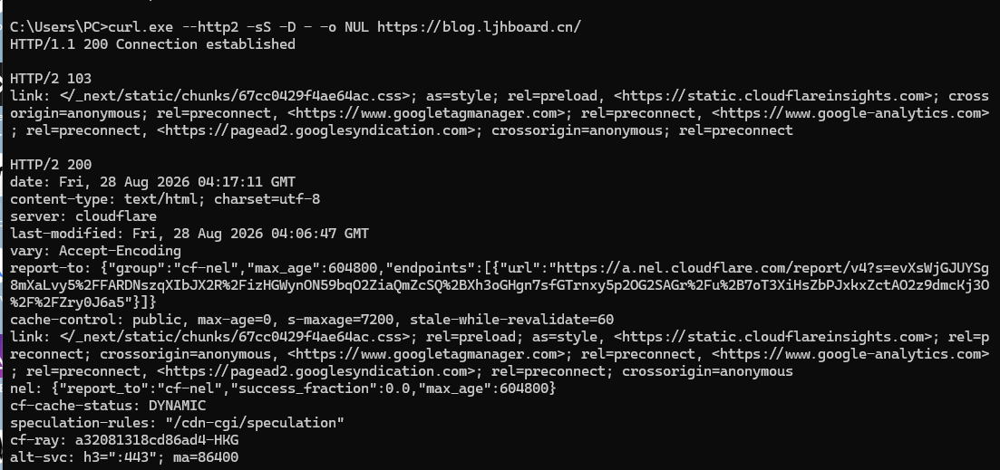
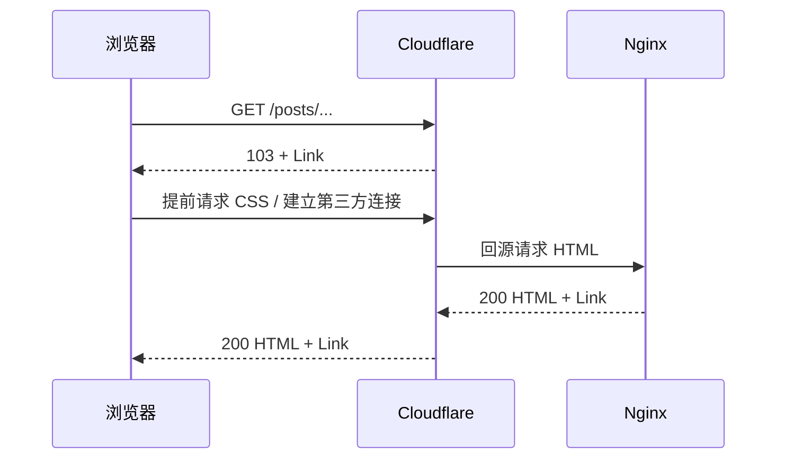
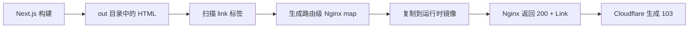

export const metadata = {
  title: '从 Link 响应头到 Cloudflare 103：静态博客的 Early Hints 实现',
  description:
    '以 Next.js 静态导出、构建时 Link 映射、Nginx 响应头和 Cloudflare 为主线，完整实现并验证 HTTP 103 Early Hints。',
  date: '2026-08-28',
  category: 'Cloudflare 优化',
  readingTime: '12 分钟',
  alternates: { canonical: '/posts/cloudflare-http3-early-hints' },
  openGraph: {
    type: 'article',
    title: '从 Link 响应头到 Cloudflare 103：静态博客的 Early Hints 实现',
    description:
      '以 Next.js 静态导出、构建时 Link 映射、Nginx 响应头和 Cloudflare 为主线，完整实现并验证 HTTP 103 Early Hints。',
    url: '/posts/cloudflare-http3-early-hints',
  },
  twitter: {
    card: 'summary_large_image',
    title: '从 Link 响应头到 Cloudflare 103：静态博客的 Early Hints 实现',
    description:
      '以 Next.js 静态导出、构建时 Link 映射、Nginx 响应头和 Cloudflare 为主线，完整实现并验证 HTTP 103 Early Hints。',
  },
}

## 读完你能做什么

这篇文章不只解释 103 的概念，而是带你完成一条可以落地的链路：

- 判断静态站点中究竟应该由谁生成 `103 Early Hints`。
- 从 Next.js 构建产物中提取每条路由真正使用的 CSS。
- 让 Nginx 在最终响应中返回正确的 `Link`，而不是硬编码带哈希的资源名。
- 在 Cloudflare 开启 Early Hints，并区分“源站准备完成”和“线上真的出现 103”。
- 用 `curl` 读懂 `103`、`200` 和代理隧道产生的三段响应。

## 先看最终结果

部署完成后执行：

```powershell
curl.exe --http2 -sS -D - -o NUL https://blog.ljhboard.cn/
```

真实响应如下。可以看到 Cloudflare 先返回 `HTTP/2 103`，其中包含 CSS 的 `preload` 和第三方域名的 `preconnect`；随后才返回最终的 `HTTP/2 200`。



最前面的 `HTTP/1.1 200 Connection established` 不是站点响应，而是本机代理建立 HTTPS CONNECT 隧道时返回的结果。真正需要观察的是后面的 `HTTP/2 103` 与 `HTTP/2 200`。

## 先建立正确的心智模型

103 是最终响应之前的临时响应。浏览器拿到其中的 `Link` 后，可以在 HTML 到达之前连接目标域名或请求关键 CSS。



这里最容易产生一个误区：**是不是给 Nginx 加一句 `early_hints on` 就够了？**

不是。Nginx 1.29 的 `early_hints` 指令用于选择性转发上游服务器已经产生的 103。这个博客由 Nginx 直接读取静态 HTML，没有一个会产生 103 的 SSR 上游。因此本方案的职责分工是：

1. Nginx 在最终 `200` 响应中提供可靠的 `Link`。
2. Cloudflare 读取并缓存符合条件的 `Link`。
3. Cloudflare 在后续符合条件的 HTTP/2 或 HTTP/3 请求中生成 103。

## 整体实现：把构建产物变成响应头

Next.js 的 CSS 文件名包含构建哈希，不能在 Nginx 配置中手写：

```text
/_next/static/chunks/67cc0429f4ae64ac.css
```

每次构建都可能变化，而且不同路由可能引用不同的样式文件。因此映射必须和本次静态导出一起生成、一起装进镜像。



### 第一步：声明可以提前连接的第三方域名

根布局已经会加载 Cloudflare Insights、Google Tag Manager、Google Analytics 和 AdSense。使用 Nextra 的 `Head` 为这些真实依赖添加 `preconnect`：

```tsx
<Head backgroundColor={{ light: '#f5f4ee', dark: '#f5f4ee' }}>
  <link
    rel="preconnect"
    href="https://static.cloudflareinsights.com"
    crossOrigin="anonymous"
  />
  <link rel="preconnect" href="https://www.googletagmanager.com" />
  <link rel="preconnect" href="https://www.google-analytics.com" />
  <link
    rel="preconnect"
    href="https://pagead2.googlesyndication.com"
    crossOrigin="anonymous"
  />
</Head>
```

项目同时保留 `dns-prefetch` 作为普通 HTML 提示，但构建脚本不会把它写入 Early Hints 响应头。103 只保留真正需要提前握手的 `preconnect`，避免重复和噪声。

### 第二步：扫描导出的 HTML

`scripts/generate-early-hints.mjs` 递归读取 `out/**/*.html`，从每个页面的 `<link>` 中提取两类信息：

- `rel="stylesheet"` 转换为 `rel=preload; as=style`。
- `rel="preconnect"` 保留，并规范化 `crossorigin`。

核心判断可以压缩为：

```js
if (relations.has('stylesheet')) {
  hints.add(`<${href}>; rel=preload; as=style`)
  continue
}

if (relations.has('preconnect')) {
  hints.add(`<${href}>; rel=preconnect${crossOrigin}`)
}
```

脚本有意排除了三类内容：

- 脚本 preload：分析和广告脚本不应该与关键 CSS 抢带宽。
- `dns-prefetch`：它不是当前 Cloudflare Early Hints 合约需要的核心提示。
- `404.html` 与 `_not-found.html`：错误页不应该进入正常路由映射。

### 第三步：生成稳定的 Nginx 路由映射

构建后会生成 `.next/early-hints-map.conf`：

```nginx
map $request_uri $early_hints_request_path {
    ~^([^?]*) $1;
}

map $early_hints_request_path $early_hints_link {
    default "";

    "/" "</_next/static/chunks/example.css>; rel=preload; as=style";
    "/posts/cloudflare-http3-early-hints" "</_next/static/chunks/example.css>; rel=preload; as=style";
}
```

第一段 `map` 专门移除查询字符串。这里不能直接依赖 `$uri`：项目使用 `try_files $uri.html` 提供无扩展名路由，Nginx 内部重写后 `$uri` 可能已经变成 `.html` 文件路径，导致公开路由匹配失败。`$request_uri` 保留原始请求，再单独去掉 `?query`，行为更稳定。

生成器还会转义 Nginx 字符串中的反斜杠、双引号和 `$`，并拒绝控制字符与重复规范化路由，避免构建产物生成不可加载的配置。

### 第四步：只给 HTML 返回 Link

Nginx 在两个提供 HTML 的 location 中加入映射结果：

```nginx
location = / {
    try_files /index.html =404;
    add_header Cache-Control "public, max-age=0, s-maxage=7200, stale-while-revalidate=60";
    add_header Link $early_hints_link always;
}

location / {
    rewrite ^(.+)/$ $1 permanent;
    try_files $uri.html $uri =404;
    add_header Cache-Control "public, max-age=0, s-maxage=7200, stale-while-revalidate=60";
    add_header Link $early_hints_link always;
}
```

空字符串不会产生 `Link` 响应头，因此 CSS、Pagefind 文件、图片和 `/healthz` 不会错误携带页面级提示。

需要特别注意 Nginx 的 `add_header` 继承规则：location 一旦定义自己的 `add_header`，上层同类配置不会按直觉自动叠加。所以 `Link` 必须明确写在这两个 HTML location 内。

### 第五步：保证映射与 HTML 来自同一次构建

`postbuild` 在静态导出、Pagefind、sitemap 和 SEO 校验后运行生成器。Docker 运行阶段再复制生成的映射：

```dockerfile
COPY --from=builder /app/.next/early-hints-map.conf /etc/nginx/conf.d/early-hints-map.conf
COPY --from=builder /app/out /usr/share/nginx/html
```

这条约束非常重要：**HTML、带哈希的 CSS 和 Nginx map 必须来自同一个构建**。如果只更新 HTML 或只复用旧 map，浏览器可能预加载已经不存在的资源。

## Cloudflare 侧如何开启

源站准备好 `Link` 后，在 Cloudflare 控制台进入：

```text
Speed → Optimization → Content Optimization → Early Hints
```

开启后不要把“每次请求都必须看到 103”写进 CI。Cloudflare 会根据 URI、最终状态码、客户端协议、缓存状态和响应时机决定是否发送 103；稳定可验证的工程合约仍然是最终 `200` 中存在正确的 `Link`。

## 分两层验收

### 验收源站合约

无论 Cloudflare 是否发送 103，最终 HTML 响应都应该包含样式 preload：

```powershell
curl.exe --http2 -sS -D - -o NUL https://blog.ljhboard.cn/
```

至少应该看到：

```http
HTTP/2 200
link: </_next/static/chunks/example.css>; rel=preload; as=style
```

### 验收 Cloudflare 103

对同一个稳定 URL 连续请求两次，让 Cloudflare 有机会填充 Early Hints 缓存。成功标志是两个状态块按顺序出现：

```http
HTTP/2 103
link: </_next/static/chunks/example.css>; rel=preload; as=style

HTTP/2 200
link: </_next/static/chunks/example.css>; rel=preload; as=style
```

还要抽取一个真实 CSS URL 再请求一次。静态资源应该只有正常的 `200`，不应携带整页的 `Link` 映射。

## 常见故障怎么判断

| 现象 | 更可能的原因 | 检查位置 |
| --- | --- | --- |
| `200` 中没有 `Link` | map 未生成、未复制或路由未匹配 | 构建日志、Docker 镜像、Nginx 配置 |
| `200` 有 `Link`，但没有 `103` | Cloudflare 未开启、缓存未就绪或本次请求未被选中 | Dashboard、连续请求、HTTP/2/3 |
| 首页有 `Link`，文章页没有 | `$uri` 被内部重写或文章路由没进入 map | `$request_uri` 去查询参数后的映射 |
| CSS 资源也有页面级 `Link` | `add_header` 放置范围过大 | Nginx location |
| 预加载 URL 返回 404 | map 与静态 HTML 不是同一次构建 | Docker 构建阶段与镜像内容 |

## 完整的 103 映射生成脚本

前文展示的是关键判断，下面是项目实际运行的完整 `scripts/generate-early-hints.mjs`。它只依赖 Node.js 标准库，可以直接放进其他 Next.js 静态导出项目：

```js
import { mkdir, readdir, readFile, writeFile } from 'node:fs/promises'
import path from 'node:path'
import { pathToFileURL } from 'node:url'

const LINK_TAG_PATTERN = /<link\b[^>]*>/gi
const ATTRIBUTE_PATTERN = /([^\s=/>]+)(?:\s*=\s*(?:"([^"]*)"|'([^']*)'|([^\s"'=<>`]+)))?/g

async function findHtmlFiles(directory) {
  const entries = await readdir(directory, { withFileTypes: true })
  const files = []

  for (const entry of entries) {
    const entryPath = path.join(directory, entry.name)

    if (entry.isDirectory()) {
      files.push(...(await findHtmlFiles(entryPath)))
    } else if (entry.isFile() && entry.name.endsWith('.html')) {
      files.push(entryPath)
    }
  }

  return files
}

function parseAttributes(tag) {
  const attributes = new Map()
  const source = tag.slice('<link'.length, -1)

  for (const match of source.matchAll(ATTRIBUTE_PATTERN)) {
    const [, name, doubleQuoted, singleQuoted, unquoted] = match
    attributes.set(name.toLowerCase(), doubleQuoted ?? singleQuoted ?? unquoted ?? '')
  }

  return attributes
}

function extractEarlyHints(html) {
  const hints = new Set()

  for (const tag of html.match(LINK_TAG_PATTERN) ?? []) {
    const attributes = parseAttributes(tag)
    const href = attributes.get('href')
    const relations = new Set((attributes.get('rel') ?? '').toLowerCase().split(/\s+/))

    if (!href) continue

    if (relations.has('stylesheet')) {
      hints.add(`<${href}>; rel=preload; as=style`)
      continue
    }

    if (relations.has('preconnect')) {
      const crossOriginValue = attributes.get('crossorigin')?.toLowerCase()
      const crossOrigin = attributes.has('crossorigin')
        ? `; crossorigin=${crossOriginValue === 'use-credentials' ? 'use-credentials' : 'anonymous'}`
        : ''
      hints.add(`<${href}>; rel=preconnect${crossOrigin}`)
    }
  }

  return [...hints]
}

function routeFromHtmlFile(exportDir, filePath) {
  const relativePath = path.relative(exportDir, filePath).split(path.sep).join('/')

  if (relativePath === 'index.html') return '/'
  if (relativePath === '404.html' || relativePath === '_not-found.html') return null

  const withoutExtension = relativePath.slice(0, -'.html'.length)
  const route = withoutExtension.endsWith('/index')
    ? withoutExtension.slice(0, -'/index'.length)
    : withoutExtension

  return `/${route}`
}

function escapeNginxValue(value) {
  return value.replaceAll('\\', '\\\\').replaceAll('"', '\\"').replaceAll('$', '\\$')
}

export async function generateEarlyHintsMap(exportDir) {
  const mappings = []
  const routes = new Set()

  for (const filePath of await findHtmlFiles(exportDir)) {
    const route = routeFromHtmlFile(exportDir, filePath)
    if (!route) continue

    if (routes.has(route)) {
      throw new Error(`Multiple HTML files map to the Early Hints route ${route}`)
    }
    if (
      [...route].some((character) => {
        const codePoint = character.codePointAt(0)
        return codePoint !== undefined && (codePoint <= 0x1f || codePoint === 0x7f)
      })
    ) {
      throw new Error(`Early Hints route contains unsupported control characters: ${route}`)
    }

    const hints = extractEarlyHints(await readFile(filePath, 'utf8'))
    if (hints.length === 0) continue

    routes.add(route)
    mappings.push([route, hints.join(', ')])
  }

  mappings.sort(([left], [right]) => left.localeCompare(right, 'en'))

  const lines = [
    'map $request_uri $early_hints_request_path {',
    '    ~^([^?]*) $1;',
    '}',
    '',
    'map $early_hints_request_path $early_hints_link {',
    '    default "";',
    ''
  ]
  for (const [route, hints] of mappings) {
    lines.push(`    "${escapeNginxValue(route)}" "${escapeNginxValue(hints)}";`)
  }
  lines.push('}', '')

  return lines.join('\n')
}

async function main() {
  const exportDir = path.resolve(process.argv[2] ?? 'out')
  const outputPath = path.resolve(process.argv[3] ?? '.next/early-hints-map.conf')
  const config = await generateEarlyHintsMap(exportDir)

  await mkdir(path.dirname(outputPath), { recursive: true })
  await writeFile(outputPath, config, 'utf8')
}

if (process.argv[1] && pathToFileURL(process.argv[1]).href === import.meta.url) {
  await main()
}
```

在 `package.json` 的 `postbuild` 末尾执行：

```json
{
  "scripts": {
    "postbuild": "... && node scripts/generate-early-hints.mjs"
  }
}
```

默认输入是 `out`，输出是 `.next/early-hints-map.conf`。如果项目目录不同，也可以显式传参：

```bash
node scripts/generate-early-hints.mjs ./out ./.next/early-hints-map.conf
```

## 官方资料

- [RFC 8297：103 Early Hints](https://www.rfc-editor.org/rfc/rfc8297)
- [Cloudflare：Early Hints](https://developers.cloudflare.com/cache/advanced-configuration/early-hints/)
- [Nginx：`early_hints` 指令](https://nginx.org/en/docs/http/ngx_http_core_module.html#early_hints)

如果某一步与你的部署结构不同，可以继续提问，并把最终 `200` 的响应头、Nginx location 和部署链路一起提供；这三项通常足以定位问题。
