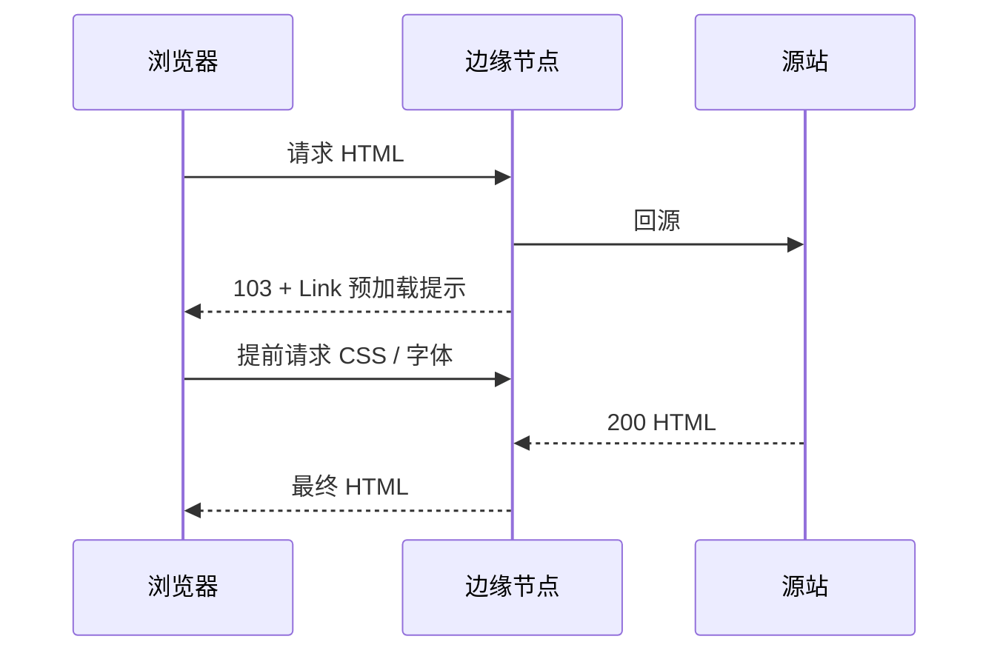

export const metadata = {
  title: '攻克首屏关键渲染路径：HTTP/3 QUIC 与 103 Early Hints 性能优化实战',
  description: '深入解析 HTTP 103 早期提示（Early Hints）与 HTTP/3 (QUIC) 协议原理，结合 Cloudflare 边缘配置提升 FCP 与 LCP 核心 Web 指标。',
  date: '2025-02-21',
  category: '网络与性能',
  readingTime: '8 分钟',
  alternates: { canonical: '/posts/cloudflare-http3-early-hints' },
  openGraph: {
    type: 'article',
    title: '攻克首屏关键渲染路径：HTTP/3 QUIC 与 103 Early Hints 性能优化实战',
    description: '深入解析 HTTP 103 早期提示（Early Hints）与 HTTP/3 (QUIC) 协议原理，结合 Cloudflare 边缘配置提升 FCP 与 LCP 核心 Web 指标。',
    url: '/posts/cloudflare-http3-early-hints',
  },
  twitter: {
    card: 'summary',
    title: '攻克首屏关键渲染路径：HTTP/3 QUIC 与 103 Early Hints 性能优化实战',
    description: '深入解析 HTTP 103 早期提示（Early Hints）与 HTTP/3 (QUIC) 协议原理，结合 Cloudflare 边缘配置提升 FCP 与 LCP 核心 Web 指标。',
  },
}

## 读完你能做什么

- 区分 HTTP/3 解决的传输层问题与 103 Early Hints 缩短的资源发现等待。
- 看懂 103、最终响应与关键资源请求之间的时序关系。
- 用浏览器网络面板和真实用户指标判断优化是否生效。



两项能力可以叠加，但不要混为一谈：HTTP/3 改善连接与丢包条件下的传输；Early Hints 让浏览器更早发现关键资源。

在衡量现代 Web 页面性能的核心体验指标（Core Web Vitals）中，**LCP（最大内容绘制）** 和 **FCP（首次内容绘制）** 往往决定了用户的留存与第一印象。

传统请求中，浏览器必须等待服务器完成 HTML 渲染并完整返回 `200 OK` 后，才能解析出页面引用的 CSS、字体和关键 JS。通过在 CDN 边缘启用 **HTTP 103 Early Hints** 与 **HTTP/3 (QUIC)**，我们能够打破这个串行等待瓶颈。

---

## 传统串行瓶颈 vs HTTP 103 Early Hints

```text
传统 HTTP 请求时序:
  浏览器 ─── 请求 HTML ───► CDN / 源站 (开始准备 HTML 数据)
  浏览器 ◄── 等待 (Server Think Time: 200~500ms 闲置) ───
  浏览器 ◄── 接收 200 OK (含 HTML) ───
  浏览器 ─── 解析 HTML，发现 style.css ───► 请求 CSS (延迟加载)

HTTP 103 Early Hints 优化时序:
  浏览器 ─── 请求 HTML ───► CDN 边缘
  浏览器 ◄── 毫秒级返回 103 Early Hints (带 Link: <style.css>; rel=preload)
  浏览器 ─── [在源站还在计算 HTML 时，已提前开始下载 CSS 与字体] ───►
  浏览器 ◄── 接收 200 OK (HTML 准备完毕)
  浏览器 ─── [CSS 已下载完毕，瞬间完成页面首屏绘制！]
```

### 核心机制：提前填补“服务器思考时间”
当服务端在进行数据库查询或 SSR 渲染计算时（通常耗时 100~500ms），浏览器连接处于空闲等待状态。

RFC 8297 定义的 **HTTP 103 Early Hints** 允许 CDN 边缘在源站尚未生成最终响应时，立即向客户端发送临时的 103 状态码和关键资源 `Link` 标头：

```http
HTTP/1.1 103 Early Hints
Link: </_next/static/css/app.css>; rel=preload; as=style
Link: </fonts/inter.woff2>; rel=preload; as=font; crossorigin
```

浏览器收到后，会立即在后台启动高优先级的网络管道预加载这些关键渲染阻塞资源。

---

## HTTP/3 与 QUIC 协议的双重加速

与 HTTP/2 基于 TCP 不同，HTTP/3 底层采用了基于 UDP 的 **QUIC 协议**：

```text
HTTP/2 (TCP):
  [Stream 1 丢包] ──► 触发 TCP 重传 ──► [Stream 2, 3, 4 全部被阻塞] (队头阻塞 Head-of-Line Blocking)

HTTP/3 (QUIC / UDP):
  [Stream 1 丢包] ──► 仅重传 Stream 1 ──► [Stream 2, 3, 4 正常流转] (彻底消除传输层队头阻塞)
```

1. **0-RTT / 1-RTT 极速握手**：QUIC 将传输层连接（UDP）与安全层握手（TLS 1.3）合二为一，极大缩短移动弱网环境下的首包耗时。
2. **连接迁移（Connection Migration）**：当移动设备从 Wi-Fi 切换到 5G 基站时，由于连接由 Connection ID 标识而非 IP+端口四元组，TCP 连接不会断开重连。

---

## Cloudflare 开启实战配置

在 Cloudflare 控制台中，开启这两项黑科技非常简便：

### 1. 开启 HTTP/3 (with QUIC)
1. 登录 Cloudflare Dashboard 并选择对应域名。
2. 进入左侧菜单 **Network**（网络）。
3. 找到 **HTTP/3 (with QUIC)** 并切换为开启。
4. 勾选 **0-RTT Connection Resumption**（0-RTT 连接恢复）。

### 2. 开启 103 Early Hints
1. 进入左侧菜单 **Speed** -> **Optimization**（速度与优化）。
2. 在 **Content Optimization** 区域找到 **Early Hints** 选项。
3. 切换开启。Cloudflare 边缘节点会自动分析你页面中导出的 `<link rel="preload">` 响应头，自动在边缘生成 103 提示响应。

---

## 性能收益与注意事项

* **实测收益**：根据 Cloudflare 与 Google Chrome 官方实验室数据，开启 Early Hints 后：
  * **LCP 指标提升 20% ~ 30%**；
  * 关键样式表加载平均提前 100ms ~ 250ms。
* **浏览器兼容性**：Chrome 103+、Edge 及现代 Chromium 内核浏览器已完全原生支持。对于尚未支持的旧客户端，103 响应会被安全忽略，完全不影响正常业务回退。
* **避免过度预加载**：只对关键渲染路径必需的 CSS 和主要字体使用 preload，避免浪费带宽与内存。

---

## 官方资料

- [Cloudflare：Early Hints](https://developers.cloudflare.com/speed/optimization/content/early-hints/)

## 自检：把知识变成判断

如果 LCP 没有改善，你能否分别验证 HTTP/3 是否协商成功、103 是否发出、关键资源是否真的提前请求？

## 总结

* **HTTP 103 Early Hints** 将浏览器的资源加载阶段提前到了“服务器计算时间”，极大消除首屏白屏。
* **HTTP/3 (QUIC)** 从传输层彻底解决了丢包队头阻塞，提升弱网稳定性。
* 在 Cloudflare CDN 开启这两项设置是当前性价比最高的前端性能基建升级。
