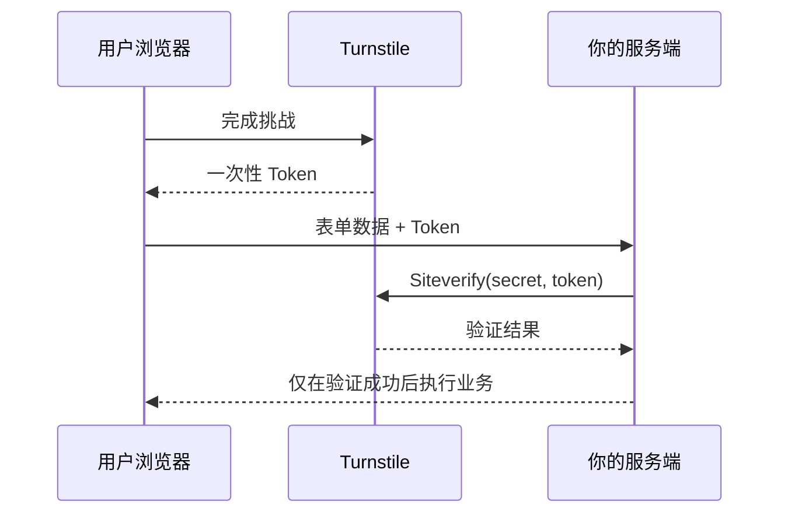

export const metadata = {
  title: 'Cloudflare Turnstile 无感人机验证全栈集成实践',
  description: '梳理 Turnstile 的客户端挑战与服务端 Siteverify 校验链路，避免把前端 Token 当作可信凭据。',
  date: '2025-02-10',
  category: '全栈与安全',
  readingTime: '8 分钟',
  alternates: { canonical: '/posts/cloudflare-turnstile' },
  openGraph: {
    type: 'article',
    title: 'Cloudflare Turnstile 无感人机验证全栈集成实践',
    description: '梳理 Turnstile 的客户端挑战与服务端 Siteverify 校验链路，避免把前端 Token 当作可信凭据。',
    url: '/posts/cloudflare-turnstile', images: ['/og-image.png'] },
  twitter: {
    card: 'summary_large_image',
    title: 'Cloudflare Turnstile 无感人机验证全栈集成实践',
    description: '梳理 Turnstile 的客户端挑战与服务端 Siteverify 校验链路，避免把前端 Token 当作可信凭据。', images: ['/og-image.png'] },
}

## 读完你能做什么

- 完成 Turnstile 小组件、业务表单与服务端 Siteverify 的完整闭环。
- 解释为什么前端拿到成功 Token 不等于业务请求可信。
- 正确处理 Token 过期、重复使用、验证失败和密钥泄露风险。



安全边界只有一句话：**Token 必须由服务端验证，且业务动作必须发生在验证成功之后。**

很多登录页或评论区为了防刷脚本，会挂上九宫格选图验证码。用户填完表单还要点几轮红绿灯和斑马线，不仅烦琐，移动端上还经常误触。Cloudflare Turnstile 的思路是把检查放在后台：利用浏览器环境特征和轻量 Proof-of-Work（工作量证明）完成静默判断，正常用户几乎不需要手动点击。

---

## Turnstile 的工作模型：前端挑战与后端二次校验

```text
1. 用户访问包含 Turnstile 组件的登录页
   │
   ▼
2. 浏览器后台运行 Cloudflare 零交互 PoW / 行为挑战
   │
   ▼
3. 挑战通过，生成一次性验证令牌 (Turnstile Token)
   │
   ▼
4. 前端表单提交: 将 { username, password, cfTurnstileToken } 发给后端
   │
   ▼
5. 业务后端服务器向 Cloudflare Siteverify 接口发起 POST 鉴权
   │
   ├── [验证失败] ──► 抛出 403 / 拒绝操作，防范重放与伪造
   └── [验证成功] ──► 放行业务逻辑，完成登录/保存
```

> [!IMPORTANT]
> **绝对不能仅在前端校验**：前端获取到的 Token 只是证据凭证，必须将其传给业务后端，由后端携带 `SECRET_KEY` 向 Cloudflare 服务器验证真伪，才能形成完整的安全闭环。

---

## 前端集成：在 Next.js / React 中嵌入 Turnstile

使用社区维护的 React 封装库 `@marsidev/react-turnstile`：

```bash
pnpm add @marsidev/react-turnstile
```

### React 组件实现代码

```tsx
// components/LoginForm.tsx
'use client';

import { useState } from 'react';
import { Turnstile } from '@marsidev/react-turnstile';

export function LoginForm() {
  const [email, setEmail] = useState('');
  const [token, setToken] = useState<string | null>(null);
  const [isLoading, setIsLoading] = useState(false);

  const handleSubmit = async (e: React.FormEvent) => {
    e.preventDefault();
    if (!token) {
      alert('请等待人机验证完成');
      return;
    }

    setIsLoading(true);
    try {
      const res = await fetch('/api/login', {
        method: 'POST',
        headers: { 'Content-Type': 'application/json' },
        body: JSON.stringify({
          email,
          token, // 携带 Turnstile 生成的令牌
        }),
      });

      const data = await res.json();
      if (!res.ok) throw new Error(data.message || '登录失败');
      alert('登录成功！');
    } catch (err: any) {
      alert(err.message);
    } finally {
      setIsLoading(false);
    }
  };

  return (
    <form onSubmit={handleSubmit} className="max-w-md space-y-4 p-6 border rounded-xl">
      <h2 className="text-xl font-bold">用户登录</h2>

      <input
        type="email"
        placeholder="请输入邮箱"
        value={email}
        onChange={(e) => setEmail(e.target.value)}
        required
        className="w-full px-3 py-2 border rounded-md"
      />

      {/* Cloudflare Turnstile 验证组件 */}
      <div className="flex justify-center my-2">
        <Turnstile
          siteKey={process.env.NEXT_PUBLIC_CLOUDFLARE_TURNSTILE_SITE_KEY!}
          onSuccess={(t) => setToken(t)}
          onError={() => setToken(null)}
          onExpire={() => setToken(null)}
          options={{
            theme: 'auto',
            size: 'normal',
          }}
        />
      </div>

      <button
        type="submit"
        disabled={isLoading || !token}
        className="w-full py-2 bg-blue-600 text-white rounded-md disabled:bg-gray-400"
      >
        {isLoading ? '验证并提交中...' : '登 录'}
      </button>
    </form>
  );
}
```

---

## 后端校验：在 Hono / Next.js Route Handler 中验证 Token

在服务端，向 `https://challenges.cloudflare.com/turnstile/v0/siteverify` 发送验证请求：

```ts
// app/api/login/route.ts
import { NextResponse } from 'next/server';

interface TurnstileVerifyResponse {
  success: boolean;
  'error-codes'?: string[];
  challenge_ts?: string;
  hostname?: string;
}

export async function POST(req: Request) {
  try {
    const { email, token } = await req.json();

    if (!token) {
      return NextResponse.json({ success: false, message: '缺少验证码 Token' }, { status: 400 });
    }

    const secretKey = process.env.CLOUDFLARE_TURNSTILE_SECRET_KEY!;

    // 构造校验表单数据
    const formData = new URLSearchParams();
    formData.append('secret', secretKey);
    formData.append('response', token);
    
    // 可选传入客户端真实 IP，进一步提升防伪造强度
    const clientIp = req.headers.get('cf-connecting-ip') || req.headers.get('x-forwarded-for');
    if (clientIp) {
      formData.append('remoteip', clientIp);
    }

    const verifyRes = await fetch('https://challenges.cloudflare.com/turnstile/v0/siteverify', {
      method: 'POST',
      body: formData,
    });

    const verifyResult: TurnstileVerifyResponse = await verifyRes.json();

    if (!verifyResult.success) {
      console.warn('Turnstile 校验失败:', verifyResult['error-codes']);
      return NextResponse.json(
        { success: false, message: '人机验证失败，请刷新后重试' },
        { status: 403 }
      );
    }

    // 校验成功，放行正常业务逻辑（如校验密码、生成 Session Token）
    return NextResponse.json({ success: true, user: { email } });
  } catch (error: any) {
    return NextResponse.json({ success: false, message: error.message }, { status: 500 });
  }
}
```

---

## reCAPTCHA 与 Turnstile 差异

| 维度 | Google reCAPTCHA v2 / v3 | Cloudflare Turnstile |
| :--- | :--- | :--- |
| **交互模式** | 常见九宫格图片点选 | 绝大多数场景后台无交互放行 |
| **数据采集** | 依赖 Google 账号生态与用户行为追踪 | 主打无隐私追踪，不用于广告画像 |
| **调用额度** | 超额后计费门槛较严格 | 免费额度宽松 |
| **无障碍 (a11y)** | 视障用户依赖音频验证码（识别困难） | 依赖设备环境特征，免除视觉点选 |

---

## 官方资料

- [Cloudflare：服务端验证](https://developers.cloudflare.com/turnstile/get-started/server-side-validation/)

## 防御与落地细节

- **Token 一次性消费**：每个 Turnstile Token 只能向 Siteverify 验证一次。如果后端校验业务逻辑失败（例如用户密码输错），前端必须重置 Turnstile 组件（调用 `reset()`）重新获取新 Token，否则用户再次点击提交时，后端 Siteverify 会直接返回 `invalid-input-response`。
- **超时失效（Expire）**：生成的 Token 约有 300 秒有效期。如果用户在填写表单时停留过久，需监听 `onExpire` 触发静默刷新，避免提交瞬间因为凭证过期被拒。
- **多层防御配合**：验证码只能挡住简易爬虫和初级撞库脚本。如果攻击者通过逆向或无头浏览器伪造指纹，后端依然需要配合 Redis 频次限制（Rate Limit）与 IP 封禁。
