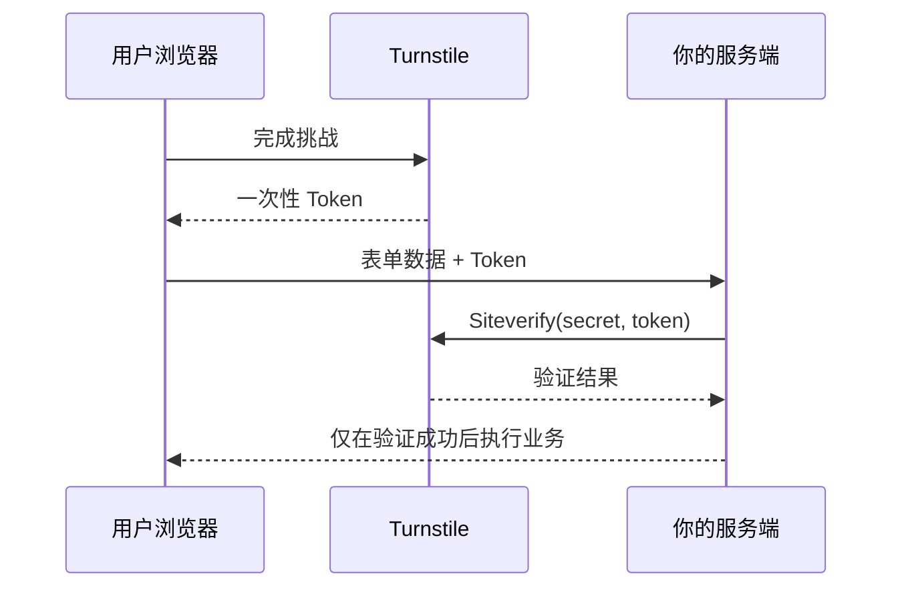

export const metadata = {
  title: '告别糟糕的图形验证码：Cloudflare Turnstile 无感人机验证全栈集成实践',
  description: '全面解析 Cloudflare Turnstile 智能人机验证原理，提供 React / Next.js 前端无缝嵌入与 Node.js / Hono 后端 Token 安全校验方案。',
  date: '2025-02-10',
  category: '全栈与安全',
  readingTime: '8 分钟',
  alternates: { canonical: '/posts/cloudflare-turnstile' },
  openGraph: {
    type: 'article',
    title: '告别糟糕的图形验证码：Cloudflare Turnstile 无感人机验证全栈集成实践',
    description: '全面解析 Cloudflare Turnstile 智能人机验证原理，提供 React / Next.js 前端无缝嵌入与 Node.js / Hono 后端 Token 安全校验方案。',
    url: '/posts/cloudflare-turnstile', images: ['/og-image.png'] },
  twitter: {
    card: 'summary_large_image',
    title: '告别糟糕的图形验证码：Cloudflare Turnstile 无感人机验证全栈集成实践',
    description: '全面解析 Cloudflare Turnstile 智能人机验证原理，提供 React / Next.js 前端无缝嵌入与 Node.js / Hono 后端 Token 安全校验方案。', images: ['/og-image.png'] },
}

## 读完你能做什么

- 完成 Turnstile 小组件、业务表单与服务端 Siteverify 的完整闭环。
- 解释为什么前端拿到成功 Token 不等于业务请求可信。
- 正确处理 Token 过期、重复使用、验证失败和密钥泄露风险。



安全边界只有一句话：**Token 必须由服务端验证，且业务动作必须发生在验证成功之后。**

在登录、注册、评论或高频 API 调用场景中，为了抵御自动化脚本、撞库和恶意爬虫，引入人机验证（CAPTCHA）是常见的防御手段。

然而，传统的“找出所有斑马线/红绿灯”式的图形验证码体验极差，不仅打断正常用户操作，更直接导致转化率暴跌。**Cloudflare Turnstile** 作为 reCAPTCHA 的现代替代品，绝大多数情况下无需用户任何手动点击即可完成静默验证，并且**完全免费、隐私友好**。

本文详解 Turnstile 的全栈运行模型与前后端接入方案。

---

## Turnstile 的工作模型：前端挑战与后端二次校验

```text
1. 用户访问包含 Turnstile 组件的登录页
   │
   ▼
2. 浏览器后台运行 Cloudflare 零交互 PoW / 行为挑战
   │
   ▼
3. 挑战通过，生成一次性验证令牌 (Turnstile Token)
   │
   ▼
4. 前端表单提交: 将 { username, password, cfTurnstileToken } 发给后端
   │
   ▼
5. 业务后端服务器向 Cloudflare Siteverify 接口发起 POST 鉴权
   │
   ├── [验证失败] ──► 抛出 403 / 拒绝操作，防范重放与伪造
   └── [验证成功] ──► 放行业务逻辑，完成登录/保存
```

> [!IMPORTANT]
> **绝对不能仅在前端校验**：前端获取到的 Token 只是证据凭证，必须将其传给业务后端，由后端携带 `SECRET_KEY` 向 Cloudflare 服务器验证真伪，才能形成完整的安全闭环。

---

## 前端集成：在 Next.js / React 中嵌入 Turnstile

推荐使用官方或经过良好维护的 React 封装库 `@marsidev/react-turnstile`：

```bash
pnpm add @marsidev/react-turnstile
```

### React 组件实现代码

```tsx
// components/LoginForm.tsx
'use client';

import { useState } from 'react';
import { Turnstile } from '@marsidev/react-turnstile';

export function LoginForm() {
  const [email, setEmail] = useState('');
  const [token, setToken] = useState<string | null>(null);
  const [isLoading, setIsLoading] = useState(false);

  const handleSubmit = async (e: React.FormEvent) => {
    e.preventDefault();
    if (!token) {
      alert('请等待人机验证完成');
      return;
    }

    setIsLoading(true);
    try {
      const res = await fetch('/api/login', {
        method: 'POST',
        headers: { 'Content-Type': 'application/json' },
        body: JSON.stringify({
          email,
          token, // 携带 Turnstile 生成的令牌
        }),
      });

      const data = await res.json();
      if (!res.ok) throw new Error(data.message || '登录失败');
      alert('登录成功！');
    } catch (err: any) {
      alert(err.message);
    } finally {
      setIsLoading(false);
    }
  };

  return (
    <form onSubmit={handleSubmit} className="max-w-md space-y-4 p-6 border rounded-xl">
      <h2 className="text-xl font-bold">用户登录</h2>

      <input
        type="email"
        placeholder="请输入邮箱"
        value={email}
        onChange={(e) => setEmail(e.target.value)}
        required
        className="w-full px-3 py-2 border rounded-md"
      />

      {/* Cloudflare Turnstile 验证组件 */}
      <div className="flex justify-center my-2">
        <Turnstile
          siteKey={process.env.NEXT_PUBLIC_CLOUDFLARE_TURNSTILE_SITE_KEY!}
          onSuccess={(t) => setToken(t)}
          onError={() => setToken(null)}
          onExpire={() => setToken(null)}
          options={{
            theme: 'auto',
            size: 'normal',
          }}
        />
      </div>

      <button
        type="submit"
        disabled={isLoading || !token}
        className="w-full py-2 bg-blue-600 text-white rounded-md disabled:bg-gray-400"
      >
        {isLoading ? '验证并提交中...' : '登 录'}
      </button>
    </form>
  );
}
```

---

## 后端校验：在 Hono / Next.js Route Handler 中验证 Token

在服务端，我们需要向 `https://challenges.cloudflare.com/turnstile/v0/siteverify` 发送验证请求：

```ts
// app/api/login/route.ts
import { NextResponse } from 'next/server';

interface TurnstileVerifyResponse {
  success: boolean;
  'error-codes'?: string[];
  challenge_ts?: string;
  hostname?: string;
}

export async function POST(req: Request) {
  try {
    const { email, token } = await req.json();

    if (!token) {
      return NextResponse.json({ success: false, message: '缺少验证码 Token' }, { status: 400 });
    }

    const secretKey = process.env.CLOUDFLARE_TURNSTILE_SECRET_KEY!;

    // 构造校验表单数据
    const formData = new URLSearchParams();
    formData.append('secret', secretKey);
    formData.append('response', token);
    
    // 可选传入客户端真实 IP，进一步提升防伪造强度
    const clientIp = req.headers.get('cf-connecting-ip') || req.headers.get('x-forwarded-for');
    if (clientIp) {
      formData.append('remoteip', clientIp);
    }

    const verifyRes = await fetch('https://challenges.cloudflare.com/turnstile/v0/siteverify', {
      method: 'POST',
      body: formData,
    });

    const verifyResult: TurnstileVerifyResponse = await verifyRes.json();

    if (!verifyResult.success) {
      console.warn('Turnstile 校验失败:', verifyResult['error-codes']);
      return NextResponse.json(
        { success: false, message: '人机验证失败，请刷新后重试' },
        { status: 403 }
      );
    }

    // 校验成功，放行正常业务逻辑（如校验密码、生成 Session Token）
    return NextResponse.json({ success: true, user: { email } });
  } catch (error: any) {
    return NextResponse.json({ success: false, message: error.message }, { status: 500 });
  }
}
```

---

## 核心优势对比

| 特性 | Google reCAPTCHA v2 / v3 | Cloudflare Turnstile |
| :--- | :--- | :--- |
| **用户体验** | 经常弹出繁琐的九宫格点图 | **95%+ 情况下零交互、秒级自动放行** |
| **隐私保护** | 采集较多用户画像与追踪数据 | **承诺不将验证数据用于广告追踪** |
| **费用方案** | 超过配额后费用昂贵 | **完全免费且无严苛调用量限制** |
| **无障碍体验 (a11y)** | 视障用户很难完成图片点选 | 自动设备特征与 PoW 校验，无视障障碍 |

---

## 官方资料

- [Cloudflare：服务端验证](https://developers.cloudflare.com/turnstile/get-started/server-side-validation/)

## 总结

* **前端**：通过 `@marsidev/react-turnstile` 组件在加载完成后获取一次性令牌。
* **后端**：在 Controller / Route Handler 中调用 Cloudflare Siteverify 接口进行服务端强校验。
* **收益**：在零成本、高隐私的前提下，彻底杜绝机器脚本爆破，同时给予真实用户极致丝滑的无感操作体验。
