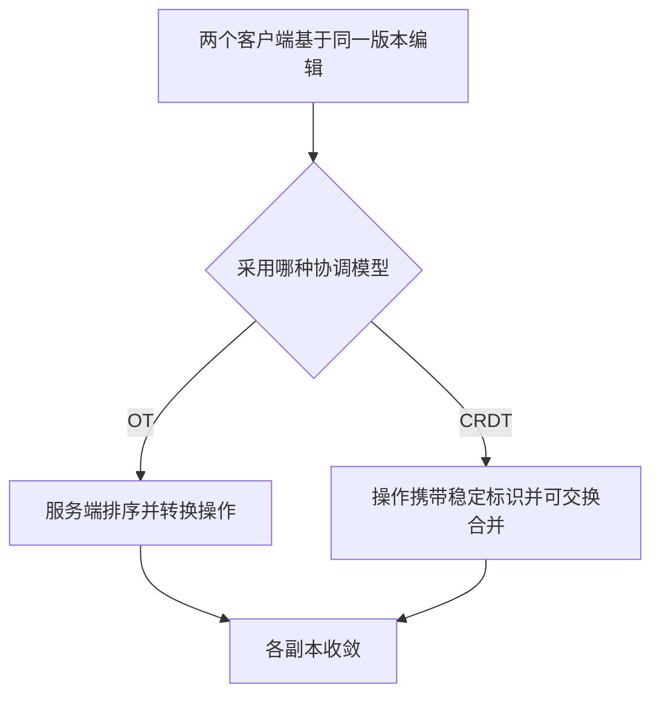

export const metadata = {
  title: '多人实时协同冲突解决算法：OT 与 CRDT 的演进与取舍',
  description: '从并发插入导致的坐标错位出发，对比 OT 的中心转换机制与 CRDT（Yjs YATA）的不可变偏序合并思路。',
  date: '2025-01-19',
  category: '协同架构',
  readingTime: '10 分钟',
  alternates: { canonical: '/posts/conflict-resolution-algorithm' },
  openGraph: {
    type: 'article',
    title: '多人实时协同冲突解决算法：OT 与 CRDT 的演进与取舍',
    description: '从并发插入导致的坐标错位出发，对比 OT 的中心转换机制与 CRDT（Yjs YATA）的不可变偏序合并思路。',
    url: '/posts/conflict-resolution-algorithm', images: ['/og-image.png'] },
  twitter: {
    card: 'summary_large_image',
    title: '多人实时协同冲突解决算法：OT 与 CRDT 的演进与取舍',
    description: '从并发插入导致的坐标错位出发，对比 OT 的中心转换机制与 CRDT（Yjs YATA）的不可变偏序合并思路。', images: ['/og-image.png'] },
}

## 读完你能做什么

- 用同一个并发插入例子解释“收敛”到底要求什么。
- 区分 OT 的操作转换与 CRDT 的可交换合并思路。
- 根据离线编辑、中心服务和元数据开销选择实现路线。



先把目标说准确：协同算法不保证所有用户在每个瞬间看到相同内容，它保证在收到同一组更新后，副本能够得到一致结果。

两个人同时在同一个文档里打字，最容易遇到的问题是光标和文本坐标错位。你在开头加了几个字，我发出的“在第 3 个字符后插入”就会落到错误的字后面。协同算法要解决的核心问题就是：怎样让所有人在网络延迟不同、收到消息顺序不同的情况下，最终合出一模一样的内容。

---

## 协同编辑的根本挑战：并发冲突

假设初始文本为 `"Cat"`，用户 A 在索引 0 插入 `"Big "`（变成 `"Big Cat"`），同时用户 B 在索引 3 插入 `"s"`（变成 `"Cats"`）：

```text
       初始状态: "Cat"
      ┌────────┴────────┐
      ▼ (User A: 插入 "Big " at 0)  ▼ (User B: 插入 "s" at 3)
   "Big Cat"                         "Cats"
      │                                 │
      ▼ 直接应用对方原始操作              ▼ 直接应用对方原始操作
   "Big Cats"                       "Big sCat"  ❌ 产生状态分裂与乱序！
```

如果不经处理直接广播坐标偏移量，由于网络到达时间不同，不同客户端上的文本索引会发生错位，导致内容彻底崩溃。

---

## 方案一：OT（Operational Transformation，操作转换）

OT 最早于 1989 年提出，是 Google Docs 和 Apache Wave 的基石。

### 1. 核心思想：转换函数 $T(op_1, op_2)$
OT 的思想是：当客户端收到来自其他用户的并发操作时，不直接应用，而是**根据本地已发生的操作对该操作的坐标位置进行“平移转换”**。

```text
OT 转换过程:
  用户 B 发来的操作: opB = Insert("s", index=3)
  用户 A 本地已执行: opA = Insert("Big ", index=0, len=4)
  经过转换: opB' = T(opB, opA) = Insert("s", index = 3 + 4 = 7)
  用户 A 应用 opB' 后得到: "Big Cats" ✅
```

### 2. OT 的核心痛点
* **必须依赖中心服务器排序**：OT 需要单一权威服务器为所有操作分配绝对全局版本号。
* **组合爆炸与工程极其复杂**：当并发操作包含富文本样式、删除、表格、段落嵌套时，两两转换函数 $T(op_i, op_j)$ 极其繁琐，难以形式化证明完全一致。
* **离线支持差**：长时间离线重新连线时，需要向服务器回溯重放大量历史操作。

---

## 方案二：CRDT（Conflict-free Replicated Data Type）

CRDT 于 2006 年后兴起，是去中心化、本地优先（Local-first）协同的核心算法。

### 1. 核心数学保证：交换律与结合律
CRDT 不试图去“平移可变索引”，而是给文档中的**每一个字符/节点分配一个全网唯一的、不可变的逻辑 ID**（如 `{ clientId, clock }`），通过构建偏序关系图，确保**无论操作以何种顺序到达、重复接收多少次，合并后的最终状态必然完全一致**。

```text
CRDT 核心两大流派:
├── 基于状态的 CRDT (CvRDT): 传输全量状态/状态向量，通过数学半格(Lattice)的 join (⊔) 操作合并
└── 基于操作的 CRDT (CmRDT): 传输轻量增量操作，要求底层网络保证因果有序传递 (Yjs 属于此类)
```

---

## Yjs 的 YATA 算法实现与性能突破

早期 CRDT 被工业界诟病的主要原因是**内存膨胀严重**（每个字符都要挂载元数据，删除后保留 Tombstone 墓碑，导致内存比纯文本大几十倍）。

**Yjs（由 Kevin Jahns 创造）** 凭借独创的 **YATA 算法** 解决了这一难题：

```text
Yjs 链表结构 (Struct / Item):
┌───────────────────────────────────────────────────────────┐
│ ID: { client: 42, clock: 0 }                              │
│ OriginLeft: ID(Prev)   | OriginRight: ID(Next)            │
│ Content: "Hello World" (多个连续输入的字符自动合并为一个 Struct) │
│ Deleted: false                                            │
└───────────────────────────────────────────────────────────┘
```

1. **块合并优化（Struct Merging）**：连续输入的文本被压缩进同一个结构体中，减少元数据开销。
2. **状态向量（State Vector）计算最小差异**：双端同步时，仅需交换几字节的状态向量，毫秒级计算出缺失的增量补丁（Delta Update）。
3. **墓碑垃圾回收（GC）**：对于已经解引用或父级被删除的树节点，安全清理墓碑标记。

---

## OT 与 CRDT 对比

| 评估维度 | OT (操作转换) | CRDT (以 Yjs 为代表) |
| :--- | :--- | :--- |
| **网络拓扑** | 必须依赖集中式服务器仲裁 | 支持 P2P、去中心化与边缘 WebSocket |
| **离线优先能力** | 较弱，长离线重连容易冲突 | 原生支持任意时长的离线自动合并 |
| **工程实现复杂度** | 转换矩阵复杂，边界条件繁多 | 算法复杂由底层库封装，业务层只调数据类型 |
| **内存开销** | 极低（仅存文本与操作） | 稍高于文本，但现代 Yjs 块合并后开销可控 |
| **常见产品** | Google Docs, 飞书文档 | Notion, Figma, Apple Notes, TipTap |

---

## 官方资料

- [Yjs：官方文档](https://docs.yjs.dev/)

## 选型建议

- **偏向传统集中式服务、超长文档**：如果文档规模极大（纯文本数万行）、历史架构已有成熟的中心协调集群，OT（如 ShareDB）在单次传输流量和极致内存节省上仍然很有竞争力。
- **偏向离线优先、富媒体混合协同**：如果需要离线编辑、块级嵌套结构（画板节点、树状目录、富文本混排），或者希望复用现代前端生态，优先选 Yjs 或 Automerge。
