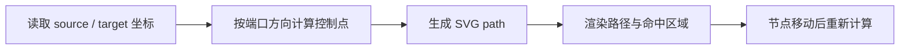

export const metadata = {
  title: '流程图自定义连线算法与吸附计算：基于 React Flow 的 SVG 自定义 Edge 渲染',
  description: '深入解析流程图与拓扑图中的自定义连线算法：涵盖贝塞尔曲线控制点计算、SVG 动态路径生成、锚点吸附算法与 React Flow Custom Edge 实战。',
  date: '2025-01-22',
  category: '前端图形学',
  readingTime: '8 分钟',
  alternates: { canonical: '/posts/custom-flowchart-connections' },
  openGraph: {
    type: 'article',
    title: '流程图自定义连线算法与吸附计算：基于 React Flow 的 SVG 自定义 Edge 渲染',
    description: '深入解析流程图与拓扑图中的自定义连线算法：涵盖贝塞尔曲线控制点计算、SVG 动态路径生成、锚点吸附算法与 React Flow Custom Edge 实战。',
    url: '/posts/custom-flowchart-connections',
  },
  twitter: {
    card: 'summary',
    title: '流程图自定义连线算法与吸附计算：基于 React Flow 的 SVG 自定义 Edge 渲染',
    description: '深入解析流程图与拓扑图中的自定义连线算法：涵盖贝塞尔曲线控制点计算、SVG 动态路径生成、锚点吸附算法与 React Flow Custom Edge 实战。',
  },
}

## 读完你能做什么

- 从起点、终点和方向向量推导贝塞尔曲线控制点。
- 把几何计算与 React Flow 的 Edge 渲染组件分开实现和测试。
- 在节点拖动时保持路径更新，并为标签、删除按钮留出交互层。



实现时先保证“同一组坐标总能得到同一路径”，再接入拖拽与交互。这样几何错误和 React 状态错误不会混在一起排查。

在可视化流程图编排（如审批流、工作流引擎、思维导图、低代码逻辑编排）中，**节点之间的连线（Edge / Connection）** 不仅需要清晰表达数据流向，还必须支持复杂的交互能力：
* 动态计算三次贝塞尔曲线（Cubic Bezier）或折线（Smooth Step）；
* 节点拖拽移动时，连线锚点（Handle）智能吸附并实时重绘；
* 在连线上嵌入交互按钮（如删除连线、设置条件分支标签）。

本文基于 **React Flow** 深度剖析 SVG 路径计算与 Custom Edge 的实现。

---

## 连线算法核心：贝塞尔曲线控制点计算

在二维平面中，从源节点坐标 $(x_1, y_1)$ 到目标节点坐标 $(x_2, y_2)$，平滑的 S 型或弧形连线通常采用三次贝塞尔曲线：

```text
三次贝塞尔公式:
  B(t) = (1-t)³P₀ + 3(1-t)²tP₁ + 3(1-t)t²P₂ + t³P₃,  t ∈ [0, 1]

SVG 路径指令:
  M sourceX sourceY C controlX1 controlY1, controlX2 controlY2, targetX targetY
```

```text
贝塞尔控制点拓扑图:
  (Source: P₀) ──────► [Control Point 1: P₁]
                                │
                                ▼
  (Target: P₃) ◄────── [Control Point 2: P₂]
```

* **水平流向**：$P_1 = (x_1 + \Delta x / 2, y_1)$，$P_2 = (x_2 - \Delta x / 2, y_2)$；
* **垂直流向**：$P_1 = (x_1, y_1 + \Delta y / 2)$，$P_2 = (x_2, y_2 - \Delta y / 2)$。

---

## 核心实现：React Flow 自定义连线组件

通过实现一个带有“删除按钮”和“动态流动光效”的 Custom Edge：

```tsx
// components/edges/CustomFlowEdge.tsx
'use client';

import React from 'react';
import {
  type EdgeProps,
  getBezierPath,
  EdgeLabelRenderer,
  BaseEdge,
} from '@xyflow/react';

export function CustomFlowEdge({
  id,
  sourceX,
  sourceY,
  targetX,
  targetY,
  sourcePosition,
  targetPosition,
  style = {},
  markerEnd,
  data,
}: EdgeProps) {
  // 1. 计算平滑贝塞尔 SVG Path 与中点坐标
  const [edgePath, labelX, labelY] = getBezierPath({
    sourceX,
    sourceY,
    sourcePosition,
    targetX,
    targetY,
    targetPosition,
  });

  return (
    <>
      {/* 基础 SVG 连线渲染 */}
      <BaseEdge
        path={edgePath}
        markerEnd={markerEnd}
        style={{
          strokeWidth: 2,
          stroke: '#3b82f6',
          ...style,
        }}
      />

      {/* 使用 EdgeLabelRenderer 渲染脱离 SVG 坐标系的绝对定位 DOM 按钮 */}
      <EdgeLabelRenderer>
        <div
          style={{
            position: 'absolute',
            transform: `translate(-50%, -50%) translate(${labelX}px,${labelY}px)`,
            pointerEvents: 'all',
          }}
          className="nodrag nopan flex items-center gap-1 bg-white px-2 py-1 border rounded-md shadow-sm text-xs"
        >
          <span>{data?.label || '流转条件'}</span>
          <button
            onClick={(e) => {
              e.stopPropagation();
              data?.onDelete?.(id);
            }}
            className="w-4 h-4 rounded-full bg-red-100 text-red-600 hover:bg-red-200 flex items-center justify-center text-[10px]"
          >
            ×
          </button>
        </div>
      </EdgeLabelRenderer>
    </>
  );
}
```

---

## 注册与在 React Flow 中使用

```tsx
import { ReactFlow, type EdgeTypes } from '@xyflow/react';
import { CustomFlowEdge } from './components/edges/CustomFlowEdge';

// 必须在组件外定义 edgeTypes，避免重复渲染
const edgeTypes: EdgeTypes = {
  custom: CustomFlowEdge,
};

export function FlowEditor() {
  return (
    <div style={{ width: '100vw', height: '100vh' }}>
      <ReactFlow
        nodes={initialNodes}
        edges={initialEdges}
        edgeTypes={edgeTypes}
        fitView
      />
    </div>
  );
}
```

---

## 官方资料

- [React Flow：Custom Edges](https://reactflow.dev/learn/customization/custom-edges)

## 自检：把知识变成判断

给定四个端口方向与两点坐标，你能否在不依赖 React 的纯函数中生成并测试路径？

## 总结

* **数学基础**：贝塞尔曲线通过控制点偏移量赋予连线符合直觉的流体美感。
* **DOM 与 SVG 解耦**：利用 `EdgeLabelRenderer` 将交互式复杂组件（输入框、删除按钮）挂载在 HTML 顶层，彻底解决 SVG 内部事件捕获与层级穿透难题。
