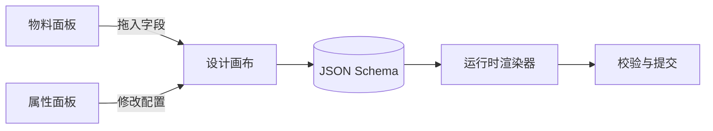

export const metadata = {
  title: '可视化动态表单设计器架构实践：拖拽编排、JSON Schema 驱动与组件渲染器',
  description: '把表单设计器拆分为物料区、画布排版与属性联动，以 JSON Schema 为契约驱动运行态渲染器。',
  date: '2025-02-14',
  category: '前端工程化',
  readingTime: '9 分钟',
  alternates: { canonical: '/posts/custom-form-designer' },
  openGraph: {
    type: 'article',
    title: '可视化动态表单设计器架构实践：拖拽编排、JSON Schema 驱动与组件渲染器',
    description: '把表单设计器拆分为物料区、画布排版与属性联动，以 JSON Schema 为契约驱动运行态渲染器。',
    url: '/posts/custom-form-designer', images: ['/og-image.png'] },
  twitter: {
    card: 'summary_large_image',
    title: '可视化动态表单设计器架构实践：拖拽编排、JSON Schema 驱动与组件渲染器',
    description: '把表单设计器拆分为物料区、画布排版与属性联动，以 JSON Schema 为契约驱动运行态渲染器。', images: ['/og-image.png'] },
}

## 读完你能做什么

- 把设计器拆成物料、画布、属性面板、Schema 与运行时渲染器。
- 设计一份可版本化、可校验、与具体 UI 库解耦的字段协议。
- 让编辑态与运行态共享数据协议，而不是共享整套组件状态。



设计器真正的产品不是三栏 UI，而是中间那份稳定协议。UI 可以替换，Schema 一旦被表单实例和历史数据依赖，就必须可迁移。

做中后台业务时，调查问卷、活动配置或审批流表单这类需求经常变动。如果每个新增字段都要改 JSX 重新打包发布，维护成本会越来越高。表单设计器的核心不是把界面做得多花哨，而是设计一套清晰的 JSON Schema，让“编辑画布”负责产出协议，“运行时渲染器”只认协议来画界面。

---

## 核心架构拓扑：三栏式设计器与渲染流水线

```text
┌────────────────────────────────────────────────────────────────────────┐
│ 表单设计态 (Design Mode)                                                │
│ ┌──────────────┬──────────────────────────────┬──────────────────────┐ │
│ │ 左侧物料库   │ 中间可视化拖拽画布           │ 右侧属性配置面板     │ │
│ │ (Components) │ (Drop Canvas & Visual Tree)  │ (Property Inspector) │ │
│ │ • 输入框     │ ┌──────────────────────────┐ │ • 字段名 (name)      │ │
│ │ • 下拉选择   │ │ [当前激活组件: 用户名]   │ │ • 标签 (label)       │ │
│ │ • 日期选择   │ └──────────────────────────┘ │ • 校验规则 (rules)   │ │
│ └──────────────┴──────────────────────────────┴──────────────────────┘ │
└──────────────────────────────────┬─────────────────────────────────────┘
                                   │ 导出 JSON Schema 协议
                                   ▼
┌────────────────────────────────────────────────────────────────────────┐
│ 表单运行态 (Runtime Renderer)                                          │
│  根据 JSON Schema 动态遍历渲染真实表单，并负责数据双向绑定与提交校验   │
└────────────────────────────────────────────────────────────────────────┘
```

---

## 核心数据协议：JSON Schema 设计

标准化、可序列化的 Schema 是设计态与运行态通信的桥梁：

```ts
// types/form-schema.ts
export type FieldType = 'input' | 'select' | 'textarea' | 'switch' | 'datepicker';

export interface FormFieldSchema {
  id: string;             // 唯一标识符
  name: string;           // 提交数据字段名
  label: string;          // 页面显示标签
  type: FieldType;        // 组件类型
  placeholder?: string;
  defaultValue?: any;
  required?: boolean;
  options?: Array<{ label: string; value: string | number }>; // 针对 select / radio
  validationRules?: Array<{
    pattern?: string;
    message: string;
  }>;
}

export interface FormSchema {
  title: string;
  layout: 'vertical' | 'horizontal';
  fields: FormFieldSchema[];
}
```

---

## 动态渲染器核心实现（Dynamic Form Renderer）

在运行态，渲染引擎根据 Schema 中的 `type` 从组件注册表中查找对应物料，完成状态驱动渲染：

```tsx
// components/FormRenderer.tsx
'use client';

import React from 'react';
import { useForm, Controller } from 'react-hook-form';
import { FormSchema, FormFieldSchema } from '@/types/form-schema';

// 基础物料注册表
const ComponentRegistry: Record<string, React.FC<any>> = {
  input: ({ field, schema }) => (
    <input
      {...field}
      placeholder={schema.placeholder}
      className="w-full px-3 py-2 border rounded-md focus:ring-2 focus:ring-blue-500"
    />
  ),
  select: ({ field, schema }) => (
    <select {...field} className="w-full px-3 py-2 border rounded-md">
      <option value="">请选择</option>
      {schema.options?.map((opt: any) => (
        <option key={opt.value} value={opt.value}>
          {opt.label}
        </option>
      ))}
    </select>
  ),
  textarea: ({ field, schema }) => (
    <textarea {...field} placeholder={schema.placeholder} rows={3} className="w-full px-3 py-2 border rounded-md" />
  ),
};

export function FormRenderer({ schema, onSubmit }: { schema: FormSchema; onSubmit: (data: any) => void }) {
  const {
    control,
    handleSubmit,
    formState: { errors },
  } = useForm();

  return (
    <form onSubmit={handleSubmit(onSubmit)} className="space-y-4 max-w-lg p-6 bg-white border rounded-xl shadow-sm">
      <h3 className="text-lg font-bold pb-2 border-b">{schema.title}</h3>

      {schema.fields.map((fieldSchema: FormFieldSchema) => {
        const Component = ComponentRegistry[fieldSchema.type];
        if (!Component) return null;

        return (
          <div key={fieldSchema.id} className="space-y-1">
            <label className="block text-sm font-medium text-gray-700">
              {fieldSchema.label} {fieldSchema.required && <span className="text-red-500">*</span>}
            </label>
            <Controller
              name={fieldSchema.name}
              control={control}
              defaultValue={fieldSchema.defaultValue || ''}
              rules={{ required: fieldSchema.required ? '该字段必填' : false }}
              render={({ field }) => <Component field={field} schema={fieldSchema} />}
            />
            {errors[fieldSchema.name] && (
              <p className="text-xs text-red-500">{errors[fieldSchema.name]?.message as string}</p>
            )}
          </div>
        );
      })}

      <button type="submit" className="px-4 py-2 bg-blue-600 text-white rounded-md hover:bg-blue-700">
        提交表单
      </button>
    </form>
  );
}
```

---

## 属性联动与高级扩展

1. **显隐联动（Conditional Visibility）**：在 Schema 中增加 `visibleOn: "form.role === 'admin'"`，渲染器在执行前对条件表达式求值，动态挂载或注销 DOM。
2. **异步选项源（Async Remote Options）**：支持在 Select 属性中配置 `remoteUrl`，组件挂载时自动发起请求拉取动态下拉字典。

---

## 官方资料

- [JSON Schema：官方规范入口](https://json-schema.org/specification)

## 边界与架构建议

- **协议版本化**：生产环境中的表单 Schema 一定要带上版本号（如 `version: 1`）。表单一旦上线并收集了用户提交数据，旧字段协议就不能随意删除，必须保证历史数据在运行态下依然能正确回显。
- **切断设计态与表单值状态**：编辑画布时的“选中间距、高亮框、拖拽占位”属于设计器专属 UI 状态；真正存入数据库的只有干净的字段配置列表与校验规则。两者的状态机必须物理切断，不能混在同一个 store 里。
