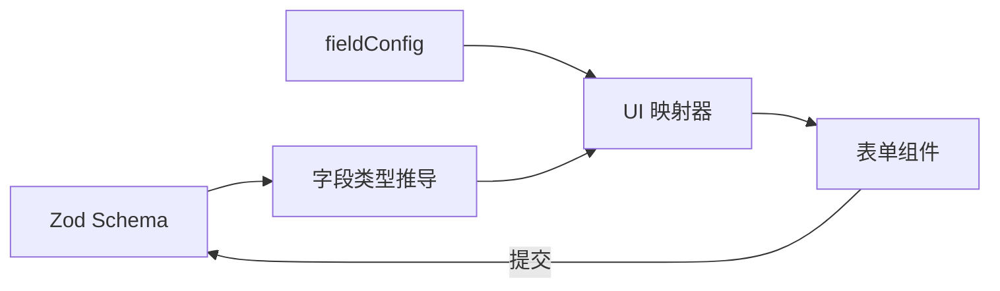

export const metadata = {
  title: '基于 Zod 模式推导的声明式动态表单（AutoForm）可行性研究与架构实践',
  description: '评估从 Zod Schema 自动推导表单 UI 的收益与边界，分析 fieldConfig 覆盖机制与复杂交互下的选型取舍。',
  date: '2024-12-04',
  category: '前端架构',
  readingTime: '9 分钟',
  alternates: { canonical: '/posts/custom-form-feasibility' },
  openGraph: {
    type: 'article',
    title: '基于 Zod 模式推导的声明式动态表单（AutoForm）可行性研究与架构实践',
    description: '评估从 Zod Schema 自动推导表单 UI 的收益与边界，分析 fieldConfig 覆盖机制与复杂交互下的选型取舍。',
    url: '/posts/custom-form-feasibility', images: ['/og-image.png'] },
  twitter: {
    card: 'summary_large_image',
    title: '基于 Zod 模式推导的声明式动态表单（AutoForm）可行性研究与架构实践',
    description: '评估从 Zod Schema 自动推导表单 UI 的收益与边界，分析 fieldConfig 覆盖机制与复杂交互下的选型取舍。', images: ['/og-image.png'] },
}

## 读完你能做什么

- 判断哪些表单可以从 Zod Schema 自动推导，哪些必须显式补充 UI 配置。
- 把数据类型、校验规则与展示意图放在正确层级。
- 用最小字段映射器验证 AutoForm 的收益与边界。



关键结论是：Zod 能描述“什么数据有效”，却不总能表达“这个字段应该怎样呈现”。因此 Schema 可以成为校验的单一事实来源，但复杂 UI 仍需要显式配置。

在现代 TypeScript 全栈开发中，一个典型的前端表单通常要写三遍：
1. 类型定义一遍（`interface FormValues { ... }`）；
2. 校验逻辑写一遍（Zod / Yup 规则）；
3. HTML / JSX 标签写一遍（输入框、选择器、标签与错误展示）。

当后端数据结构调整时，前端需要同步修改这三处地方，稍有疏漏就会引发类型断裂。

很多团队尝试用 AutoForm 这类方案：直接读取后端的 Zod 校验规则，通过运行时反射自动生成输入框、下拉框和错误提示。但实际做下来会发现，Schema 能管好数据格式，却管不好界面呈现。比如同样是字符串，究竟该渲染成单行输入框、多行文本域，还是富文本？这篇文章分析用 Zod 自动生成表单在哪些场景划算，在什么情况下反而增加包袱。

---

## 核心工作流：从 Zod Schema 到 UI 映射

```text
Zod Schema 定义
  │
  ├── z.string() ────────────────► 映射为 <Input type="text" />
  ├── z.number() ────────────────► 映射为 <Input type="number" />
  ├── z.boolean() ───────────────► 映射为 <Switch /> 或 <Checkbox />
  ├── z.enum(['Admin', 'User']) ─► 映射为 <Select options={...} />
  ├── z.date() ──────────────────► 映射为 <DatePicker />
  └── z.object({ ... }) ─────────► 递归映射为 Fieldset 子表单组
  │
  ▼ 运行时类型反射 (Schema AST Parsing)
AutoForm 智能渲染器 (自动绑定 React Hook Form / VeeValidate + 错误提示)
```

---

## 实战示例：仅通过 Zod Schema 驱动表单

```tsx
import { z } from 'zod';
import { AutoForm, AutoFormSubmit } from '@/components/ui/auto-form';

// 1. 声明业务数据模型与校验规则
const userProfileSchema = z.object({
  username: z
    .string()
    .min(3, '用户名至少 3 个字符')
    .describe('用户登录名称'), // describe 自动作为表单 Label
  email: z
    .string()
    .email('请输入合法的邮箱格式')
    .describe('工作电子邮箱'),
  role: z
    .enum(['Developer', 'Designer', 'ProductManager'])
    .default('Developer')
    .describe('团队角色'),
  notifications: z
    .boolean()
    .default(true)
    .describe('开启每周邮件订阅通知'),
  bio: z
    .string()
    .optional()
    .describe('个人简介 (选填)'),
});

export function ProfileFormPage() {
  const handleSubmit = (data: z.infer<typeof userProfileSchema>) => {
    console.log('校验通过，提交数据:', data);
  };

  return (
    <div className="max-w-md mx-auto p-6 border rounded-xl shadow-sm">
      <h2 className="text-xl font-bold mb-4">个人资料配置</h2>
      
      {/* 2. 一行代码自动生成完整的表单 */}
      <AutoForm
        formSchema={userProfileSchema}
        onSubmit={handleSubmit}
        fieldConfig={{
          bio: {
            fieldType: 'textarea', // 覆盖默认渲染类型为多行文本
            inputProps: {
              placeholder: '写点什么介绍自己吧...',
            },
          },
        }}
      >
        <AutoFormSubmit>保存配置</AutoFormSubmit>
      </AutoForm>
    </div>
  );
}
```

---

## 可行性评估与技术边界分析

| 评估维度 | 传统手动手写表单 | AutoForm (Zod 驱动) | 权衡与结论 |
| :--- | :--- | :--- | :--- |
| **开发效率** | 编写较多重复排版 JSX | 仅需定义 Zod Schema | 标准后台表单提效明显 |
| **类型一致性** | 需手动保证 TS 与 UI 同步 | 类型与校验天然绑定 | 字段改动可在编译期捕获 |
| **高度定制 UI** | 可任意排列 DOM 节点与样式 | 需通过 fieldConfig 覆盖 | 复杂排版维护成本上升 |
| **异步动态选项** | 原生支持 | 需在 fieldConfig 中注入 Hook | 需要自定义插槽扩展 |

---

## 官方资料

- [Zod：官方文档](https://zod.dev/)

## 选型结论

- **适合的场景**：内部运营后台、参数配置面板、标准化 CRUD 弹窗。这类页面的特点是字段多、样式要求统一，用 Schema 自动推导能省去大量重复排版。
- **不适合的场景**：高度定制的 C 端核心页面、复杂分步向导（Wizard）、或者多字段强联动的复杂表单。一旦 `fieldConfig` 里的重载代码写得比原生 JSX 还长，就违背了自动化的初衷，老老实实手写表单反而更好维护。
