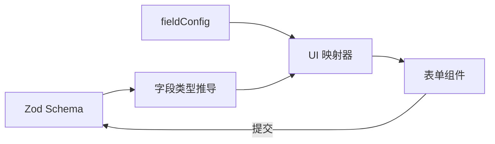

export const metadata = {
  title: '基于 Zod 模式推导的声明式动态表单（AutoForm）可行性研究与架构实践',
  description: '深度探索以 Zod Schema 为单一事实来源（Single Source of Truth）自动推导 UI 表单的可行性：涵盖类型反射、字段配置覆盖（fieldConfig）与复杂嵌套校验。',
  date: '2024-12-04',
  category: '前端架构',
  readingTime: '9 分钟',
  alternates: { canonical: '/posts/custom-form-feasibility' },
  openGraph: {
    type: 'article',
    title: '基于 Zod 模式推导的声明式动态表单（AutoForm）可行性研究与架构实践',
    description: '深度探索以 Zod Schema 为单一事实来源（Single Source of Truth）自动推导 UI 表单的可行性：涵盖类型反射、字段配置覆盖（fieldConfig）与复杂嵌套校验。',
    url: '/posts/custom-form-feasibility',
  },
  twitter: {
    card: 'summary',
    title: '基于 Zod 模式推导的声明式动态表单（AutoForm）可行性研究与架构实践',
    description: '深度探索以 Zod Schema 为单一事实来源（Single Source of Truth）自动推导 UI 表单的可行性：涵盖类型反射、字段配置覆盖（fieldConfig）与复杂嵌套校验。',
  },
}

## 读完你能做什么

- 判断哪些表单可以从 Zod Schema 自动推导，哪些必须显式补充 UI 配置。
- 把数据类型、校验规则与展示意图放在正确层级。
- 用最小字段映射器验证 AutoForm 的收益与边界。



关键结论是：Zod 能描述“什么数据有效”，却不总能表达“这个字段应该怎样呈现”。因此 Schema 可以成为校验的单一事实来源，但复杂 UI 仍需要显式配置。

在现代 TypeScript 全栈开发中，一个典型的前端表单通常要写三遍：
1. **类型定义一遍**（`interface FormValues { ... }`）；
2. **校验逻辑写一遍**（Zod / Yup 规则）；
3. **HTML / JSX 标签写一遍**（`<input />`, `<select />`, `<label />`, `<error />`）。

当后端数据结构调整时，前端需要同步修改这三处地方，稍有疏漏就会引发类型断裂。

**AutoForm（基于 Zod 的自动化表单生成体系）** 提出了一种全新的设计范式：**将 Zod Schema 作为唯一的真相来源（Single Source of Truth），直接通过反射机制自动生成完整的 UI 表单与校验逻辑**。本文对其可行性与边界进行深度评估。

---

## 核心工作流：从 Zod Schema 到 UI 映射

```text
Zod Schema 定义
  │
  ├── z.string() ────────────────► 映射为 <Input type="text" />
  ├── z.number() ────────────────► 映射为 <Input type="number" />
  ├── z.boolean() ───────────────► 映射为 <Switch /> 或 <Checkbox />
  ├── z.enum(['Admin', 'User']) ─► 映射为 <Select options={...} />
  ├── z.date() ──────────────────► 映射为 <DatePicker />
  └── z.object({ ... }) ─────────► 递归映射为 Fieldset 子表单组
  │
  ▼ 运行时类型反射 (Schema AST Parsing)
AutoForm 智能渲染器 (自动绑定 React Hook Form / VeeValidate + 错误提示)
```

---

## 实战示例：仅通过 Zod Schema 驱动复杂表单

```tsx
import { z } from 'zod';
import { AutoForm, AutoFormSubmit } from '@/components/ui/auto-form';

// 1. 声明完整的业务数据模型与校验规则
const userProfileSchema = z.object({
  username: z
    .string()
    .min(3, '用户名至少 3 个字符')
    .describe('用户登录名称'), // describe 自动作为表单 Label
  email: z
    .string()
    .email('请输入合法的邮箱格式')
    .describe('工作电子邮箱'),
  role: z
    .enum(['Developer', 'Designer', 'ProductManager'])
    .default('Developer')
    .describe('团队角色'),
  notifications: z
    .boolean()
    .default(true)
    .describe('开启每周邮件订阅通知'),
  bio: z
    .string()
    .optional()
    .describe('个人简介 (选填)'),
});

export function ProfileFormPage() {
  const handleSubmit = (data: z.infer<typeof userProfileSchema>) => {
    console.log('校验通过，提交数据:', data);
  };

  return (
    <div className="max-w-md mx-auto p-6 border rounded-xl shadow-sm">
      <h2 className="text-xl font-bold mb-4">个人资料配置</h2>
      
      {/* 2. 一行代码自动生成完整的表单 */}
      <AutoForm
        formSchema={userProfileSchema}
        onSubmit={handleSubmit}
        fieldConfig={{
          bio: {
            fieldType: 'textarea', // 覆盖默认渲染类型为多行文本
            inputProps: {
              placeholder: '写点什么介绍自己吧...',
            },
          },
        }}
      >
        <AutoFormSubmit>保存配置</AutoFormSubmit>
      </AutoForm>
    </div>
  );
}
```

---

## 可行性评估与技术边界分析

| 评估维度 | 传统手动手写表单 | AutoForm (Zod 驱动) | 权衡与结论 |
| :--- | :--- | :--- | :--- |
| **开发效率** | 低（重复编写几十行 JSX） | **极高（仅需定义 Zod Schema）** | CRUD 管理后台提效 **80% 以上** |
| **类型一致性** | 弱（需手动保证 TS 与 UI 同步） | **强（类型与校验 100% 自动绑定）** | 重构时字段改动直接在编译期报错 |
| **极致高度定制 UI** | 强（可任意排列 DOM 像素） | 中等（需通过 fieldConfig 覆盖） | 营销活动类奇特布局仍需局部手写 |
| **异步动态选项支持** | 原生支持 | 需在 fieldConfig 中注入 Hook | 通过组件插槽（Slots）机制可良好兼容 |

---

## 官方资料

- [Zod：官方文档](https://zod.dev/)

## 总结

* **中后台降本增效利器**：对于标准的数据录入、配置页、后台 CRUD 模块，基于 Zod 的 AutoForm 能够消除 90% 的模板代码。
* **渐进式增强**：通过提供 `fieldConfig` 和自定义渲染槽，既保留了 Schema 驱动的速度，又兼顾了复杂场景的定制能力。
