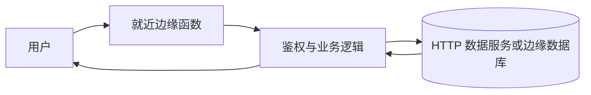

export const metadata = {
  title: '后端部署到边缘函数的架构探索：用 Hono 构建零服务器高性能 API',
  description: '对比常驻容器与 Edge Runtime 的启动与网络差异，用 Hono 构建轻量边缘 API 并梳理无状态数据库连接方案。',
  date: '2024-12-28',
  category: '全栈与边缘计算',
  readingTime: '9 分钟',
  alternates: { canonical: '/posts/edge-function-backend-deployment' },
  openGraph: {
    type: 'article',
    title: '后端部署到边缘函数的架构探索：用 Hono 构建零服务器高性能 API',
    description: '对比常驻容器与 Edge Runtime 的启动与网络差异，用 Hono 构建轻量边缘 API 并梳理无状态数据库连接方案。',
    url: '/posts/edge-function-backend-deployment', images: ['/og-image.png'] },
  twitter: {
    card: 'summary_large_image',
    title: '后端部署到边缘函数的架构探索：用 Hono 构建零服务器高性能 API',
    description: '对比常驻容器与 Edge Runtime 的启动与网络差异，用 Hono 构建轻量边缘 API 并梳理无状态数据库连接方案。', images: ['/og-image.png'] },
}

## 读完你能做什么

- 根据执行位置、启动方式、运行时 API 与连接生命周期选择部署形态。
- 用 Hono 写出可部署到边缘运行时的最小 API，并识别 Node.js 专属依赖。
- 为边缘函数选择适配的数据库连接方案，而不是照搬常驻服务器连接池。



边缘运行时的优势来自就近执行和弹性调度，约束也来自短生命周期与受限运行时。先列出依赖的系统 API 和数据库连接模式，再决定是否迁移。

搭一个轻量 API（例如 Webhook 接收器、鉴权中间层或静态网站的动态代理），专门租台 VPS、装 Docker 再配 Nginx 常常显得过重，每个月还得花机器成本。边缘运行时（Edge Runtime）提供了一种不用管服务器的思路：代码直接跑在 CDN 边缘节点的 V8 沙箱里，冷启动往往在毫秒级。但这套方案并不是银弹，它带来了严格的运行时约束。

---

## 传统 Node.js 容器 vs Serverless Function vs Edge Runtime

```text
部署形态演进对比:
┌─────────────────────────┬─────────────────────────┬─────────────────────────┐
│     传统 VPS / 容器      │    Serverless Lambda    │      Edge Runtime       │
├─────────────────────────┼─────────────────────────┼─────────────────────────┤
│ • 机器常驻，固定月费   │ • 按次计费，弹性伸缩   │ • 全球边缘多活，按需计费│
│ • 无冷启动             │ • 冷启动较重 (300~1000ms)│ • 极速冷启动 (<10ms)    │
│ • 单机房，物理距离延迟  │ • 集中在指定云区域     │ • 毫秒级就近接入 (PoP)   │
│ • 支持所有 Node.js 模块│ • 支持大部分 Node.js 库 │ • 严格遵循 Web 标准 API │
└─────────────────────────┴─────────────────────────┴─────────────────────────┘
```

> [!NOTE]
> **Edge Runtime 的约束**：由于边缘运行时并非完整 Linux OS，而是轻量 V8 沙箱（如 Cloudflare workerd），因此**不能**依赖 Node.js 底层 C++ 原生扩展或同步文件系统（如 `fs.readFileSync`），必须采用标准的 `fetch`、`Web Crypto`、`Streams` 以及 ESM 模块。

---

## 核心选型：为什么是 Hono？

Hono 专为现代 Edge 环境设计：
1. **体积轻量**：核心库几乎无额外依赖，打包体积不到 20KB。
2. **遵循 Web 标准**：原生基于 Request / Response 与 Fetch API 构建，无需 Node.js 特有包装。
3. **跨平台兼容**：同一套业务代码可部署在 Vercel Edge、Cloudflare Workers，也能无缝跑在 Deno、Bun 或传统 Node.js 上。

---

## 项目搭建与 Vercel 部署实战

### 1. 使用脚手架初始化

```bash
pnpm create hono my-edge-api
```
在交互式提示中选择目标平台（例如 `vercel` 或 `cloudflare-workers`）。

### 2. 编写模块化业务路由

```ts
// src/index.ts
import { Hono } from 'hono';
import { cors } from 'hono/cors';
import { logger } from 'hono/logger';
import { prettyJSON } from 'hono/pretty-json';

const app = new Hono();

// 挂载全局中间件
app.use('*', logger());
app.use('*', prettyJSON());
app.use('*', cors({
  origin: ['https://my-blog.com', 'http://localhost:3000'],
  allowMethods: ['GET', 'POST', 'PUT', 'DELETE'],
}));

// 健康检查
app.get('/health', (c) => {
  return c.json({
    status: 'ok',
    region: c.req.raw.headers.get('cf-ipcountry') || 'global',
    timestamp: Date.now(),
  });
});

// 动态参数与 REST API
app.get('/api/users/:id', async (c) => {
  const userId = c.req.param('id');
  return c.json({
    id: userId,
    name: 'Developer',
    role: 'Admin',
  });
});

export default app;
```

---

## 边缘环境下的数据库连接策略

在边缘函数中访问关系型数据库（如 PostgreSQL / MySQL）不能使用传统的持久化 TCP 连接池（因为边缘函数会频繁销毁与创建，容易瞬间耗尽数据库最大连接数）。

### 推荐的数据库接入方案：
1. **Serverless HTTP 驱动**：使用 **Neon Serverless Postgres** 或 **PlanetScale**，通过无状态的 HTTP API 执行 SQL。
2. **连接池代理中间件**：使用 **Prisma Accelerate** 或 **Supabase Connection Pooling (PgBouncer)**。

```ts
// 示例：使用 Serverless HTTP 访问数据库
import { neon } from '@neondatabase/serverless';

app.get('/api/posts', async (c) => {
  const sql = neon(c.env.DATABASE_URL);
  const posts = await sql`SELECT id, title, created_at FROM posts ORDER BY created_at DESC LIMIT 10`;
  return c.json(posts);
});
```

---

## 部署与自定义域名解析

1. **部署到 Vercel**：
   运行 `pnpm vercel --prod`，Vercel 会自动识别入口文件并部署为边缘运行时。
2. **解决默认域名解析限制**：
   默认生成的 `*.vercel.app` 域名在部分网络环境下可能受阻。最佳实践是在 Vercel 项目设置中绑定自己的自定义二级域名（如 `api.example.com`），并通过 CNAME 解析至 `cname.vercel-dns.com`，享受自动签发的 SSL 证书。

---

## 官方资料

- [Hono：Getting Started](https://hono.dev/docs/getting-started/basic)

## 边界与取舍

边缘函数最适合无状态或短平快的逻辑：API 代理、地理位置分流、Webhook 转发、轻量鉴权。但如果你的后端有下面这些特征，老老实实买台常规容器反而更省心：
- 依赖复杂的本地文件读写或重量级 Node.js 原生 C++ 插件（如 Puppeteer、图像处理底层库）；
- 大量依赖传统长连接 TCP 数据库且没有连接池中间层（边缘函数并发一高很容易瞬间打爆数据库连接数）；
- 有长时间运行的后台计算或异步任务（大部分边缘函数对执行时长有 30 秒至几分钟的严格限制）。
