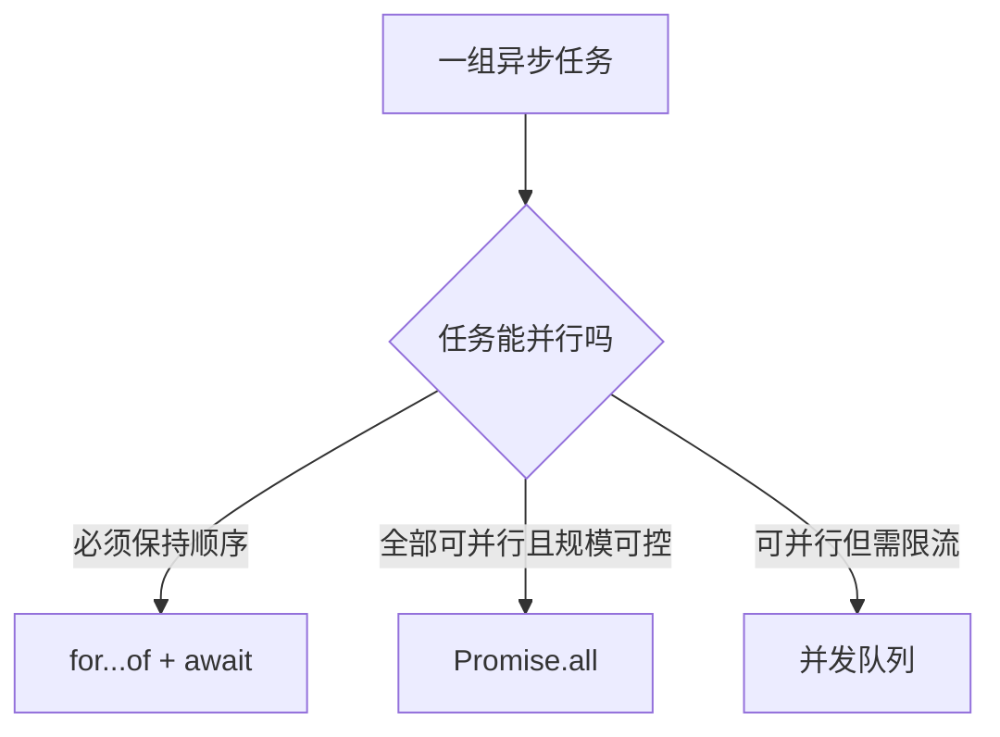

export const metadata = {
  title: '为什么 Biome / ESLint 推荐用 for...of 替代 forEach？从异步文件上传的踩坑说起',
  description: '深入剖析 Array.prototype.forEach 无法 await 异步回调的底层机制，对比 for...of 串行执行与 Promise.all 并发控制的最佳实践。',
  date: '2025-01-30',
  category: 'JavaScript 核心',
  readingTime: '7 分钟',
  alternates: { canonical: '/posts/for-of-vs-foreach' },
  openGraph: {
    type: 'article',
    title: '为什么 Biome / ESLint 推荐用 for...of 替代 forEach？从异步文件上传的踩坑说起',
    description: '深入剖析 Array.prototype.forEach 无法 await 异步回调的底层机制，对比 for...of 串行执行与 Promise.all 并发控制的最佳实践。',
    url: '/posts/for-of-vs-foreach',
  },
  twitter: {
    card: 'summary',
    title: '为什么 Biome / ESLint 推荐用 for...of 替代 forEach？从异步文件上传的踩坑说起',
    description: '深入剖析 Array.prototype.forEach 无法 await 异步回调的底层机制，对比 for...of 串行执行与 Promise.all 并发控制的最佳实践。',
  },
}

## 读完你能做什么

- 解释为什么 `forEach(async () => {})` 不会等待回调完成。
- 在串行、受控并发和全并发之间按业务约束选择写法。
- 正确收集异步错误与结果，避免函数提前返回。



真正的问题不是两种循环语法谁更高级，而是调用者需要等待什么。先定义顺序、并发上限和失败策略，再选择控制流。

在现代前端开发中，许多代码规范工具（如 Biome 的 `noForEach` 规则或 ESLint 的相关插件）都强烈建议使用 `for...of` 替代 `Array.prototype.forEach`。

很多开发者最初可能以为这只是纯粹的代码风格偏好，直到在处理 **多文件异步上传（如上传至 Supabase / S3 存储桶）** 或 **表单批量提交** 时踩到一个致命的“异步静默跳过” Bug。

---

## 经典踩坑场景：文件批量上传为什么“直接跳过了”？

假设我们要实现一个文件上传表单，当用户点击提交时，依次将选中的文件上传到云存储，并在所有文件上传完成后更新数据库并提示用户：

```ts
// ❌ 常见错误写法：在 forEach 回调中使用 async/await
async function handleUploadFiles(files: File[]) {
  console.log('1. 开始上传流程');

  files.forEach(async (file) => {
    // 试图等待文件上传至 Supabase Storage
    const { data, error } = await supabase.storage
      .from('documents')
      .upload(`public/${file.name}`, file);

    console.log(`- 文件 ${file.name} 上传完成`);
  });

  console.log('2. 所有文件处理完毕，提交数据库');
  await saveFormToDatabase();
  toast.success('上传成功！');
}
```

### 运行现象与致命后果

当你运行上述代码时，控制台输出顺序通常是：
1. `1. 开始上传流程`
2. `2. 所有文件处理完毕，提交数据库`
3. 提示“上传成功！”
4. 几秒后才陆续输出 `- 文件 x.png 上传完成`

**后果**：表单过早认为上传已完成，并提交了空的或未就绪的数据；如果上传中间抛出异常，外层的 `try...catch` 根本捕获不到，造成严重的数据状态不一致。

---

## 底层机制：为什么 `forEach` 不能处理异步？

`Array.prototype.forEach` 在 ECMAScript 规范中的本质是一个**完全同步的高阶函数**。

如果我们查看它的简化版 Polyfill 逻辑，就能一目了然：

```ts
// Array.prototype.forEach 的底层运行模型
Array.prototype.myForEach = function (callback, thisArg) {
  for (let i = 0; i < this.length; i++) {
    if (i in this) {
      // ⚠️ forEach 只是调用 callback(item, i, array)，并丢弃了返回值！
      callback.call(thisArg, this[i], i, this);
    }
  }
};
```

```text
forEach 循环时序：
  Iteration 0 -> 执行 callback() -> 产生 Promise (未被等待)
  Iteration 1 -> 执行 callback() -> 产生 Promise (未被等待)
  Iteration 2 -> 执行 callback() -> 产生 Promise (未被等待)
  循环立即同步结束！
  外部代码继续往下跑...
```

当你把一个 `async` 函数传给 `forEach` 时：
1. 每次回调执行后都会返回一个 `Promise`。
2. 但是 `forEach` 内部**完全没有** `await callback()` 的逻辑，它直接忽略了返回的 Promise，紧接着执行下一轮循环。
3. 因此整个 `forEach` 会在所有 Promise 还在 pending 时就瞬间同步执行完毕。

---

## 正确解法：根据场景选择 `for...of` 或 `Promise.all`

### 方案 1：使用 `for...of` 实现受控串行上传

`for...of` 是语言内置的语法结构（基于迭代器协议 Iterable Protocol），`await` 表达式能直接挂起当前外层 `async` 函数的执行上下文，直到当前项的异步操作完成后才进入下一次迭代。

```ts
// ✅ 方案 1：for...of 串行安全执行（适合有速率限制或依赖先后顺序的场景）
async function handleUploadFilesSequential(files: File[]) {
  console.log('开始串行上传...');

  for (const file of files) {
    console.log(`正在上传: ${file.name}`);
    const { data, error } = await supabase.storage
      .from('documents')
      .upload(`public/${file.name}`, file);

    if (error) {
      throw new Error(`上传失败 ${file.name}: ${error.message}`);
    }
  }

  console.log('所有文件均已顺序上传完毕！');
  await saveFormToDatabase();
}
```

### 方案 2：使用 `Promise.all` 实现高并发上传

如果各个文件的上传互相独立，串行上传会浪费带宽。可以使用 `Array.prototype.map` 将每个文件映射为 Promise，并配合 `Promise.all` 进行并行等待：

```ts
// ✅ 方案 2：Promise.all 并发上传（适合追求速度且无严格速率限制的场景）
async function handleUploadFilesParallel(files: File[]) {
  console.log('开始并发上传...');

  const uploadPromises = files.map(async (file) => {
    const { data, error } = await supabase.storage
      .from('documents')
      .upload(`public/${file.name}`, file);

    if (error) throw error;
    return data;
  });

  // 等待所有文件并发上传全部完成
  const results = await Promise.all(uploadPromises);

  console.log(`成功并发上传 ${results.length} 个文件`);
  await saveFormToDatabase();
}
```

> [!TIP]
> **生产级并发控制**：当文件数量达到几十甚至上百个时，无限制的 `Promise.all` 容易耗尽浏览器 TCP 连接数或触发服务端 429 限流。建议配合 `p-limit` 设置并发池（如 3~5 个并发）。

---

## `for...of` 相比 `forEach` 的综合优势

| 维度 | `Array.prototype.forEach` | `for...of` 循环 |
| :--- | :--- | :--- |
| **异步支持 (`async/await`)** | ❌ 无法等待回调 Promise | ✅ 原生支持同步等待与挂起 |
| **控制流打断 (`break` / `return`)** | ❌ 无法提前终止循环 | ✅ 支持 `break`、`continue`、`return` |
| **遍历目标** | 仅支持标准数组及类数组 | 任意实现了 `[Symbol.iterator]` 的对象（Array, Set, Map, NodeList 等） |
| **性能与调用栈** | 每次迭代创建新的函数调用栈帧 | 语言级语句，零额外闭包开销 |

---

## 官方资料

- [MDN：`for...of`](https://developer.mozilla.org/docs/Web/JavaScript/Reference/Statements/for...of)

## 自检：把知识变成判断

面对批量上传，你能否明确顺序要求、并发上限和单个失败是否终止整体，再选择循环方案？

## 总结

1. **绝对不要**在 `Array.prototype.forEach` 回调中使用 `async/await`，因为它永远不会等待异步操作。
2. 串行、有依赖或需要中断时，**首选 `for...of`**。
3. 多个相互独立的异步任务，使用 **`map` + `Promise.all`**（或并发池）实现高效并发。
