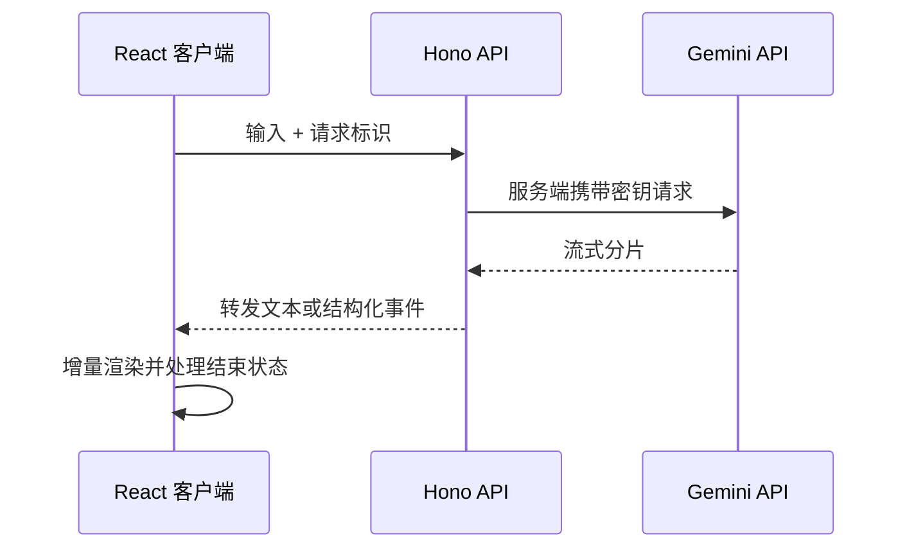

export const metadata = {
  title: 'Google Gemini API 全栈调用指南：从 Edge 代理、流式传输（SSE）到结构化输出',
  description: '通过 Hono 边缘代理统一管理 Gemini 密钥与跨域，结合 SSE 流式输出与 responseSchema 结构化约束。',
  date: '2025-01-12',
  category: 'AI 工程',
  readingTime: '9 分钟',
  alternates: { canonical: '/posts/gemini-api' },
  openGraph: {
    type: 'article',
    title: 'Google Gemini API 全栈调用指南：从 Edge 代理、流式传输（SSE）到结构化输出',
    description: '通过 Hono 边缘代理统一管理 Gemini 密钥与跨域，结合 SSE 流式输出与 responseSchema 结构化约束。',
    url: '/posts/gemini-api', images: ['/og-image.png'] },
  twitter: {
    card: 'summary_large_image',
    title: 'Google Gemini API 全栈调用指南：从 Edge 代理、流式传输（SSE）到结构化输出',
    description: '通过 Hono 边缘代理统一管理 Gemini 密钥与跨域，结合 SSE 流式输出与 responseSchema 结构化约束。', images: ['/og-image.png'] },
}

## 读完你能做什么

- 把 Gemini 密钥保留在服务端，通过边缘 API 代理组织模型请求。
- 根据消费方选择纯文本流、结构化 JSON 或工具调用。
- 在前端正确处理分片、取消、错误与最终状态。



代理层不只是隐藏密钥，它还是统一鉴权、限流、日志和输出契约的边界。不要让浏览器直接持有生产密钥。

直接在前端调模型 API 几乎不可行：不仅把生产密钥直接暴露在浏览器的 Network 面板里，还会遇到跨域和连通性问题。更合理的做法是把模型调用收拢在边缘网关或后端接口之后，由服务端保管密钥并向前端回传流式数据。

---

## 架构拓扑：为什么需要边缘 API 代理？

```text
客户端浏览器 (React / Next.js)
  │
  ▼ POST /api/chat/stream (避免客户端直连暴露 API Key，解决 CORS 跨域)
Hono 边缘网关 (部署于 Cloudflare / Vercel Edge)
  │
  ├── 1. 业务鉴权与速率限制 (Rate Limit)
  ├── 2. 注入服务端环境变量 GEMINI_API_KEY
  │
  ▼ Google Generative AI SDK (流式调用)
Google Gemini API (googleapis.com)
  │
  ▼ SSE (Server-Sent Events) 逐字推回
客户端实时打字机渲染
```

---

## 第一步：服务端 Hono 边缘路由实现

安装官方 SDK 与 Hono 流式响应工具包：

```bash
pnpm add @google/generative-ai hono
```

### 1. 实现流式输出（Streaming SSE）接口

```ts
// src/routes/gemini.ts
import { Hono } from 'hono';
import { streamText } from 'hono/streaming';
import { GoogleGenerativeAI } from '@google/generative-ai';

const geminiRoute = new Hono();

geminiRoute.post('/chat/stream', async (c) => {
  const { prompt, history = [] } = await c.req.json();
  const apiKey = c.env?.GEMINI_API_KEY || process.env.GEMINI_API_KEY;

  if (!apiKey) {
    return c.json({ error: 'API Key 未配置' }, 500);
  }

  const genAI = new GoogleGenerativeAI(apiKey);
  // 使用高性价比的 Gemini 1.5 Flash 或最新的 2.0 Flash
  const model = genAI.getGenerativeModel({ model: 'gemini-1.5-flash' });

  // 开启流式 SSE 响应
  return streamText(c, async (stream) => {
    try {
      const chat = model.startChat({
        history: history.map((h: any) => ({
          role: h.role === 'user' ? 'user' : 'model',
          parts: [{ text: h.content }],
        })),
      });

      const result = await chat.sendMessageStream(prompt);

      for await (const chunk of result.stream) {
        const chunkText = chunk.text();
        await stream.write(chunkText);
      }
    } catch (err: any) {
      await stream.write(`\n[Error: ${err.message}]`);
    }
  });
});

export default geminiRoute;
```

---

## 第二步：结构化输出（JSON Mode / Function Calling）

让大模型返回可直接被程序消费的强类型 JSON 数据：

```ts
import { GoogleGenerativeAI, SchemaType } from '@google/generative-ai';

const genAI = new GoogleGenerativeAI(process.env.GEMINI_API_KEY!);

const model = genAI.getGenerativeModel({
  model: 'gemini-1.5-flash',
  generationConfig: {
    responseMimeType: 'application/json',
    responseSchema: {
      type: SchemaType.OBJECT,
      properties: {
        sentiment: {
          type: SchemaType.STRING,
          enum: ['positive', 'neutral', 'negative'],
          description: '情感倾向分析结果',
        },
        confidence: {
          type: SchemaType.NUMBER,
          description: '置信度得分 (0-1)',
        },
        tags: {
          type: SchemaType.ARRAY,
          items: { type: SchemaType.STRING },
          description: '提取出的核心关键词',
        },
      },
      required: ['sentiment', 'confidence', 'tags'],
    },
  },
});

async function analyzeFeedback(text: string) {
  const result = await model.generateContent(`请分析以下用户评论：${text}`);
  const jsonResponse = JSON.parse(result.response.text());
  return jsonResponse;
}
```

---

## 第三步：前端 React 打字机效果消费

在 React 组件中使用原生 `ReadableStream` 消费流式接口：

```tsx
// components/GeminiChat.tsx
'use client';

import { useState } from 'react';

export function GeminiChat() {
  const [input, setInput] = useState('');
  const [reply, setReply] = useState('');
  const [isGenerating, setIsGenerating] = useState(false);

  const handleSend = async () => {
    if (!input.trim() || isGenerating) return;
    
    setIsGenerating(true);
    setReply('');

    try {
      const response = await fetch('/api/chat/stream', {
        method: 'POST',
        headers: { 'Content-Type': 'application/json' },
        body: JSON.stringify({ prompt: input }),
      });

      if (!response.body) throw new Error('ReadableStream 不可用');

      const reader = response.body.getReader();
      const decoder = new TextDecoder();

      while (true) {
        const { done, value } = await reader.read();
        if (done) break;
        const textChunk = decoder.decode(value, { stream: true });
        setReply((prev) => prev + textChunk);
      }
    } catch (err: any) {
      setReply(`发生错误: ${err.message}`);
    } finally {
      setIsGenerating(false);
    }
  };

  return (
    <div className="space-y-4 max-w-xl">
      <div className="p-4 bg-gray-50 border rounded-lg min-h-[120px] whitespace-pre-wrap">
        {reply || (isGenerating ? 'Gemini 正在思考中...' : '等待输入提问...')}
      </div>
      <div className="flex gap-2">
        <input
          value={input}
          onChange={(e) => setInput(e.target.value)}
          placeholder="问问 Gemini..."
          className="flex-1 px-3 py-2 border rounded-md"
        />
        <button
          onClick={handleSend}
          disabled={isGenerating}
          className="px-4 py-2 bg-blue-600 text-white rounded-md disabled:bg-gray-400"
        >
          发送
        </button>
      </div>
    </div>
  );
}
```

---

## 官方资料

- [Google AI：Gemini API 文档](https://ai.google.dev/gemini-api/docs)

## 生产落地注意事项

- **密钥隔离**：所有模型请求收拢在服务端或边缘中间层，不要心存侥幸在前端环境变量里注入 `NEXT_PUBLIC_GEMINI_KEY`。
- **流式异常与取消**：前端消费 `ReadableStream` 时必须绑定 `AbortController`，当用户切换页面或重新提问时及时取消网络连接，避免无谓消耗 Token。
- **结构化约束**：纯靠提示词要求模型“只输出 JSON”经常会出现 markdown 代码块包裹；直接配置 `responseSchema` 是保证程序下游可靠解析的最好方式。
