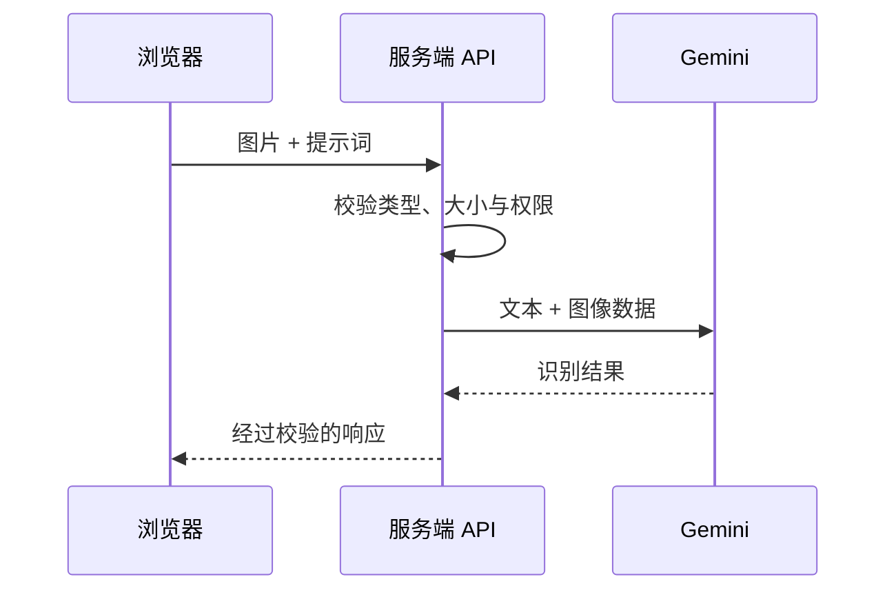

export const metadata = {
  title: '基于 Google Gemini 多模态视觉模型的图像智能识别与结构化提取实战',
  description: '全面剖析 Gemini 1.5 / 2.0 Flash 视觉模型的多模态能力：涵盖图片 URL 抓取、Multipart 文件流式上传、OCR 票据识别与 JSON 结构化提取。',
  date: '2025-01-25',
  category: 'AI 工程',
  readingTime: '9 分钟',
  alternates: { canonical: '/posts/gemini-image-recognition' },
  openGraph: {
    type: 'article',
    title: '基于 Google Gemini 多模态视觉模型的图像智能识别与结构化提取实战',
    description: '全面剖析 Gemini 1.5 / 2.0 Flash 视觉模型的多模态能力：涵盖图片 URL 抓取、Multipart 文件流式上传、OCR 票据识别与 JSON 结构化提取。',
    url: '/posts/gemini-image-recognition',
  },
  twitter: {
    card: 'summary',
    title: '基于 Google Gemini 多模态视觉模型的图像智能识别与结构化提取实战',
    description: '全面剖析 Gemini 1.5 / 2.0 Flash 视觉模型的多模态能力：涵盖图片 URL 抓取、Multipart 文件流式上传、OCR 票据识别与 JSON 结构化提取。',
  },
}

## 读完你能做什么

- 把浏览器中的图片转换成模型接口接受的 MIME 类型与二进制数据。
- 在服务端校验文件大小、类型与请求权限，再调用多模态模型。
- 为识别失败、超时和结构化输出不合法设计可恢复路径。



多模态调用的难点通常不在“把图片发过去”，而在输入边界和输出契约。生产接口应限制体积与 MIME 类型，并把模型输出当作不可信数据继续校验。

Gemini 1.5 / 2.0 Flash 具备原生的**原生多模态（Native Multimodal）**架构，不仅能理解文字，还能直接对高分辨率图像、图表、UI 界面截图乃至 PDF 扫描件进行毫秒级的视觉理解与结构化字段提取。

在实际业务中，图像识别需求通常分为两种场景：
1. **远程图片 URL 解析**（如电商商品图、社交媒体图片链接）；
2. **本地文件直接上传**（如用户即时上传的身份证、发票、设计稿原图）。

本文提供一套基于 Hono + Zod + Google Generative AI 的生产级视觉 API 实现方案。

---

## 视觉数据流转模型

```text
客户端请求
  │
  ├── 1. 图片 URL (JSON 格式) ──► 服务端 fetch 下载为 ArrayBuffer
  │                                    │
  └── 2. 本地文件 (FormData 格式) ────► 直接读取 File 二进制流
                                       │
                                       ▼ 转换为 Base64 InlineData
                              { inlineData: { data: '...', mimeType: 'image/png' } }
                                       │
                                       ▼ 注入 Prompt 与 JSON Schema
                              Gemini 视觉大模型 (gemini-1.5-flash)
                                       │
                                       ▼
                       结构化 JSON 或 SSE 打字机流式输出
```

---

## 核心接口实现：Hono + Gemini SDK

### 1. 远程图片 URL 结构化识别接口

```ts
// src/routes/vision.ts
import { Hono } from 'hono';
import { zValidator } from '@hono/zod-validator';
import { z } from 'zod';
import { GoogleGenerativeAI } from '@google/generative-ai';

const visionRoute = new Hono();
const genAI = new GoogleGenerativeAI(process.env.GEMINI_API_KEY!);
const model = genAI.getGenerativeModel({ model: 'gemini-1.5-flash' });

visionRoute.post(
  '/image-url',
  zValidator(
    'json',
    z.object({
      imageUrl: z.string().url('必须提供合法的图片 URL'),
      prompt: z.string().default('请详细描述这张图片的内容，并提取所有可见的文本。'),
      mimeType: z.enum(['image/jpeg', 'image/png', 'image/webp']).default('image/jpeg'),
    })
  ),
  async (c) => {
    const { imageUrl, prompt, mimeType } = c.req.valid('json');

    try {
      // 1. 服务端拉取远程图片并转为二进制
      const resp = await fetch(imageUrl);
      if (!resp.ok) throw new Error(`拉取图片失败: ${resp.statusText}`);
      
      const buffer = await resp.arrayBuffer();
      const base64Data = Buffer.from(buffer).toString('base64');

      // 2. 构造多模态 Payload 调用模型
      const result = await model.generateContent([
        {
          inlineData: {
            data: base64Data,
            mimeType,
          },
        },
        prompt,
      ]);

      return c.json({
        success: true,
        text: result.response.text(),
      });
    } catch (error: any) {
      return c.json({ success: false, error: error.message }, 500);
    }
  }
);
```

### 2. 本地文件上传与发票/收据结构化提取

结合 Zod 的 `form` 验证与 Gemini 的 JSON 约束，实现高精度票据提取：

```ts
import { SchemaType } from '@google/generative-ai';

// 定义带 JSON Schema 的发票专用解析模型
const invoiceModel = genAI.getGenerativeModel({
  model: 'gemini-1.5-flash',
  generationConfig: {
    responseMimeType: 'application/json',
    responseSchema: {
      type: SchemaType.OBJECT,
      properties: {
        merchant: { type: SchemaType.STRING, description: '商家或开票方名称' },
        date: { type: SchemaType.STRING, description: '开票日期 YYYY-MM-DD' },
        totalAmount: { type: SchemaType.NUMBER, description: '总消费金额' },
        currency: { type: SchemaType.STRING, description: '币种 (如 CNY, USD)' },
        items: {
          type: SchemaType.ARRAY,
          items: {
            type: SchemaType.OBJECT,
            properties: {
              name: { type: SchemaType.STRING },
              price: { type: SchemaType.NUMBER },
              quantity: { type: SchemaType.INTEGER },
            },
          },
        },
      },
      required: ['merchant', 'totalAmount'],
    },
  },
});

visionRoute.post('/upload-invoice', async (c) => {
  const body = await c.req.parseBody();
  const file = body['file'];

  if (!(file instanceof File)) {
    return c.json({ error: '必须上传有效的文件' }, 400);
  }

  const arrayBuffer = await file.arrayBuffer();
  const base64Data = Buffer.from(arrayBuffer).toString('base64');

  const result = await invoiceModel.generateContent([
    {
      inlineData: {
        data: base64Data,
        mimeType: file.type || 'image/png',
      },
    },
    '请提取发票中的商家、日期、明细和总金额。',
  ]);

  // 直接解析返回的结构化 JSON
  const parsedInvoice = JSON.parse(result.response.text());
  return c.json({ success: true, data: parsedInvoice });
});
```

---

## 多模态实战性能与注意事项

1. **Token 与分辨率优化**：
   * Gemini 视觉模型会自动将图像切片（Tiles）。对于 1024x1024 标准图像，通常消耗 **258 个 Tokens** 左右；
   * 在移动端上传前，建议使用 Canvas 进行适当压缩（如长边不超过 2048px），在不损失文字清晰度的前提下削减上传带宽。
2. **大文件采用 File API**：
   * 当图片体积大于 20MB（或视频/超长 PDF）时，不建议使用 `inlineData`（Base64 膨胀约 33%），应改用 Google Cloud 提供的 `GoogleAIFileManager` 预先上传获取 URI。
3. **敏感信息与合规**：
   * 涉及用户身份证件、人脸识别时，确保传输全程启用 HTTPS/TLS 并在识别完成后立即销毁内存 Buffer。

---

## 官方资料

- [Google AI：图像理解](https://ai.google.dev/gemini-api/docs/image-understanding)

## 自检：把知识变成判断

服务端是否同时限制 MIME、体积和权限？模型返回非预期结构时是否会被校验层拒绝？

## 总结

* **全格式支持**：结合 `inlineData` 与 Base64，可无缝对接 URL 抓取与文件直传。
* **从“描述图片”到“结构化提取”**：利用 `responseSchema`，Gemini 能直接充当生产级 OCR + NLP 结构化解析引擎。
