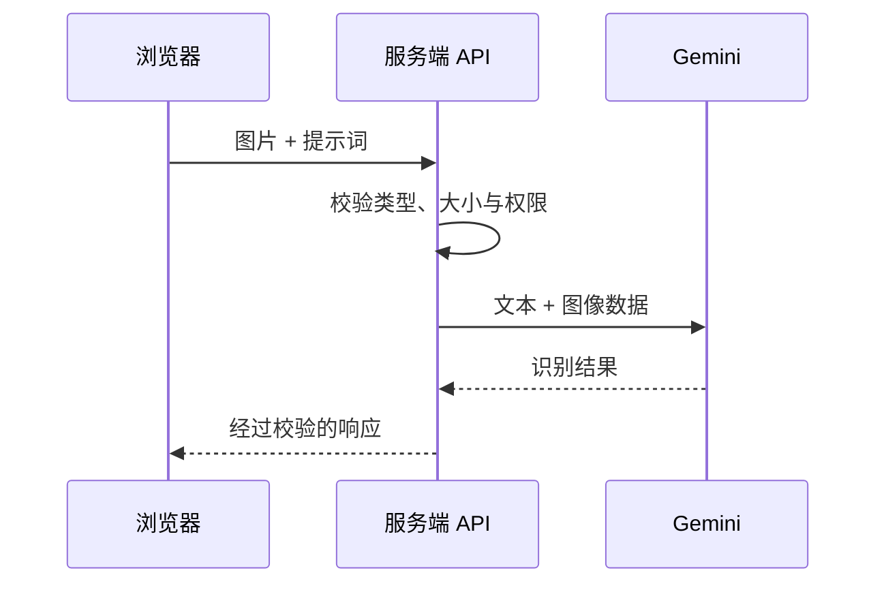

export const metadata = {
  title: '基于 Google Gemini 多模态视觉模型的图像智能识别与结构化提取实战',
  description: '将图片转换为模型可消费的 Base64 与 MIME 格式，结合 Zod 校验与 responseSchema 提取发票等结构化数据。',
  date: '2025-01-25',
  category: 'AI 工程',
  readingTime: '9 分钟',
  alternates: { canonical: '/posts/gemini-image-recognition' },
  openGraph: {
    type: 'article',
    title: '基于 Google Gemini 多模态视觉模型的图像智能识别与结构化提取实战',
    description: '将图片转换为模型可消费的 Base64 与 MIME 格式，结合 Zod 校验与 responseSchema 提取发票等结构化数据。',
    url: '/posts/gemini-image-recognition', images: ['/og-image.png'] },
  twitter: {
    card: 'summary_large_image',
    title: '基于 Google Gemini 多模态视觉模型的图像智能识别与结构化提取实战',
    description: '将图片转换为模型可消费的 Base64 与 MIME 格式，结合 Zod 校验与 responseSchema 提取发票等结构化数据。', images: ['/og-image.png'] },
}

## 读完你能做什么

- 把浏览器中的图片转换成模型接口接受的 MIME 类型与二进制数据。
- 在服务端校验文件大小、类型与请求权限，再调用多模态模型。
- 为识别失败、超时和结构化输出不合法设计可恢复路径。



多模态调用的难点通常不在“把图片发过去”，而在输入边界和输出契约。生产接口应限制体积与 MIME 类型，并把模型输出当作不可信数据继续校验。

接入多模态模型时，很多开发者以为把图片 URL 直接发给模型就行。但实际工程中往往会遇到防盗链拦截、超大图片传输过慢、或者模型把图片里明明存在的字段漏掉的问题。处理图像输入的核心，在于在服务端把好大小与格式关，并用强 Schema 锁死输出。

业务中的图像识别主要对应两种场景：
1. 远程图片 URL 解析（如爬虫抓取的商品图、外部图片链接）；
2. 本地文件直接上传（如用户在前端选中的发票、小票截图）。

---

## 视觉数据流转模型

```text
客户端请求
  │
  ├── 1. 图片 URL (JSON 格式) ──► 服务端 fetch 下载为 ArrayBuffer
  │                                    │
  └── 2. 本地文件 (FormData 格式) ────► 直接读取 File 二进制流
                                       │
                                       ▼ 转换为 Base64 InlineData
                              { inlineData: { data: '...', mimeType: 'image/png' } }
                                       │
                                       ▼ 注入 Prompt 与 JSON Schema
                              Gemini 视觉大模型 (gemini-1.5-flash)
                                       │
                                       ▼
                       结构化 JSON 或 SSE 打字机流式输出
```

---

## 核心接口实现：Hono + Gemini SDK

### 1. 远程图片 URL 结构化识别接口

```ts
// src/routes/vision.ts
import { Hono } from 'hono';
import { zValidator } from '@hono/zod-validator';
import { z } from 'zod';
import { GoogleGenerativeAI } from '@google/generative-ai';

const visionRoute = new Hono();
const genAI = new GoogleGenerativeAI(process.env.GEMINI_API_KEY!);
const model = genAI.getGenerativeModel({ model: 'gemini-1.5-flash' });

visionRoute.post(
  '/image-url',
  zValidator(
    'json',
    z.object({
      imageUrl: z.string().url('必须提供合法的图片 URL'),
      prompt: z.string().default('请详细描述这张图片的内容，并提取所有可见的文本。'),
      mimeType: z.enum(['image/jpeg', 'image/png', 'image/webp']).default('image/jpeg'),
    })
  ),
  async (c) => {
    const { imageUrl, prompt, mimeType } = c.req.valid('json');

    try {
      // 1. 服务端拉取远程图片并转为二进制
      const resp = await fetch(imageUrl);
      if (!resp.ok) throw new Error(`拉取图片失败: ${resp.statusText}`);
      
      const buffer = await resp.arrayBuffer();
      const base64Data = Buffer.from(buffer).toString('base64');

      // 2. 构造多模态 Payload 调用模型
      const result = await model.generateContent([
        {
          inlineData: {
            data: base64Data,
            mimeType,
          },
        },
        prompt,
      ]);

      return c.json({
        success: true,
        text: result.response.text(),
      });
    } catch (error: any) {
      return c.json({ success: false, error: error.message }, 500);
    }
  }
);
```

### 2. 本地文件上传与发票/收据结构化提取

结合 Zod 的 `form` 验证与 Gemini 的 JSON 约束，实现高精度票据提取：

```ts
import { SchemaType } from '@google/generative-ai';

// 定义带 JSON Schema 的发票专用解析模型
const invoiceModel = genAI.getGenerativeModel({
  model: 'gemini-1.5-flash',
  generationConfig: {
    responseMimeType: 'application/json',
    responseSchema: {
      type: SchemaType.OBJECT,
      properties: {
        merchant: { type: SchemaType.STRING, description: '商家或开票方名称' },
        date: { type: SchemaType.STRING, description: '开票日期 YYYY-MM-DD' },
        totalAmount: { type: SchemaType.NUMBER, description: '总消费金额' },
        currency: { type: SchemaType.STRING, description: '币种 (如 CNY, USD)' },
        items: {
          type: SchemaType.ARRAY,
          items: {
            type: SchemaType.OBJECT,
            properties: {
              name: { type: SchemaType.STRING },
              price: { type: SchemaType.NUMBER },
              quantity: { type: SchemaType.INTEGER },
            },
          },
        },
      },
      required: ['merchant', 'totalAmount'],
    },
  },
});

visionRoute.post('/upload-invoice', async (c) => {
  const body = await c.req.parseBody();
  const file = body['file'];

  if (!(file instanceof File)) {
    return c.json({ error: '必须上传有效的文件' }, 400);
  }

  const arrayBuffer = await file.arrayBuffer();
  const base64Data = Buffer.from(arrayBuffer).toString('base64');

  const result = await invoiceModel.generateContent([
    {
      inlineData: {
        data: base64Data,
        mimeType: file.type || 'image/png',
      },
    },
    '请提取发票中的商家、日期、明细和总金额。',
  ]);

  // 直接解析返回的结构化 JSON
  const parsedInvoice = JSON.parse(result.response.text());
  return c.json({ success: true, data: parsedInvoice });
});
```

---

## 性能与边界注意事项

1. **Token 与分辨率权衡**：
   Gemini 视觉模型会将输入图像切片（Tiles）。对于 1024x1024 图像，通常消耗约 258 个 Tokens。在移动端上传前，建议在前端用 Canvas 将超大图片长边等比缩放到 2048px 以内，既能保留文字可读性，又能大幅减少网络上传耗时。
2. **大文件改用 File API**：
   当图片体积大于 20MB（或超长 PDF、短视频）时，不宜使用 `inlineData`（Base64 膨胀约 33%），应改用官方提供的 `GoogleAIFileManager` 预先上传并获得 URI。
3. **敏感凭据清理**：
   处理发票或证件截图时，确保服务端内存 Buffer 处理完后立即释放，避免在日志中打印 Base64 全文。

---

## 官方资料

- [Google AI：图像理解](https://ai.google.dev/gemini-api/docs/image-understanding)

## 工程踩坑小结

- **Base64 传输限制**：小图片通过 `inlineData` 传 Base64 最轻便，但数据体积膨胀 33%。超过 10MB 的图或多页 PDF，一定要换用官方的文件上传接口（File API），否则容易拖垮服务端的内存与网络带宽。
- **提取结果双重校验**：即使模型配置了 `responseSchema`，关键数值字段（如发票金额、税号）在下游入库前仍然需要做业务规则校验，防止模型出现数字笔画误读。
