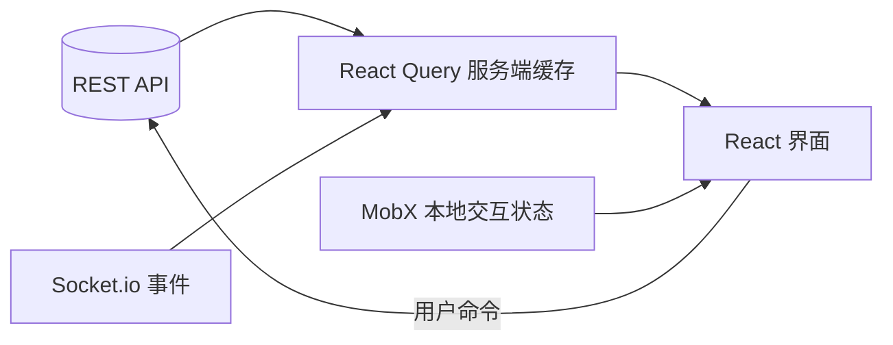

export const metadata = {
  title: 'Jebet 敏捷项目管理平台架构设计：多租户工作区、MobX 响应式状态与 Socket.io 实时协同',
  description: '梳理敏捷协作看板中 MobX 局部响应与 React Query 服务端缓存的分工，结合 Socket.io 实现多成员状态同步。',
  date: '2025-02-14',
  category: '系统架构',
  readingTime: '9 分钟',
  alternates: { canonical: '/posts/jebet-project-management' },
  openGraph: {
    type: 'article',
    title: 'Jebet 敏捷项目管理平台架构设计：多租户工作区、MobX 响应式状态与 Socket.io 实时协同',
    description: '梳理敏捷协作看板中 MobX 局部响应与 React Query 服务端缓存的分工，结合 Socket.io 实现多成员状态同步。',
    url: '/posts/jebet-project-management', images: ['/og-image.png'] },
  twitter: {
    card: 'summary_large_image',
    title: 'Jebet 敏捷项目管理平台架构设计：多租户工作区、MobX 响应式状态与 Socket.io 实时协同',
    description: '梳理敏捷协作看板中 MobX 局部响应与 React Query 服务端缓存的分工，结合 Socket.io 实现多成员状态同步。', images: ['/og-image.png'] },
}

## 读完你能做什么

- 把 UI 状态、服务端缓存与实时事件分配给不同状态通道。
- 解释 React Query、MobX 与 Socket.io 之间的数据所有权边界。
- 在多租户系统中让授权校验落在服务端，而不是只隐藏前端按钮。



双状态方案可行的前提是没有“双重真相”：远端实体由查询缓存持有，弹窗、选择和临时编辑状态由客户端 Store 持有，实时事件负责使缓存失效或合并更新。

做敏捷协作看板时，最常碰到的架构矛盾在于：看板卡片频繁拖拽需要极高的局部响应速度，而跨成员协作又需要后端状态与 WebSocket 实时刷新。如果直接把所有数据塞进单个全局状态树，拖拽一张卡片就会引发整个看板成百上千个 DOM 节点的浅层重绘。这套系统采用 MobX 管高频局部拖拽，React Query 管服务端缓存，Socket.io 负责增量广播。

---

## 整体架构分层与数据总线

```text
┌────────────────────────────────────────────────────────┐
│ 客户端展示层 (React + TypeScript + TailwindCSS)       │
│  ├── 敏捷看板 (Kanban) / 甘特图 (Gantt) 视图           │
│  ├── 成员任务分配与富文本描述抽屉                      │
│  └── 实时动态活动流 (Activity Feed & Toast Notifications)│
├────────────────────────────────────────────────────────┤
│ 双驱状态管理中枢                                       │
│  ├── MobX Store: 负责高频、细粒度响应式交互 (卡片拖拽) │
│  └── TanStack Query: 负责异步服务端数据缓存与预加载    │
├────────────────────────────────────────────────────────┤
│ 实时通信总线 (Socket.io WebSocket 管道)                │
│  └── 任务状态流转广播、成员在线心跳、编辑锁定提示      │
├────────────────────────────────────────────────────────┤
│ 权限与数据隔离 (RBAC 多工作区)                         │
│  └── Workspace -> Project -> Sprint -> Task 严格级联   │
└────────────────────────────────────────────────────────┘
```

---

## 核心设计一：为什么采用 MobX + React Query 双驱模型？

在看板系统中，用户频繁将任务卡片在“待办 -> 进行中 -> 已完成”列之间快速拖拽。
* **全局单一 State 树的开销**：每次拖拽微调位置，如果引发整棵组件树的浅拷贝，容易在长列表场景下掉帧；
* **MobX 的局部依赖追踪**：MobX 基于细粒度响应式更新，只有真正被修改了 `status` 或 `order` 的单张卡片组件会触发重绘，其余卡片保持静止；
* **结合 TanStack Query**：由 React Query 负责数据的初次拉取、缓存失效与后端 API 同步，数据拉取完成后注入 MobX Domain Model。

```tsx
import { makeAutoObservable } from 'mobx';
import { observer } from 'mobx-react-lite';

class TaskStore {
  tasks: Map<string, Task> = new Map();

  constructor() {
    makeAutoObservable(this);
  }

  moveTask(taskId: string, targetColumn: string, newOrder: number) {
    const task = this.tasks.get(taskId);
    if (task) {
      task.status = targetColumn;
      task.order = newOrder;
      // 触发后台静默同步
      this.syncToServer(task);
    }
  }
}
```

---

## 核心设计二：Socket.io 实时事件协同总线

为了避免团队成员“同时修改同一任务发生覆盖”，系统建立了细粒度的房间事件订阅：

```ts
// 监听特定工作区与项目的事件流
socket.on('task:updated', (payload: { taskId: string; updatedBy: string; changes: any }) => {
  // 1. 局部更新 MobX 任务状态
  taskStore.applyRemoteUpdate(payload.taskId, payload.changes);
  
  // 2. 弹出轻量通知
  toast.info(`${payload.updatedBy} 更新了任务状态`);
});
```

---

## 核心设计三：多租户与 RBAC 权限隔离

数据模型采用四级严格级联体系：
1. **Workspace（工作区）**：公司或团队维度，隔离所有计费与顶级成员列表；
2. **Project（项目空间）**：支持公开或私有权限控制（Owner / Maintainer / Contributor / Viewer）；
3. **Sprint（迭代周期）**：敏捷冲刺目标与燃尽图计算；
4. **Task / Issue（原子任务）**：包含子任务、工时估算与附件。

---

## 官方资料

- [TanStack Query：概览](https://tanstack.com/query/latest/docs/framework/react/overview)

## 经验与踩坑复盘

- **避免广播回环抖动**：本地拖拽完成后会触发接口调用并通过 WebSocket 广播给房间内的所有成员。发送者本地必须过滤掉自己刚刚发出的广播（通过携带唯一的 `clientId` 或 `requestId`），否则本地卡片会因为收到自己的回包而产生二次重绘和位置闪烁。
- **权限校验必须在后端收口**：前端依据角色隐藏“删除任务”或“修改工作区设置”按钮只为了交互友好，所有接口入参必须在后端通过 JWT 和工作区 ID 执行二次鉴权。
