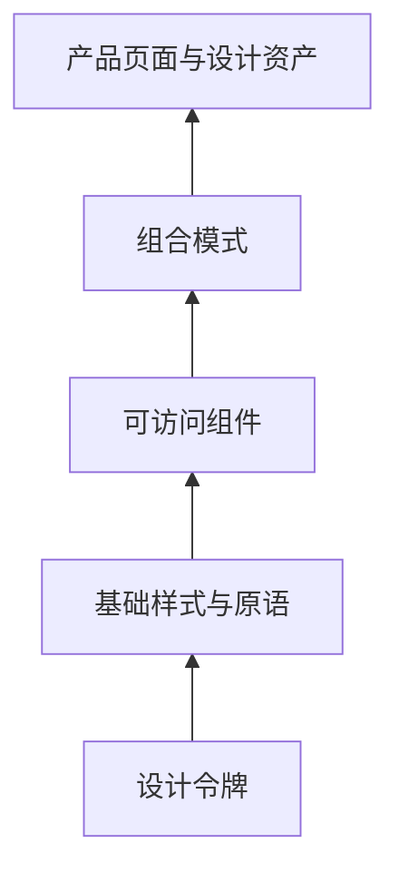

export const metadata = {
  title: 'LJH-Design 设计系统架构设计：从 Design Tokens、Radix UI 到 AI 辅助生成平台',
  description: '梳理设计系统的分层结构：用 CSS 变量管理 Design Tokens，通过 Radix UI 与 CVA 解耦无头逻辑与视觉样式。',
  date: '2025-02-14',
  category: '架构设计',
  readingTime: '9 分钟',
  alternates: { canonical: '/posts/ljh-design-system' },
  openGraph: {
    type: 'article',
    title: 'LJH-Design 设计系统架构设计：从 Design Tokens、Radix UI 到 AI 辅助生成平台',
    description: '梳理设计系统的分层结构：用 CSS 变量管理 Design Tokens，通过 Radix UI 与 CVA 解耦无头逻辑与视觉样式。',
    url: '/posts/ljh-design-system', images: ['/og-image.png'] },
  twitter: {
    card: 'summary_large_image',
    title: 'LJH-Design 设计系统架构设计：从 Design Tokens、Radix UI 到 AI 辅助生成平台',
    description: '梳理设计系统的分层结构：用 CSS 变量管理 Design Tokens，通过 Radix UI 与 CVA 解耦无头逻辑与视觉样式。', images: ['/og-image.png'] },
}

## 读完你能做什么

- 区分设计令牌、基础组件、组合模式与业务模板的责任层级。
- 用 CSS 变量承载可运行时切换的视觉决策。
- 评估 Headless 组件与 AI 生成内容应当遵守的组件契约。



设计系统的价值不是组件数量，而是让相同决策只定义一次。越靠下的层级越稳定、越通用；业务语义越强的内容越应留在产品层。

业务线一多，最常见的视觉问题就是“同一个主色有五种不同的十六进制编码，弹窗在不同页面里的圆角和阴影各不相同”。搭设计系统不是为了给团队塞一个沉重的巨石组件库，而是把视觉决策（Design Tokens）和无障碍交互（Headless 原语）拆开，让业务开发既能统一规范，又不失灵活性。这篇文章记录这套设计系统的分层实践。

---

## 设计系统五层金字塔架构

```text
┌────────────────────────────────────────────────────────┐
│ 第 5 层: AI 智能生成层 (AI Generative Layout & Copilot) │
│  └── 基于 LLM 与 Prompt 快速组装页面原型与 Schema 规范  │
├────────────────────────────────────────────────────────┤
│ 第 4 层: 业务模板与区块层 (Composite Blocks / Templates)│
│  └── 认证表单、指标大屏、数据表格、复杂筛选器         │
├────────────────────────────────────────────────────────┤
│ 第 3 层: 视觉呈现组件库 (Styled Components: Shadcn/UI) │
│  └── Button, Dialog, Dropdown, Tabs, Toast             │
├────────────────────────────────────────────────────────┤
│ 第 2 层: 无头可访问原语 (Headless Primitives: Radix UI) │
│  └── 键盘焦点捕获、ARIA 属性映射、屏幕阅读器支持        │
├────────────────────────────────────────────────────────┤
│ 第 1 层: 原子设计变量 (Design Tokens: CSS Variables)   │
│  └── Color Palettes, Spacing, Typography, Shadows      │
└────────────────────────────────────────────────────────┘
```

---

## 核心设计一：基于 CSS 变量的 Design Tokens 体系

为了实现灵活的深色模式与品牌换肤，所有视觉参数通过 CSS 变量抽象：

```css
/* styles/tokens.css */
:root {
  --background: 0 0% 100%;
  --foreground: 222.2 84% 4.9%;
  --primary: 221.2 83.2% 53.3%;
  --primary-foreground: 210 40% 98%;
  --radius: 0.5rem;
}

.dark {
  --background: 222.2 84% 4.9%;
  --foreground: 210 40% 98%;
  --primary: 217.2 91.2% 59.8%;
  --primary-foreground: 222.2 47.4% 11.2%;
}
```

在 Tailwind 配置中直接映射为语义化 Utility：

```ts
// tailwind.config.ts
export default {
  theme: {
    extend: {
      colors: {
        background: 'hsl(var(--background))',
        foreground: 'hsl(var(--foreground))',
        primary: {
          DEFAULT: 'hsl(var(--primary))',
          foreground: 'hsl(var(--primary-foreground))',
        },
      },
      borderRadius: {
        lg: 'var(--radius)',
      },
    },
  },
};
```

---

## 核心设计二：Headless 无头交互解耦

传统 UI 组件库常常将 DOM 逻辑与样式紧紧耦合在一起，导致定制非常困难。

LJH-Design 采用 **Radix UI Primitives + Tailwind CSS (CVA，Class Variance Authority)** 的模式：
* **Radix UI** 负责复杂的键盘导航、焦点陷阱（Focus Trap）、WAI-ARIA 属性；
* **CVA** 负责声明式管理组件的变体（Variant）与尺寸（Size）：

```tsx
import { cva, type VariantProps } from 'class-variance-authority';

const buttonVariants = cva(
  'inline-flex items-center justify-center font-medium transition-colors rounded-md focus:outline-none focus:ring-2 focus:ring-offset-2',
  {
    variants: {
      variant: {
        primary: 'bg-primary text-primary-foreground hover:bg-primary/90',
        secondary: 'bg-secondary text-secondary-foreground hover:bg-secondary/80',
        outline: 'border border-input bg-background hover:bg-accent',
        ghost: 'hover:bg-accent hover:text-accent-foreground',
      },
      size: {
        sm: 'h-8 px-3 text-xs',
        md: 'h-10 px-4 text-sm',
        lg: 'h-12 px-6 text-base',
      },
    },
    defaultVariants: {
      variant: 'primary',
      size: 'md',
    },
  }
);
```

---

## 核心设计三：AI 辅助设计与生成模块

平台内置了 AI Copilot，能够根据用户自然语言需求（例如“生成一个包含用户画像与支付明细的侧边抽屉”）：
1. 检索符合 LJH-Design 规范的组件 Schema；
2. 组装成合法的 JSX / React 代码片段；
3. 在沙箱 Playground 中即时渲染并支持实时调优。

---

## 官方资料

- [W3C：Design Tokens Format Module](https://www.designtokens.org/tr/drafts/format/)

## 实践经验与边界

- **Tokens 粒度不要过碎**：初期最容易犯的错误是给每一个组件甚至每一个边框都定义一套独立的变量（如 `--button-primary-hover-border-color`）。更推荐以语义化调色板（`primary`, `background`, `muted`）和比例尺度（`space-4`, `radius-md`）为主，过碎的变量会导致维护成本指数上升。
- **样式与行为分离**：像下拉菜单、弹窗、Tabs 这一类有复杂键盘焦点和可访问性要求的组件，优先复用 Radix UI 这类成熟原语，自己的精力应集中在业务变体（CVA）和布局组合上。
