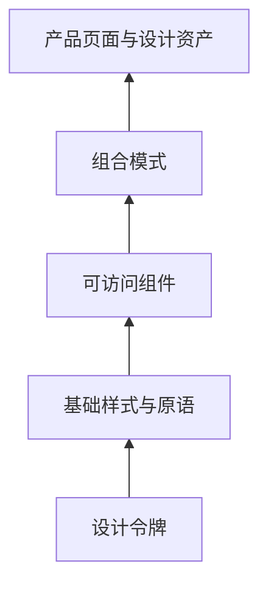

export const metadata = {
  title: 'LJH-Design 设计系统架构设计：从 Design Tokens、Radix UI 到 AI 辅助生成平台',
  description: '全面解析现代前端设计系统架构：涵盖原子化 Design Tokens 规范、Headless 无头 UI 原语解耦、深浅主题切换与 AI 辅助界面生成系统的落地实践。',
  date: '2025-02-14',
  category: '架构设计',
  readingTime: '9 分钟',
  alternates: { canonical: '/posts/ljh-design-system' },
  openGraph: {
    type: 'article',
    title: 'LJH-Design 设计系统架构设计：从 Design Tokens、Radix UI 到 AI 辅助生成平台',
    description: '全面解析现代前端设计系统架构：涵盖原子化 Design Tokens 规范、Headless 无头 UI 原语解耦、深浅主题切换与 AI 辅助界面生成系统的落地实践。',
    url: '/posts/ljh-design-system',
  },
  twitter: {
    card: 'summary',
    title: 'LJH-Design 设计系统架构设计：从 Design Tokens、Radix UI 到 AI 辅助生成平台',
    description: '全面解析现代前端设计系统架构：涵盖原子化 Design Tokens 规范、Headless 无头 UI 原语解耦、深浅主题切换与 AI 辅助界面生成系统的落地实践。',
  },
}

## 读完你能做什么

- 区分设计令牌、基础组件、组合模式与业务模板的责任层级。
- 用 CSS 变量承载可运行时切换的视觉决策。
- 评估 Headless 组件与 AI 生成内容应当遵守的组件契约。



设计系统的价值不是组件数量，而是让相同决策只定义一次。越靠下的层级越稳定、越通用；业务语义越强的内容越应留在产品层。

在多产品线并行的研发体系中，缺乏统一的设计系统会导致各项目 UI 风格割裂、重复造轮子、无障碍（a11y）标准缺失以及重构维护成本高昂。

**LJH-Design** 是一个集成了**设计资产管理、原子组件库与 AI 辅助设计生成**的综合性设计系统平台。本文分享其核心架构分层与工程实现。

---

## 设计系统五层金字塔架构

```text
┌────────────────────────────────────────────────────────┐
│ 第 5 层: AI 智能生成层 (AI Generative Layout & Copilot) │
│  └── 基于 LLM 与 Prompt 快速组装页面原型与 Schema 规范  │
├────────────────────────────────────────────────────────┤
│ 第 4 层: 业务模板与区块层 (Composite Blocks / Templates)│
│  └── 认证表单、指标大屏、数据表格、复杂筛选器         │
├────────────────────────────────────────────────────────┤
│ 第 3 层: 视觉呈现组件库 (Styled Components: Shadcn/UI) │
│  └── Button, Dialog, Dropdown, Tabs, Toast             │
├────────────────────────────────────────────────────────┤
│ 第 2 层: 无头可访问原语 (Headless Primitives: Radix UI) │
│  └── 键盘焦点捕获、ARIA 属性映射、屏幕阅读器支持        │
├────────────────────────────────────────────────────────┤
│ 第 1 层: 原子设计变量 (Design Tokens: CSS Variables)   │
│  └── Color Palettes, Spacing, Typography, Shadows      │
└────────────────────────────────────────────────────────┘
```

---

## 核心设计一：基于 CSS 变量的 Design Tokens 体系

为了实现灵活的深色模式与品牌换肤，所有视觉参数通过 CSS 变量抽象：

```css
/* styles/tokens.css */
:root {
  --background: 0 0% 100%;
  --foreground: 222.2 84% 4.9%;
  --primary: 221.2 83.2% 53.3%;
  --primary-foreground: 210 40% 98%;
  --radius: 0.5rem;
}

.dark {
  --background: 222.2 84% 4.9%;
  --foreground: 210 40% 98%;
  --primary: 217.2 91.2% 59.8%;
  --primary-foreground: 222.2 47.4% 11.2%;
}
```

在 Tailwind 配置中直接映射为语义化 Utility：

```ts
// tailwind.config.ts
export default {
  theme: {
    extend: {
      colors: {
        background: 'hsl(var(--background))',
        foreground: 'hsl(var(--foreground))',
        primary: {
          DEFAULT: 'hsl(var(--primary))',
          foreground: 'hsl(var(--primary-foreground))',
        },
      },
      borderRadius: {
        lg: 'var(--radius)',
      },
    },
  },
};
```

---

## 核心设计二：Headless 无头交互解耦

传统 UI 组件库（如 Ant Design）常常将 DOM 逻辑与样式紧紧耦合在一起，导致定制非常困难。

LJH-Design 采用 **Radix UI Primitives + Tailwind CSS (CVA，Class Variance Authority)** 的模式：
* **Radix UI** 负责复杂的键盘导航、焦点陷阱（Focus Trap）、WAI-ARIA 属性；
* **CVA** 负责声明式管理组件的变体（Variant）与尺寸（Size）：

```tsx
import { cva, type VariantProps } from 'class-variance-authority';

const buttonVariants = cva(
  'inline-flex items-center justify-center font-medium transition-colors rounded-md focus:outline-none focus:ring-2 focus:ring-offset-2',
  {
    variants: {
      variant: {
        primary: 'bg-primary text-primary-foreground hover:bg-primary/90',
        secondary: 'bg-secondary text-secondary-foreground hover:bg-secondary/80',
        outline: 'border border-input bg-background hover:bg-accent',
        ghost: 'hover:bg-accent hover:text-accent-foreground',
      },
      size: {
        sm: 'h-8 px-3 text-xs',
        md: 'h-10 px-4 text-sm',
        lg: 'h-12 px-6 text-base',
      },
    },
    defaultVariants: {
      variant: 'primary',
      size: 'md',
    },
  }
);
```

---

## 核心设计三：AI 辅助设计与生成模块

平台内置了 AI Copilot，能够根据用户自然语言需求（例如“生成一个包含用户画像与支付明细的侧边抽屉”）：
1. 检索符合 LJH-Design 规范的组件 Schema；
2. 组装成合法的 JSX / React 代码片段；
3. 在沙箱 Playground 中即时渲染并支持实时调优。

---

## 官方资料

- [W3C：Design Tokens Format Module](https://www.designtokens.org/tr/drafts/format/)

## 自检：把知识变成判断

新增一个颜色或交互模式时，你能否判断它应属于令牌、基础组件、组合模式还是业务页面？

## 总结

* **下层稳固**：通过 Design Tokens 与 Radix UI 确保全平台样式规范与无障碍基线统一。
* **上层高效**：通过 Shadcn / CVA 模式保持极高的样式可定制性，辅以 AI 生成加速业务交付。
