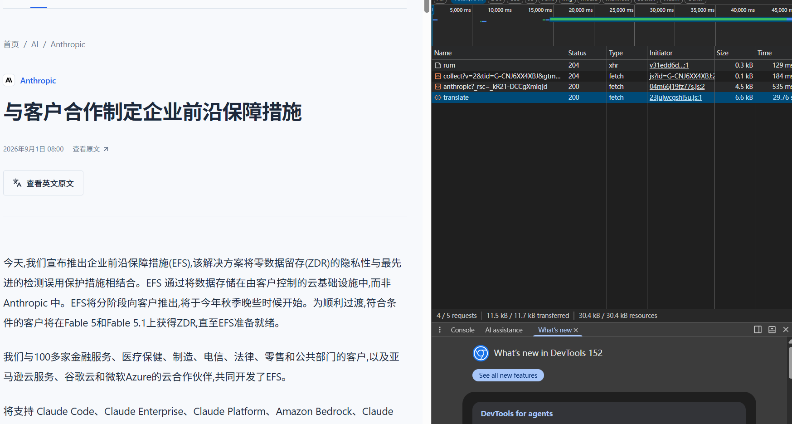

export const metadata = {
  title: '给 Next.js 网站加上本地翻译',
  description: '使用 MTranServer 实现文章英译中，在 Next.js 中接入翻译接口、翻译按钮和原文切换。',
  date: '2026-09-12',
  category: 'AI 工程',
  readingTime: '6 分钟',
  alternates: { canonical: '/posts/local-english-chinese-translation' },
  openGraph: { type: 'article', title: '给 Next.js 网站加上本地翻译', description: '使用 MTranServer 实现文章英译中，在 Next.js 中接入翻译接口、翻译按钮和原文切换。', url: '/posts/local-english-chinese-translation' },
  twitter: { card: 'summary', title: '给 Next.js 网站加上本地翻译', description: '使用 MTranServer 实现文章英译中，在 Next.js 中接入翻译接口、翻译按钮和原文切换。' }
}

英文文章页加上一个“翻译为中文”按钮，点击后展示中文，再点击就能切回英文原文。这篇文章就来实现这个功能。

翻译使用 [MTranServer](https://github.com/xxnuo/MTranServer) 的 npm 包，直接在 Next.js 服务端调用本地模型。前端负责展示，正文在运行 Next 的机器上完成翻译。


## 安装 MTranServer

在已有的 Next.js App Router 项目中安装依赖：

```bash
bun add --exact mtranserver@4.0.33
```

在 `next.config.ts` 中将模型包作为服务端外部依赖：

```ts
import type { NextConfig } from 'next'

const nextConfig: NextConfig = {
  serverExternalPackages: ['mtranserver']
}

export default nextConfig
```

如果项目已经有配置，将这一项合并进去即可。然后在 `.gitignore` 中加入模型目录：

```text
.mtran/
```

## 在服务端实现英译中

新建 `lib/translation.ts`，统一管理模型实例和翻译方法：

```ts
import path from 'node:path'
import { MTran } from 'mtranserver'

let ready: Promise<MTran> | undefined

function getEngine() {
  if (!ready) {
    ready = (async () => {
      const engine = new MTran({
        configDir: path.join(process.cwd(), '.mtran/config'),
        modelDir: path.join(process.cwd(), '.mtran/models'),
        checkUpdate: false,
        logToFile: false
      })

      try {
        await engine.init()
        return engine
      } catch (error) {
        await engine.close().catch(() => {})
        throw error
      }
    })().catch((error) => {
      ready = undefined
      throw error
    })
  }
  return ready
}

export async function translateArticle(title: string, content: string) {
  const engine = await getEngine()
  const translatedTitle = await engine.translate('en', 'zh', title)
  const translatedContent = await engine.translate('en', 'zh', content)

  return {
    title: translatedTitle,
    content: translatedContent
  }
}
```

`engine.translate('en', 'zh', text)` 就是英译中的核心调用。这里分别翻译标题和正文，返回的结构仍然是 `title` 和 `content`，方便页面直接替换显示。

`ready` 保存初始化任务，让后续请求复用当前进程里的模型实例。第一次使用某个语言对时，MTranServer 默认会获取所需模型；提前准备模型的方法放在文末扩展中。库接口可参考官方的 [usage.ts 示例](https://github.com/xxnuo/MTranServer/blob/main/example/usage.ts)。

接着新建 `app/api/translate/route.ts`：

```ts
import { translateArticle } from '../../../lib/translation'

export const runtime = 'nodejs'

export async function POST(request: Request) {
  const input = await request.json().catch(() => null)

  if (
    !input ||
    typeof input.title !== 'string' ||
    typeof input.content !== 'string' ||
    !input.title.trim() ||
    !input.content.trim() ||
    input.title.length > 500 ||
    input.content.length > 20_000
  ) {
    return Response.json({ error: '请提供有效的文章标题和正文' }, { status: 400 })
  }

  try {
    const translation = await translateArticle(input.title, input.content)
    return Response.json({ translation })
  } catch {
    return Response.json({ error: '翻译失败，请稍后重试' }, { status: 503 })
  }
}
```

现在页面向 `/api/translate` 发送标题和正文，就能拿到中文结果。为了方便本地演示，这里直接接收文本；已有文章数据库的项目，可以改为只传文章 ID，再由服务端查询文章。


在页面上英文文章试一下：



启动项目：

```bash
bun --bun run dev
```

打开页面，点击“翻译为中文”，等待中文标题和正文出现。这个示例使用纯文本正文，保留换行即可直接展示。


## 扩展：提前下载模型，缩短首次等待

文章翻译功能已经可以使用。如果希望在第一次点击按钮之前准备好模型，可以增加一个独立脚本。

新建 `scripts/prepare-translation.mjs`：

```js
import path from 'node:path'
import { MTran } from 'mtranserver'

const engine = new MTran({
  configDir: path.join(process.cwd(), '.mtran/config'),
  modelDir: path.join(process.cwd(), '.mtran/models'),
  checkUpdate: false,
  logToFile: false
})

try {
  await engine.init()
  await engine.downloadModel('en', 'zh')
  console.log('英译中模型已准备好')
} finally {
  await engine.close()
}
```

从项目根目录执行：

```bash
bun scripts/prepare-translation.mjs
```

脚本与服务端使用相同的模型目录。下载完成后，后续翻译可以复用本地文件；这个步骤是可选的，不影响前面的接入方式。

提前下载保留的是磁盘上的模型文件。Next 进程首次推理时仍需加载模型，独立脚本不会替另一个进程保留内存状态。
