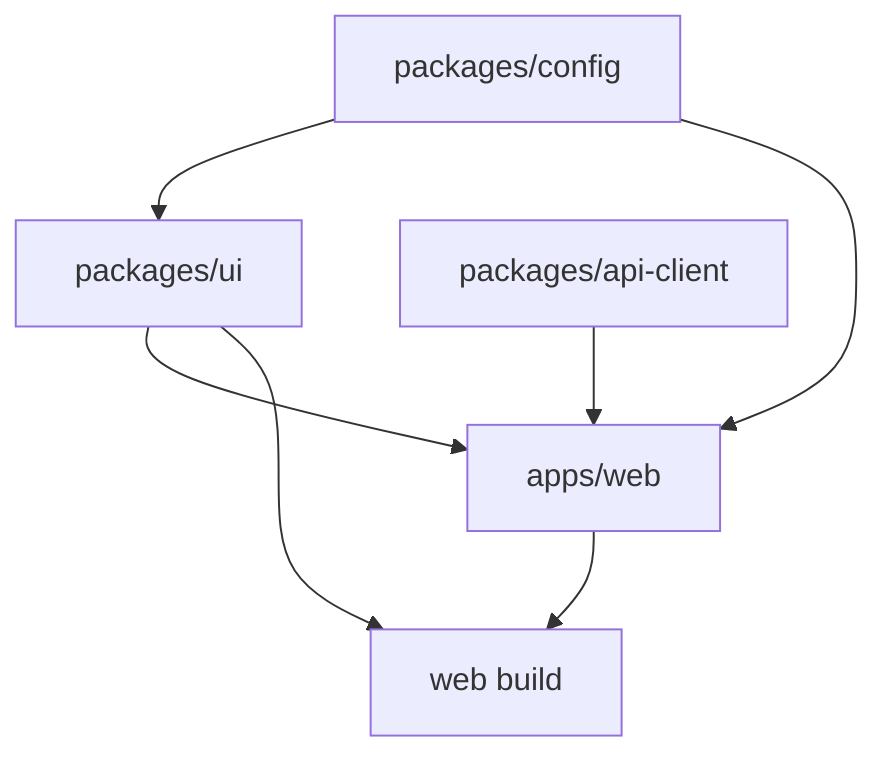

export const metadata = {
  title: 'Monorepo 实践：pnpm Workspace 与 Turborepo',
  description: '探讨前端 Monorepo 方案中 pnpm workspace 的依赖组织与 Turborepo 任务编排机制，分析依赖拓扑、增量构建缓存与跨包联调实践。',
  date: '2024-12-28',
  category: '前端工程化',
  readingTime: '10 分钟',
  alternates: { canonical: '/posts/monorepo-management' },
  openGraph: {
    type: 'article',
    title: 'Monorepo 实践：pnpm Workspace 与 Turborepo',
    description: '探讨前端 Monorepo 方案中 pnpm workspace 的依赖组织与 Turborepo 任务编排机制，分析依赖拓扑、增量构建缓存与跨包联调实践。',
    url: '/posts/monorepo-management', images: ['/og-image.png'] },
  twitter: {
    card: 'summary_large_image',
    title: 'Monorepo 实践：pnpm Workspace 与 Turborepo',
    description: '探讨前端 Monorepo 方案中 pnpm workspace 的依赖组织与 Turborepo 任务编排机制，分析依赖拓扑、增量构建缓存与跨包联调实践。', images: ['/og-image.png'] },
}

## 读完你能做什么

- 判断团队的问题是否真的需要 Monorepo，而不是把仓库合并当成目标。
- 用 pnpm workspace 表达包依赖，用 Turborepo 表达任务依赖与缓存边界。
- 让构建缓存依赖明确输入，避免复用过期产物。



Workspace 管依赖安装与包链接，任务编排器管命令顺序和缓存。把两者职责分开，才能定位“依赖没解析”和“任务没重跑”这两类不同问题。

在项目规模扩大后，随着公共 UI 组件、工具函数库与多个业务应用的拆分，多仓库（Multi-repo）往往会带来版本发布繁琐、跨仓库联调链路长等问题。

将关联项目聚合在同一仓库中维护（Monorepo）是一种常见解法。本文结合 pnpm workspace 的依赖拓扑与 Turborepo 任务调度，梳理大仓工程化组织与构建缓存实践。

---

## Multi-repo vs Monorepo 架构权衡

```text
Multi-repo (多仓库模式):
  [组件库 Repo] ──发布 npm (v1.0.1)──► [业务应用 A Repo 升级依赖]
                                      └──► [业务应用 B Repo 升级依赖]
  痛点: 跨包修改必须先发布才能测试，PR 割裂，CICD 重复运行。

Monorepo (单仓库多包模式):
  my-monorepo/
  ├── apps/
  │   ├── web-app/ (Next.js 应用)
  │   └── admin-portal/ (管理后台)
  └── packages/
      ├── ui-kit/ (公共组件库，使用 workspace:* 本地实时软链)
      ├── tsconfig/ (共享 TS 规则)
      └── eslint-config/ (共享代码规范)
  优势: 单个 PR 覆盖全链路原子变更，本地开发零等待。
```

---

## 为什么从 Lerna 转向 Turborepo？

早期的 Lerna 和 npm/yarn v1 在 Monorepo 下存在明显性能瓶颈：
1. **依赖幽灵依赖（Phantom Dependencies）**：npm 扁平化 node_modules 容易导致子包未声明依赖却能意外引用。
2. **构建串行与重复计算**：当执行 `build` 时，Lerna 往往串行遍历所有包，即便某些包代码完全没变，每次仍要全量重构。

**Turborepo** 由 Vercel 团队采用 Go 语言重写，带来了两大质的飞跃：

```text
Turborepo 任务执行有向无环图 (DAG Pipeline):
               [packages/utils:build]
                         │
                         ▼
               [packages/ui:build]
             ┌───────────┴───────────┐
             ▼                       ▼
      [apps/web:build]      [apps/admin:build]
  (命中本地/远程缓存时复用已有产物)
```

---

## 生产级工程拓扑搭建全流程

### 1. `pnpm-workspace.yaml` 配置

```yaml
packages:
  - 'apps/*'
  - 'packages/*'
```

### 2. 跨包引用使用 `workspace:*` 协议

在 `apps/web/package.json` 中声明对公共 UI 包的本地引用：

```json
{
  "name": "web-app",
  "dependencies": {
    "@my-org/ui": "workspace:*",
    "@my-org/utils": "workspace:*"
  }
}
```
* **原理解析**：pnpm 会自动将 `@my-org/ui` 软链接（Symlink）到本地 `packages/ui`，在开发时修改 UI 组件无需发布，Web 应用可立即捕捉变化。

### 3. `turbo.json` 任务调度与增量缓存

在根目录配置 `turbo.json`：

```json
{
  "$schema": "https://turbo.build/schema.json",
  "pipeline": {
    "build": {
      // 依赖上游包的 build 产物完成后再执行当前包的 build
      "dependsOn": ["^build"],
      // 声明产物目录，Turborepo 会自动哈希并缓存该目录
      "outputs": ["dist/**", ".next/**", "!dist/.cache/**"]
    },
    "lint": {
      "dependsOn": ["^lint"]
    },
    "dev": {
      "cache": false,
      "persistent": true
    }
  }
}
```

---

## 官方资料

- [pnpm：Workspaces](https://pnpm.io/workspaces)

## 工程经验小结

Monorepo 并不会自动带来工程效率的提升，反而对团队的依赖规范和发版流程提出了更高要求。

使用 Turborepo 时，最关键的是合理配置 `inputs` 与 `outputs` 缓存边界：如果 `outputs` 遗漏了关键产物目录，或者 `inputs` 没有包含影响构建的环境变量，就可能导致 CI 命中错误缓存、构建出带有隐性问题的产物。另外，跨包之间尽量避免循环依赖，保持单向依赖拓扑是保证 Monorepo 可持续维护的前提。
