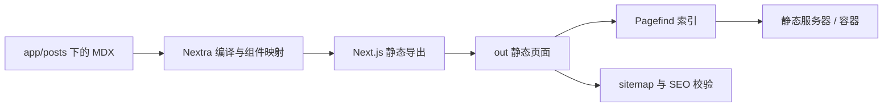

export const metadata = {
  title: '基于 Next.js App Router 与 Nextra 4 构建现代静态技术博客全流程',
  description: '全面剖析基于 Next.js App Router 与 Nextra 4 搭建个人技术博客的架构方案：涵盖 MDX 自定义组件注入、Pagefind 离线全文检索、Sitemap 自动生成与 Docker 多阶段构建部署。',
  date: '2025-01-28',
  category: '建站与专题',
  readingTime: '9 分钟',
  alternates: { canonical: '/posts/nextra-blog-setup' },
  openGraph: {
    type: 'article',
    title: '基于 Next.js App Router 与 Nextra 4 构建现代静态技术博客全流程',
    description: '全面剖析基于 Next.js App Router 与 Nextra 4 搭建个人技术博客的架构方案：涵盖 MDX 自定义组件注入、Pagefind 离线全文检索、Sitemap 自动生成与 Docker 多阶段构建部署。',
    url: '/posts/nextra-blog-setup', images: ['/og-image.png'] },
  twitter: {
    card: 'summary_large_image',
    title: '基于 Next.js App Router 与 Nextra 4 构建现代静态技术博客全流程',
    description: '全面剖析基于 Next.js App Router 与 Nextra 4 搭建个人技术博客的架构方案：涵盖 MDX 自定义组件注入、Pagefind 离线全文检索、Sitemap 自动生成与 Docker 多阶段构建部署。', images: ['/og-image.png'] },
}

## 读完你能做什么

- 解释 MDX 文件如何经过 Next.js 与 Nextra 生成静态页面。
- 配置组件映射、全文检索、站点地图和静态导出。
- 用生产构建而不是开发服务器验证真实部署产物。



建站流程应围绕最终产物设计。开发模式只证明页面能热更新，`pnpm build` 才能同时暴露 MDX 编译、静态路由、索引与部署配置问题。

构建个人技术博客时，开发者追求的是：**极速的书写体验（纯 Markdown / MDX）、精美的默认排版与代码高亮、零运维成本的静态导出，以及毫秒级的站内全文检索**。

**Nextra 4** 深度融合了 Next.js App Router 架构，允许直接将 `app/posts/<slug>/page.mdx` 映射为标准页面路由。本文完整记录本博客的工程搭建全流程。

---

## 博客架构拓扑

```text
app/posts/<slug>/page.mdx (MDX 文章源码)
  │
  ▼ Next.js 静态编译 (next build / output: 'export')
out/ 静态站点产物 (HTML + JS + CSS)
  │
  ├─► npx pagefind --site out ──► 生成 WebAssembly 离线全局搜索索引
  ├─► npx next-sitemap ────────► 生成 sitemap.xml 与 robots.txt
  │
  ▼ Docker 多阶段打包 (Node 构建 -> Nginx Alpine 静态服务)
输出仅 25MB 的高可用镜像 blog:sha-<commit>
```

---

## 关键工程配置实战

### 1. `next.config.ts` 配置

```ts
import nextra from 'nextra';

const withNextra = nextra({
  // 启用静态图片优化与提取
  staticImage: true,
});

export default withNextra({
  // 关键：导出为纯静态 HTML/CSS 资产
  output: 'export',
  images: {
    unoptimized: true, // 静态导出需禁用服务端图片动态压缩
  },
});
```

### 2. MDX 自定义组件映射 (`mdx-components.tsx`)

在根目录下创建 `mdx-components.tsx`，统一拦截 Markdown 标签并赋予交互能力：

```tsx
import type { MDXComponents } from 'mdx/types';

export function useMDXComponents(components: MDXComponents): MDXComponents {
  return {
    ...components,
    // 为代码块添加复制按钮与优雅样式
    pre: ({ children, ...props }) => (
      <pre className="relative overflow-x-auto rounded-xl bg-gray-900 p-4 text-sm" {...props}>
        {children}
      </pre>
    ),
  };
}
```

### 3. `next-sitemap.config.cjs` 自动化 SEO

```js
/** @type {import('next-sitemap').IConfig} */
module.exports = {
  siteUrl: process.env.NEXT_PUBLIC_SITE_URL || 'https://my-blog.com',
  generateRobotsTxt: true,
  output: 'export',
  sitemapSize: 5000,
  outDir: 'out',
};
```

---

## 生产级 Docker 多阶段构建 (`Dockerfile`)

为了确保博客能在任意服务器以极小体积、零环境依赖运行，采用 Multi-Stage Dockerfile：

```dockerfile
# 阶段一：依赖安装与构建
FROM node:20-alpine AS builder
RUN corepack enable && corepack prepare pnpm@latest --activate
WORKDIR /app

COPY package.json pnpm-lock.yaml ./
RUN pnpm install --frozen-lockfile

COPY . .
ARG NEXT_PUBLIC_SITE_URL
ENV NEXT_PUBLIC_SITE_URL=$NEXT_PUBLIC_SITE_URL

# 执行静态构建与索引生成
RUN pnpm build

# 阶段二：生产 Nginx 极简镜像
FROM nginx:alpine AS runner
WORKDIR /usr/share/nginx/html

# 仅拷贝构建产物
COPY --from=builder /app/out ./
COPY deploy/nginx.conf /etc/nginx/conf.d/default.conf

EXPOSE 80
CMD ["nginx", "-g", "daemon off;"]
```

---

## 官方资料

- [Nextra：Getting Started](https://nextra.site/docs)

## 总结

* **Nextra 4 + App Router** 提供了与 Next.js 生态最契合的 MDX 写作与组件扩展体验。
* **Pagefind** 带来了零后端成本、亚毫秒级响应的 WebAssembly 全文检索。
* **Docker 静态容器化** 使得博客发布过程轻量、安全且具备强可重现性。
