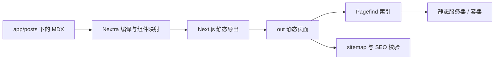

export const metadata = {
  title: '基于 Next.js App Router 与 Nextra 4 构建静态博客',
  description: '记录基于 Next.js App Router 与 Nextra 4 搭建个人静态博客的工程方案，包括 MDX 组件注入、Pagefind 离线检索、Sitemap 自动化生成与 Docker 多阶段构建。',
  date: '2025-01-28',
  category: '建站与专题',
  readingTime: '9 分钟',
  alternates: { canonical: '/posts/nextra-blog-setup' },
  openGraph: {
    type: 'article',
    title: '基于 Next.js App Router 与 Nextra 4 构建静态博客',
    description: '记录基于 Next.js App Router 与 Nextra 4 搭建个人静态博客的工程方案，包括 MDX 组件注入、Pagefind 离线检索、Sitemap 自动化生成与 Docker 多阶段构建。',
    url: '/posts/nextra-blog-setup', images: ['/og-image.png'] },
  twitter: {
    card: 'summary_large_image',
    title: '基于 Next.js App Router 与 Nextra 4 构建静态博客',
    description: '记录基于 Next.js App Router 与 Nextra 4 搭建个人静态博客的工程方案，包括 MDX 组件注入、Pagefind 离线检索、Sitemap 自动化生成与 Docker 多阶段构建。', images: ['/og-image.png'] },
}

## 读完你能做什么

- 解释 MDX 文件如何经过 Next.js 与 Nextra 生成静态页面。
- 配置组件映射、全文检索、站点地图和静态导出。
- 用生产构建而不是开发服务器验证真实部署产物。



建站流程应围绕最终产物设计。开发模式只证明页面能热更新，`pnpm build` 才能同时暴露 MDX 编译、静态路由、索引与部署配置问题。

在个人技术博客的技术选型中，静态站点生成（SSG）通常能带来较低的服务器成本与较好的访问体验。

Nextra 4 支持 Next.js App Router，允许直接将 `app/posts/<slug>/page.mdx` 映射为标准页面路由。本文梳理从 MDX 渲染、Pagefind 静态检索到 Docker 容器化打包的完整搭建流程。

---

## 博客架构拓扑

2026-10-17 按实际仓库重新核对了本文配置。可复核的基线是本站仓库 [4a22956](https://github.com/ljh12138164/blog/tree/4a22956188dcbac6cd77dd152a6c1a025d748650)，不是一个独立的教程 demo。后续域名切换以仓库当前 `site.config.json` 为准。

| 项目 | 核对的版本或入口 |
| --- | --- |
| 框架 | Next.js 16.0.7、React 19.1.0、Nextra 4.6.1 |
| 包管理与检索 | pnpm 9.12.3、Pagefind 1.5.2、next-sitemap 4.2.3 |
| 容器 | Node 22 Alpine 构建，Nginx 1.29 Alpine 运行，容器端口 8080 |
| 实际配置 | [package.json](https://github.com/ljh12138164/blog/blob/4a22956188dcbac6cd77dd152a6c1a025d748650/package.json)、[Dockerfile](https://github.com/ljh12138164/blog/blob/4a22956188dcbac6cd77dd152a6c1a025d748650/Dockerfile)、[部署文档](https://github.com/ljh12138164/blog/blob/4a22956188dcbac6cd77dd152a6c1a025d748650/docs/deployment.md) |

这里的版本表描述这次核对范围，不代表推荐读者长期停留在这些版本。复现旧提交与新建生产站点的依赖维护是两件事。

```text
app/posts/<slug>/page.mdx (MDX 文章源码)
  │
  ▼ Next.js 静态编译 (next build / output: 'export')
out/ 静态站点产物 (HTML + JS + CSS)
  │
  ├─► npx pagefind --site out ──► 生成 WebAssembly 离线全局搜索索引
  ├─► npx next-sitemap ────────► 生成 sitemap.xml 与 robots.txt
  │
  ▼ Docker 多阶段打包 (Node 构建 -> Nginx Alpine 静态服务)
输出静态服务镜像 blog:sha-<commit>（体积需按实际构建测量）
```

---

## 关键工程配置实战

### 1. `next.config.ts` 配置

这一段只说明静态导出开关；本站完整配置还包含 Nextra 与资源处理，不能直接用这段覆盖仓库文件。

```ts
import nextra from 'nextra';

const withNextra = nextra({
  // 启用静态图片优化与提取
  staticImage: true,
});

export default withNextra({
  // 关键：导出为纯静态 HTML/CSS 资产
  output: 'export',
  images: {
    unoptimized: true, // 静态导出需禁用服务端图片动态压缩
  },
});
```

### 2. MDX 自定义组件映射 (`mdx-components.tsx`)

在根目录下创建 `mdx-components.tsx`，统一拦截 Markdown 标签并赋予交互能力：

这是最小映射示意。本站实际还会注入文章容器、目录和代码块组件，完整入口见 [mdx-components.tsx](https://github.com/ljh12138164/blog/blob/4a22956188dcbac6cd77dd152a6c1a025d748650/mdx-components.tsx)。

```tsx
import type { MDXComponents } from 'mdx/types';

export function useMDXComponents(components: MDXComponents): MDXComponents {
  return {
    ...components,
    // 为代码块添加复制按钮与优雅样式
    pre: ({ children, ...props }) => (
      <pre className="relative overflow-x-auto rounded-xl bg-gray-900 p-4 text-sm" {...props}>
        {children}
      </pre>
    ),
  };
}
```

### 3. `next-sitemap.config.cjs` 自动化 SEO

下面保留本站地图配置的必要部分：从 `site.config.json` 读取域名，设置 `generateIndexSitemap: false`，最终只输出一份 `sitemap.xml`。仓库完整文件还包含页面权重与 robots 策略。

```js
/** @type {import('next-sitemap').IConfig} */
const siteConfig = require('./site.config.json');

module.exports = {
  siteUrl: siteConfig.url,
  generateRobotsTxt: true,
  generateIndexSitemap: false,
  outDir: 'out',
};
```

---

## 生产级 Docker 多阶段构建 (`Dockerfile`)

当前多阶段构建的关键部分如下：使用 Node 22、固定 pnpm 9.12.3 和端口 8080，并复制 Early Hints 映射。健康探针在容器本地访问 `/healthz`。运行环境仍依赖 Docker、端口映射及宿主反向代理；镜像不会替你配置域名和证书。

```dockerfile
# 阶段一：依赖安装与构建
FROM node:22-alpine AS builder
RUN corepack enable && corepack prepare pnpm@9.12.3 --activate
WORKDIR /app

COPY package.json pnpm-lock.yaml ./
RUN pnpm install --frozen-lockfile

COPY . .
# 执行静态构建与索引生成
RUN pnpm build

# 阶段二：生产 Nginx 极简镜像
FROM nginx:1.29-alpine AS runner
WORKDIR /usr/share/nginx/html

# 仅拷贝构建产物
COPY --from=builder /app/out ./
COPY deploy/nginx.conf /etc/nginx/conf.d/default.conf
COPY --from=builder /app/.next/early-hints-map.conf /etc/nginx/conf.d/early-hints-map.conf

EXPOSE 8080
HEALTHCHECK --interval=10s --timeout=3s --start-period=5s --retries=3 \
  CMD wget -q -O /dev/null http://localhost:8080/healthz || exit 1
CMD ["nginx", "-g", "daemon off;"]
```

---

## 官方资料

- [Nextra：Getting Started](https://nextra.site/docs)

## 怎样复现和判断结果

先检出上述基线，避免把后续改动误认成本文结果。复现需要能安装锁文件中的依赖；构建时还可能获取外部资源，网络失败应单独排查。

```bash
git clone https://github.com/ljh12138164/blog.git
cd blog
git checkout 4a22956188dcbac6cd77dd152a6c1a025d748650
corepack enable
corepack prepare pnpm@9.12.3 --activate
pnpm install --frozen-lockfile
pnpm typecheck
pnpm build
pnpm test:unit
pnpm test:resource-hints
```

`postbuild` 在 Next.js 导出之后运行 RSS、llms 文本、Pagefind、sitemap 和 SEO 校验，再生成 Early Hints、Service Worker 与预压缩文件。判断完成不能只看 Next.js 的路由表：还应检查 `out/index.html`、`out/_pagefind/pagefind.js`、`out/sitemap.xml`、`out/robots.txt` 和 `.next/early-hints-map.conf`。详细顺序以 `package.json` 为准。

本站的 [资源提示测试](https://github.com/ljh12138164/blog/blob/4a22956188dcbac6cd77dd152a6c1a025d748650/scripts/resource-hints.test.mjs)会检查第三方域名只做 DNS 预解析，并核对 HTML 与 Early Hints。它验证产物契约，不测量访客的 LCP，也不能证明 Cloudflare 每次都会返回 103。本文没有附可重复的镜像大小或访问速度采样，因此不提供固定体积、加载提速百分比或高可用承诺。

## 方案取舍与失败边界

- 仅运行开发服务器不足以验证：Pagefind 和 sitemap 在 `postbuild` 生成，开发模式下搜索正常或页面正常都不能代替完整导出检查。
- 只改页面 canonical 不够：发布脚本也断言正式域名；两者不一致会触发部署失败。域名切换必须同步生成文件、发布断言与旧站跳转，源站证书域名则按实际回源配置保留。
- 浮动 `pnpm@latest` 不适合复现：本文最初的示例使用浮动版本，本次已按实际文件修正为固定包管理版本并使用锁文件。
- 静态导出适合本站的公开文章。依赖按用户请求读取 Cookie、鉴权或动态数据库的功能需要独立服务；不能把这些运行时能力写进 MDX 就期待 Nginx 执行。

## 工程经验小结

纯静态博客架构免除了服务端进程常驻的运维与安全负担。

但在配置 Next.js `output: 'export'` 时，所有依赖服务端的运行时特性（如动态服务端重定向、Cookie 读取、服务端 Header 处理）都无法生效，必须转由构建期脚本或 Nginx/CDN 边缘规则接管。

另外，每次新增文章或修改元数据后，应保证本地能跑通完整构建与 SEO 校验脚本（如 `pnpm build` 与 `verify-seo.mjs`），避免将损坏的路由或缺失的 Frontmatter 推送到生产环境。
