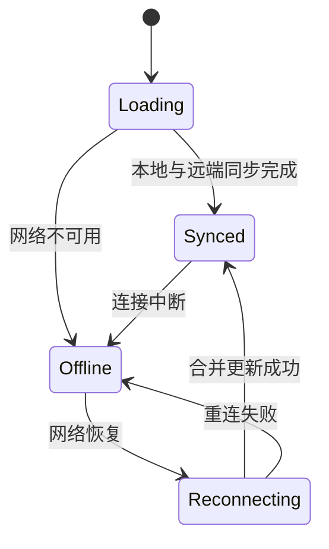

export const metadata = {
  title: '企业级云端协同笔记系统架构设计：从状态同步机、目录树到版本快照回滚',
  description: '全面解析实时协同文档系统的全栈工程架构：涵盖 Yjs 状态同步状态机、千万级文档虚拟目录树、多租户权限控制与历史版本快照差异比对。',
  date: '2025-02-14',
  category: '系统架构',
  readingTime: '10 分钟',
  alternates: { canonical: '/posts/note-collaboration-system' },
  openGraph: {
    type: 'article',
    title: '企业级云端协同笔记系统架构设计：从状态同步机、目录树到版本快照回滚',
    description: '全面解析实时协同文档系统的全栈工程架构：涵盖 Yjs 状态同步状态机、千万级文档虚拟目录树、多租户权限控制与历史版本快照差异比对。',
    url: '/posts/note-collaboration-system',
  },
  twitter: {
    card: 'summary',
    title: '企业级云端协同笔记系统架构设计：从状态同步机、目录树到版本快照回滚',
    description: '全面解析实时协同文档系统的全栈工程架构：涵盖 Yjs 状态同步状态机、千万级文档虚拟目录树、多租户权限控制与历史版本快照差异比对。',
  },
}

## 读完你能做什么

- 把文档内容同步、目录组织、在线感知与历史版本拆成独立子系统。
- 用状态机描述首次加载、离线编辑、重连同步和冲突收敛。
- 为权限、持久化与快照分别定义数据边界和恢复路径。



协同系统不能只画“客户端连 WebSocket”。真正需要设计的是连接断开后仍能编辑、恢复后如何合并、持久化失败怎样告警，以及权限变化何时生效。

随着远程办公与知识管理的普及，现代团队对“云端协同笔记”的要求不再局限于单机 Markdown 编辑，而是要求具备**类似 Notion 的实时多人协同、毫秒级状态同步、多层级无限树状知识库、细粒度权限控制与历史快照回滚**能力。

本文分享一套完整的协同笔记系统全栈架构设计与核心技术实现。

---

## 系统全景分层架构

```text
┌────────────────────────────────────────────────────────┐
│ 前端展现层 (Vue 3 / React + TailwindCSS + Pinia/Zustand)│
│  ├── 知识库无限虚拟目录树 (Virtual Tree)                │
│  ├── Tiptap 富文本 / Block 块级编辑器容器               │
│  └── 协同光标与在线感知头像条 (Awareness Avatars)        │
├────────────────────────────────────────────────────────┤
│ 协同与通信层 (Yjs + WebSocket + Hocuspocus Client)     │
│  ├── 协同同步状态机 (Sync State Machine)                │
│  ├── 离线持久化适配器 (IndexedDB Provider)              │
│  └── 冲突自动合并引擎 (CRDT YATA Engine)                │
├────────────────────────────────────────────────────────┤
│ 服务端核心中台 (Hocuspocus Server + Node.js / Hono)     │
│  ├── 房间会话管理与 WebSocket 广播 (Pub/Sub)            │
│  ├── JWT 多租户权限与文档读写隔离                      │
│  └── 自动去抖与增量快照引擎 (Snapshot Worker)           │
├────────────────────────────────────────────────────────┤
│ 持久化存储层 (PostgreSQL + S3 对象存储 + Redis)         │
│  ├── PostgreSQL: 文档元数据、目录关系、用户权限 RBAC    │
│  ├── S3 存储桶: 历史版本全量快照、图片与附件            │
│  └── Redis: 分布式在线状态与心跳缓存                   │
└────────────────────────────────────────────────────────┘
```

---

## 核心设计一：文档协同状态机（Sync State Machine）

为了让用户清晰感知当前网络的连接与同步状态，客户端抽象了严谨的状态机流转：

```text
[未连接 DISCONNECTED]
  │
  ▼ 发起 WebSocket 连接
[连接中 CONNECTING]
  │
  ▼ 握手与鉴权成功
[同步中 SYNCING] ──► 从服务端拉取初始缺失的 Yjs Updates
  │
  ▼ 同步完成
[已同步 SYNCED] ◄───► [有本地未保存更改 SAVING]
  │
  ▼ 遭遇弱网/断网
[离线编辑 OFFLINE] ──► 自动存入本地 IndexedDB，重连后自动合并
```

### 状态机接口定义与 Pinia 状态管理

```ts
export type SyncStatus = 'disconnected' | 'connecting' | 'syncing' | 'synced' | 'saving' | 'offline';

export interface DocumentState {
  id: string;
  title: string;
  syncStatus: SyncStatus;
  onlineUsers: Array<{
    id: string;
    name: string;
    avatar: string;
    color: string;
  }>;
  isReadOnly: boolean;
}
```

---

## 核心设计二：离线优先（Offline-First）双 Provider 架构

为了实现即使在飞机上、地铁断网时也能流畅写作，系统同时挂载了 **IndexedDB Provider** 与 **WebSocket Provider**：

```ts
import * as Y from 'yjs';
import { IndexeddbPersistence } from 'y-indexeddb';
import { HocuspocusProvider } from '@hocuspocus/provider';

export function createCollaborativeDoc(docId: string, token: string) {
  const ydoc = new Y.Doc();

  // 1. 本地秒开：优先从浏览器的 IndexedDB 秒级加载文档内容
  const idbProvider = new IndexeddbPersistence(`note-doc-${docId}`, ydoc);

  idbProvider.on('synced', () => {
    console.log('本地 IndexedDB 已完成加载，页面可立即交互');
  });

  // 2. 云端连接：在后台并发建立 WebSocket 长连接
  const wsProvider = new HocuspocusProvider({
    url: 'wss://collab.example.com',
    name: docId,
    document: ydoc,
    token,
  });

  return { ydoc, idbProvider, wsProvider };
}
```

---

## 核心设计三：版本快照与差异回滚（Version Snapshots & Diff）

协同系统中不能简单通过 Git 提交来存版本，而是通过记录 Yjs 的版本向量快照：

1. **自动打点**：每当协作者停止输入超过 5 分钟，或重大里程碑（如手动点击“创建版本”）时，服务端触发快照提取；
2. **状态提取**：调用 `Y.encodeSnapshot(Y.snapshot(ydoc))` 生成轻量级快照二进制；
3. **差异比对**：利用 `Y.createDocFromSnapshot(ydoc, snapshot)` 重建历史版本的只读文档，并在前端高亮展示增删对比；
4. **一键回滚**：将选定历史快照的数据作为新事务提交至当前 Y.Doc，实现无冲突、不丢历史记录的安全回滚。

---

## 官方资料

- [Yjs：Provider 与持久化生态](https://docs.yjs.dev/ecosystem/connection-provider)

## 自检：把知识变成判断

断网编辑、重连、权限撤销和持久化失败四个场景是否都有明确状态与恢复策略？

## 总结

* **架构核心**：通过 **Yjs CRDT + IndexedDB + WebSocket** 实现真正的离线优先与毫秒级协同。
* **可靠性基石**：严格的状态机流转让网络中断、重连与冲突解决对用户完全透明且可感知。
* **业务扩展**：基于快照机制与树状层级设计，能轻松支撑从个人知识库到万人团队的知识中台演进。
