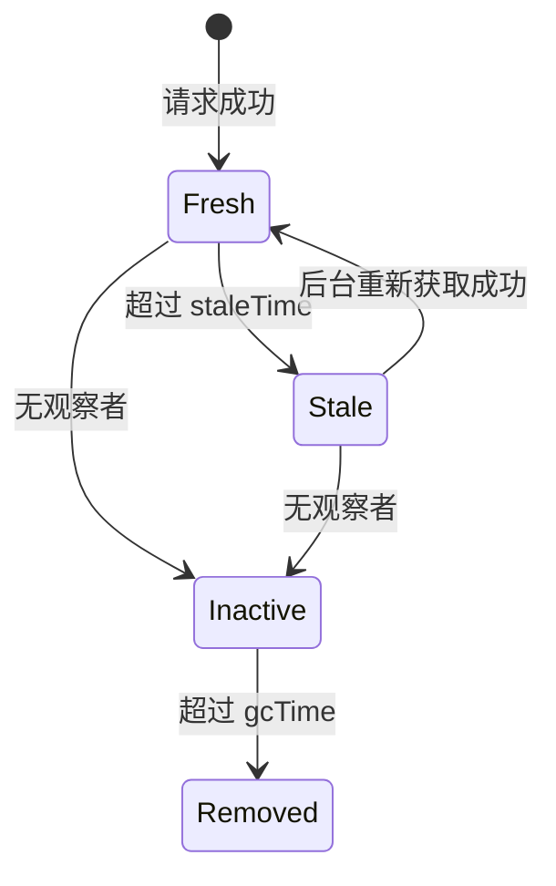

export const metadata = {
  title: 'TanStack Query (React Query) 架构与性能优化实战：请求去重、缓存分层与数据预取',
  description: '全面剖析 TanStack Query 服务端状态管理哲学：对比传统 Axios 封装，详解 QueryKey 缓存分层、并发请求自动合并去重、乐观更新与预取机制。',
  date: '2025-01-28',
  category: 'React 进阶',
  readingTime: '9 分钟',
  alternates: { canonical: '/posts/react-query-api-optimization' },
  openGraph: {
    type: 'article',
    title: 'TanStack Query (React Query) 架构与性能优化实战：请求去重、缓存分层与数据预取',
    description: '全面剖析 TanStack Query 服务端状态管理哲学：对比传统 Axios 封装，详解 QueryKey 缓存分层、并发请求自动合并去重、乐观更新与预取机制。',
    url: '/posts/react-query-api-optimization',
  },
  twitter: {
    card: 'summary',
    title: 'TanStack Query (React Query) 架构与性能优化实战：请求去重、缓存分层与数据预取',
    description: '全面剖析 TanStack Query 服务端状态管理哲学：对比传统 Axios 封装，详解 QueryKey 缓存分层、并发请求自动合并去重、乐观更新与预取机制。',
  },
}

## 读完你能做什么

- 区分请求函数、服务端状态缓存与客户端 UI 状态。
- 为 Query Key、`staleTime` 和 `gcTime` 建立可预测的规则。
- 安全实现预取、失效与乐观更新，并在失败时回滚。



Axios 负责“怎样发请求”，TanStack Query 负责“何时请求、结果缓存在哪里、何时视为过期”。两者并不竞争，职责边界清楚后配置才有意义。

在前端应用中，许多团队经常混淆 **客户端本地状态（Client State，如弹窗显隐、侧边栏折叠）** 与 **服务端状态（Server State，如用户列表、文章详情、订单流水）**。

传统使用 `useEffect + useState + axios` 获取数据时，不仅需要手写大量的 `isLoading`、`isError` 状态变量，更面临**重复请求泛滥、数据陈旧不同步、Tab 切换无缓存白屏**等问题。

**TanStack Query（React Query）** 重新定义了数据获取范式。本文详解其底层的缓存管理与性能优化精髓。

---

## Axios vs TanStack Query：职责边界划分

```text
┌──────────────────────────────────────────────────────────┐
│ TanStack Query (服务端状态中枢)                          │
│  ├── 智能内存缓存 (QueryCache) & 垃圾回收 (gcTime)        │
│  ├── 请求合并与去重 (Request Deduplication)              │
│  ├── 窗口聚焦 / 网络恢复自动静默刷新 (Refetch on Focus)   │
│  └── 乐观更新 (Optimistic UI) & 预取 (Prefetching)        │
├──────────────────────────────────────────────────────────┤
│ Axios / Fetch (底层 HTTP 通信管道)                      │
│  └── 仅负责发送 HTTP 报文、携带 Headers、处理拦截器      │
└──────────────────────────────────────────────────────────┘
```

> [!NOTE]
> **React Query 不是 Axios 的替代品，而是它的管理者**。React Query 负责调度“何时发起请求、何时复用缓存”，而具体的数据获取依然通过 Axios 或 `fetch` 执行。

---

## 核心优化一：QueryKey 与并发请求自动去重（Deduplication）

在复杂仪表盘（Dashboard）中，导航栏头像组件、侧边栏用户徽章组件和主内容区往往同时需要当前登录用户的信息：

```text
组件 A (NavBar)    ─── useQuery(['user', 'me']) ──┐
组件 B (SideBar)   ─── useQuery(['user', 'me']) ──┼──► 仅发出 1 次 HTTP 请求！
组件 C (MainPanel) ─── useQuery(['user', 'me']) ──┘    (其余组件共享同一 In-Flight Promise)
```

只要 `queryKey` 严格一致，TanStack Query 会在微任务级别**自动拦截并合并所有并发的相同请求**，避免后端被无意义的重复流量冲击。

---

## 核心优化二：深刻理解 `staleTime` 与 `gcTime`

很多开发者对 React Query 数据的“保鲜期”产生误解：

```text
数据生命周期时序:
  [数据获取成功] ────(staleTime: 5分钟)────► [数据变为 Stale 陈旧] ────(gcTime: 10分钟)────► [内存回收]
       │                                            │
       ▼                                            ▼
  在此期间重新挂载组件:                      在此期间重新挂载组件:
  直接读取内存缓存，不发起任何网络请求       先展示缓存(0等待)，同时后台静默发请求刷新
```

* **`staleTime`（数据保鲜期）**：默认是 `0`。在 `staleTime` 内，组件重新渲染或再次挂载直接使用缓存，**绝不发请求**；
* **`gcTime`（垃圾回收时间，v4 称 cacheTime）**：默认是 `5 分钟`。当没有任何组件在使用这个 query 时，数据会在内存中保留指定时间后被清除。

### 推荐全局配置：

```ts
// lib/query-client.ts
import { QueryClient } from '@tanstack/react-query';

export const queryClient = new QueryClient({
  defaultOptions: {
    queries: {
      staleTime: 1000 * 60 * 2, // 2 分钟内数据视为最新，避免频繁抖动
      gcTime: 1000 * 60 * 10,   // 闲置 10 分钟后释放内存
      refetchOnWindowFocus: false, // 视业务需求决定切屏是否刷新
      retry: 2, // 失败重试 2 次
    },
  },
});
```

---

## 核心优化三：乐观更新（Optimistic Updates）提升操作手感

在点赞、收藏或状态切换等高频操作中，等待后端返回 200 再更新 UI 会给用户带来滞后感。

利用 `useMutation` 的 `onMutate`，我们可以在请求发出瞬间直接修改本地缓存：

```tsx
const queryClient = useQueryClient();

const mutation = useMutation({
  mutationFn: (newTodo: { text: string }) => axios.post('/api/todos', newTodo),
  
  // 1. 在请求发送前立即触发
  onMutate: async (newTodo) => {
    // 取消相关的在途查询，防止覆盖乐观数据
    await queryClient.cancelQueries({ queryKey: ['todos'] });

    // 保存先前的快照用于回滚
    const previousTodos = queryClient.getQueryData(['todos']);

    // 乐观地直接更新本地缓存
    queryClient.setQueryData(['todos'], (old: any) => [...old, { id: 'temp-id', ...newTodo }]);

    return { previousTodos };
  },

  // 2. 若接口报错，秒级回滚到旧快照
  onError: (err, newTodo, context) => {
    queryClient.setQueryData(['todos'], context?.previousTodos);
    toast.error('添加失败，已回滚');
  },

  // 3. 无论成功失败，最后重新与服务端同步一次
  onSettled: () => {
    queryClient.invalidateQueries({ queryKey: ['todos'] });
  },
});
```

---

## 官方资料

- [TanStack Query：Important Defaults](https://tanstack.com/query/latest/docs/framework/react/guides/important-defaults)

## 自检：把知识变成判断

相同 Query Key 是否代表相同数据？乐观更新失败时是否能恢复快照并重新验证服务端状态？

## 总结

* **告别手动状态管理**：消除 80% 的样板代码（`useEffect` + `setLoading`）。
* **极速响应与去重**：自动请求合并与缓存分层让页面拥有“桌面级”切换响应速度。
* **极致用户体验**：结合乐观更新，让网络应用交互获得本地应用般的即时反馈。
