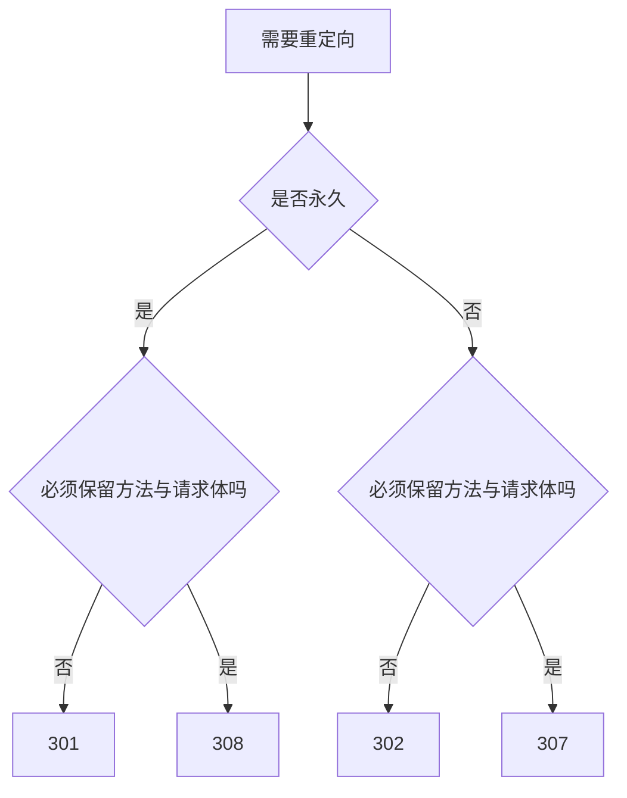

export const metadata = {
  title: 'HTTP 重定向状态码选型：301、302、307 与 308 对比',
  description: '对比 301、302、307 与 308 重定向状态码的语义差异，分析 POST 方法重写为 GET 的历史背景、搜索引擎权重继承机制与配置实践。',
  date: '2025-01-31',
  category: '网络与 SEO',
  readingTime: '8 分钟',
  alternates: { canonical: '/posts/redirect-status-codes-seo' },
  openGraph: {
    type: 'article',
    title: 'HTTP 重定向状态码选型：301、302、307 与 308 对比',
    description: '对比 301、302、307 与 308 重定向状态码的语义差异，分析 POST 方法重写为 GET 的历史背景、搜索引擎权重继承机制与配置实践。',
    url: '/posts/redirect-status-codes-seo', images: ['/og-image.png'] },
  twitter: {
    card: 'summary_large_image',
    title: 'HTTP 重定向状态码选型：301、302、307 与 308 对比',
    description: '对比 301、302、307 与 308 重定向状态码的语义差异，分析 POST 方法重写为 GET 的历史背景、搜索引擎权重继承机制与配置实践。', images: ['/og-image.png'] },
}

## 读完你能做什么

- 同时根据永久性与请求方法是否保留选择 301、302、307 或 308。
- 为域名迁移、HTTP 到 HTTPS 和临时维护设计正确跳转。
- 用状态码、Location、重定向链和 canonical 验证 SEO 配置。



选型时先回答两个问题：跳转是永久还是临时？原请求的方法与请求体是否必须保留？SEO 是重要结果，但不能覆盖 HTTP 语义和业务安全。

在 Web 开发中，重定向常用于域名迁移、规范化 URL（Canonicalization）以及路由兼容。

面对 `301 Moved Permanently`、`302 Found`、`307 Temporary Redirect` 和 `308 Permanent Redirect` 这四个常见状态码，不同状态码在浏览器对请求方法的篡改行为、缓存机制以及搜索引擎权重继承上各有差异。

本文梳理 30X 系列状态码的历史演进与选型场景。

---

## 30X 状态码演进与四大核心区别

```text
HTTP/1.0 规范历史包袱:
  [客户端发出 POST] ──301/302 重定向──► [旧浏览器擅自将重定向请求篡改为 GET！]

HTTP/1.1 严格定义补充:
  - 307 (临时重定向): 严禁改变请求方法 (POST 保持 POST)
  - 308 (永久重定向): 严禁改变请求方法 (POST 保持 POST)
```

### 核心对照矩阵

| 状态码 | HTTP 规范 | 性质 | 请求方法保留（POST/PUT） | 浏览器默认缓存 | 搜索引擎权重传递 |
| :--- | :--- | :--- | :--- | :--- | :--- |
| **`301`** | HTTP/1.0 | 永久移动 (Moved Permanently) | ⚠️ 常见浏览器会篡改为 GET | ✅ 强缓存（需显式设置） | 向搜索引擎传递永久迁移信号 |
| **`302`** | HTTP/1.0 | 临时移动 (Found) | ⚠️ 常见浏览器会篡改为 GET | ❌ 不缓存 | ❌ **不传递权重**（保留原 URL） |
| **`307`** | HTTP/1.1 | 临时重定向 (Temporary Redirect) | ✅ **严格保持原 Method 与 Body** | ❌ 不缓存 | ❌ 不传递权重 |
| **`308`** | HTTP/1.1 | 永久重定向 (Permanent Redirect) | ✅ **严格保持原 Method 与 Body** | ✅ 强缓存 | ✅ **完整传递权重** |

---

## 深入机制一：POST 变 GET 的历史 Bug 与解决方案

在早期 HTTP/1.0 时代，当客户端向 `/submit-order` 发送 `POST` 请求而服务器返回 `301` 或 `302` 时，几乎所有主流浏览器都会自动把随后的重定向请求强制转为 `GET /new-order`，导致原本携带在 Request Body 中的 JSON 或表单数据完全丢失。

为了解决这个问题：
* **如果是临时重定向且涉及非幂等请求（POST / PUT / DELETE）**：请务必使用 **`307`**；
* **如果是永久重定向且涉及 API 接口变更**：请务必使用 **`308`**。

---

## 深入机制二：SEO 权重传递与 302 网址劫持风险

### 1. 权重传递（Link Equity / PageRank）
* **301 / 308**：告知 Google / 百度爬虫“旧页面已永久失效，请将旧 URL 积累的所有排名、外链和权重完全转移给新 URL，并在搜索索引中用新 URL 替代旧 URL”。
* **302 / 307**：爬虫认为旧页面只是临时维护，因此**继续保留旧 URL 在搜索结果中**。

### 2. 警惕 302 网址劫持（302 Hijacking）
由于 302 临时重定向不会更新索引，历史上常有黑帽 SEO 做法：
* 攻击者建立高权重域名 A，通过 302 重定向到你的原创内容页面 B；
* 搜索引擎抓取到 B 的优质内容，却错误地把搜索结果的标题和点击跳转归属在域名 A 旗下；
* **防御建议**：所有长期固定的页面迁移、HTTP 强制跳 HTTPS、非 www 跳转 www 等，**一律使用 301 或 308**。

---

## 生产环境重定向实践配置（Nginx / Next.js）

### 1. Next.js `next.config.ts` 中的标准配置

```ts
import type { NextConfig } from 'next';

const nextConfig: NextConfig = {
  async redirects() {
    return [
      // 永久 URL 结构迁移：设置 permanent: true (Next.js 默认输出 308)
      {
        source: '/old-blog/:slug',
        destination: '/posts/:slug',
        permanent: true, // 输出 308 Permanent Redirect，保障 SEO
      },
      // 临时活动页面跳转：设置 permanent: false (Next.js 默认输出 307)
      {
        source: '/campaign/spring',
        destination: '/campaign/2025',
        permanent: false, // 输出 307 Temporary Redirect
      },
    ];
  },
};

export default nextConfig;
```

### 2. Nginx 配置强制 HTTPS 与规范域名

```nginx
# 强制 HTTP 跳转 HTTPS (使用 301 永久重定向)
server {
    listen 80;
    server_name example.com www.example.com;
    return 301 https://example.com$request_uri;
}
```

---

## 官方资料

- [MDN：HTTP 重定向](https://developer.mozilla.org/docs/Web/HTTP/Guides/Redirections)

## 工程经验小结

重定向不仅关乎 HTTP 状态码的数值，还直接影响浏览器对请求方法的篡改行为以及缓存有效期。

对于涉及表单提交或非幂等操作的 API 接口，如果继续沿用传统的 301/302，部分老客户端会将 POST 转为 GET 导致请求体参数丢失，此时应使用语义明确的 308/307。

此外，301 与 308 默认具备强缓存特性，一旦误配置了永久重定向且被浏览器或 CDN 缓存，后续撤销和修复成本极高。在不确定迁移是否最终确立前，可以先用临时重定向进行灰度验证，待路径稳定后再调整为永久重定向。
