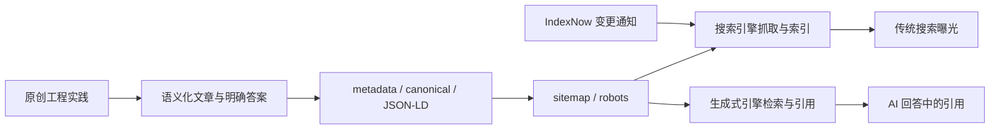
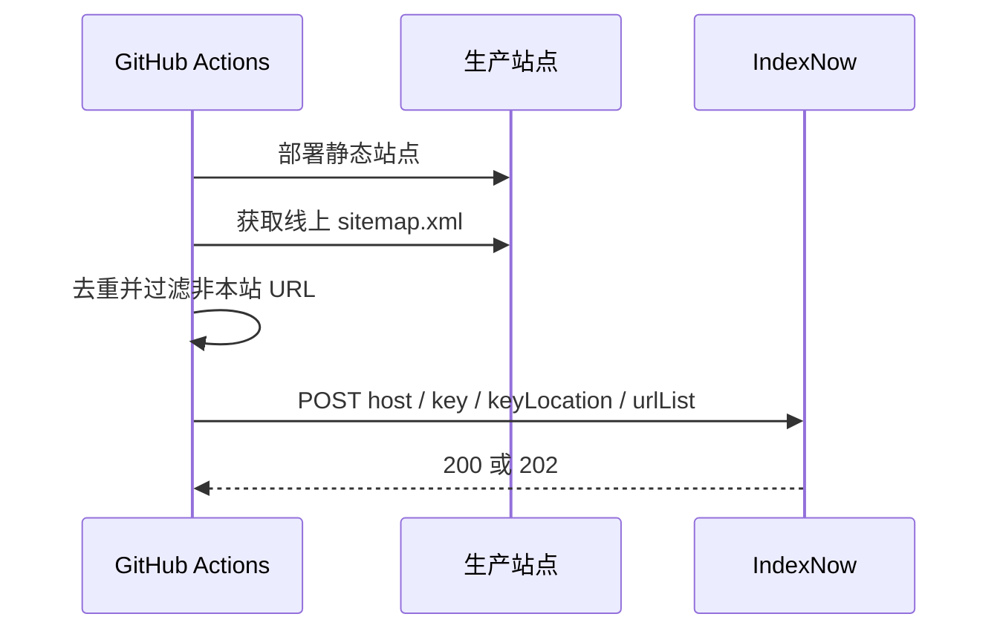

export const metadata = {
  title: '从 SEO 到 GEO：静态技术博客的可发现、可引用与 IndexNow 实践',
  description: '结合本站的 Next.js、Nextra、JSON-LD、sitemap、llms.txt 与 IndexNow 发布链路，说明如何同时优化传统搜索收录和生成式搜索引用。',
  date: '2026-08-29',
  category: '搜索与内容工程',
  readingTime: '16 分钟',
  alternates: { canonical: '/posts/seo-geo-indexnow' },
  openGraph: {
    type: 'article',
    title: '从 SEO 到 GEO：静态技术博客的可发现、可引用与 IndexNow 实践',
    description: '结合本站的 Next.js、Nextra、JSON-LD、sitemap、llms.txt 与 IndexNow 发布链路，说明如何同时优化传统搜索收录和生成式搜索引用。',
    url: '/posts/seo-geo-indexnow', images: ['/og-image.png'] },
  twitter: {
    card: 'summary_large_image',
    title: '从 SEO 到 GEO：静态技术博客的可发现、可引用与 IndexNow 实践',
    description: '结合本站的 Next.js、Nextra、JSON-LD、sitemap、llms.txt 与 IndexNow 发布链路，说明如何同时优化传统搜索收录和生成式搜索引用。', images: ['/og-image.png'] },
}

## 读完你能做什么

- 区分 SEO、GEO 与 IndexNow 各自在内容发现链路中的作用。
- 为 Next.js 静态博客建立可抓取、可理解、可引用的内容结构。
- 把 sitemap 与 IndexNow 接入发布流程，同时避开“提交即收录”和“`llms.txt` 能提升排名”这类误区。



先记住一条主线：**SEO 解决“页面能否被搜索系统发现、理解并呈现”，GEO 关注“内容能否在生成式回答里成为可靠来源”，IndexNow 只负责更及时地通知部分搜索引擎 URL 已经变化。**三者互相连接，但谁也不能代替优质内容和可抓取的页面。

---

## SEO 与 GEO 不是两套互相独立的工程

SEO（Search Engine Optimization）通常优化抓取、索引、页面理解和搜索结果点击。GEO（Generative Engine Optimization）则把目标延伸到 AI Overview、AI Mode、ChatGPT Search 等生成式搜索场景：系统不只返回链接，还会检索多个来源、综合答案并附上引用。

这并不意味着要抛弃 SEO。Google 明确说明，其生成式搜索仍建立在核心搜索排名与质量系统之上，页面首先要能被索引并允许展示摘要，才有资格进入相关生成式功能。Google 也把所谓 AEO/GEO 视为搜索体验优化的一部分，而不是一条独立的捷径。参见 [Google：为生成式 AI 搜索优化网站](https://developers.google.com/search/docs/fundamentals/ai-optimization-guide)。

可以把整个过程分成四层：

| 层级 | 要解决的问题 | 本项目的做法 |
| :--- | :--- | :--- |
| 发现 | 爬虫怎样知道页面存在或发生变化？ | 内部链接、单文件 `sitemap.xml`、IndexNow |
| 理解 | 页面主题、作者和规范 URL 是什么？ | metadata、canonical、语义化 HTML、JSON-LD |
| 选择 | 为什么搜索或 AI 系统应该采用这篇内容？ | 原创实践、清晰结论、边界条件、一手资料 |
| 转化 | 用户为什么愿意点击并继续阅读？ | 准确标题与摘要、快速页面、清楚的文章结构 |

优化顺序也应按这四层推进。没有稳定 canonical 和可抓取正文时，先做“让 AI 更容易引用”的花式格式，收益通常很有限。

## 第一层：让每篇文章只有一个明确身份

本站把正式域名集中在 `site.config.json`，由根布局的 `metadataBase`、文章 metadata、sitemap 和构建校验共同使用。每篇 MDX 文章导出标题、摘要、日期、分类、阅读时间、canonical、Open Graph 与 Twitter 字段：

```js
export const metadata = {
  title: '文章标题',
  description: '准确说明文章解决的问题与实践范围',
  date: '2026-08-29',
  category: '搜索与内容工程',
  readingTime: '12 分钟',
  alternates: { canonical: '/posts/example' },
  openGraph: {
    type: 'article',
    title: '文章标题',
    description: '与页面一致的公开摘要',
    url: '/posts/example',
  },
}
```

这里最重要的不是堆关键词，而是一致性：页面标题、公开摘要、分享卡片和 canonical 描述的是同一个内容实体。构建后的每个 HTML 还会经过 `scripts/verify-seo.mjs` 检查，确保只出现一个正式域名下的 canonical，避免 localhost、源站 IP 或重复 URL 分散信号。

文章正文由统一的 `Article` 组件渲染 metadata 中的 H1，MDX 从 H2 开始。这样既保持一个清晰的主标题，也形成对读者、屏幕阅读器和检索系统都友好的标题层级。Google 的建议同样是自然写作，用段落与小标题帮助人理解内容，而不是为了关键词制造大量近义页面。参见 [Google SEO 入门指南](https://developers.google.com/search/docs/fundamentals/seo-starter-guide)。

## 第二层：用结构化数据解释实体，而不是制造排名幻觉

根布局输出 `WebSite` 与 `Person`，文章组件再根据 metadata 输出 `TechArticle` 和 `BreadcrumbList`。其中包含：

- `headline`、`description`、`datePublished` 与 `dateModified`；
- 可唯一识别作者的名称、主页和 `sameAs`；
- `mainEntityOfPage`、文章分类与面包屑路径。

JSON-LD 的价值是给搜索系统明确线索，并让页面具备参与富媒体结果的条件；它不是排名保证。Google 目前为文章富媒体结果正式列出的类型是 `Article`、`NewsArticle` 与 `BlogPosting`。本站使用的 `TechArticle` 是 Schema.org 中更贴近技术文章的类型，但如果目标是严格贴合 Google 的 Article 富媒体文档，可以进一步评估改为 `BlogPosting` 或同时声明兼容类型。无论选择哪一种，结构化数据都必须和用户真正看见的内容一致。参见 [Google Article 结构化数据文档](https://developers.google.com/search/docs/appearance/structured-data/article) 与 [结构化数据通用规范](https://developers.google.com/search/docs/appearance/structured-data/sd-policies)。

作者实体对技术博客尤其重要。一个稳定的作者 URL、简介与外部身份链接，比在正文里反复写“专业”“权威”更可验证。发布日期和修改日期也应该表达真实变化；目前本站只维护一个 `date`，因此 `datePublished` 与 `dateModified` 相同。若以后频繁更新旧文，应该拆分 `date` 与 `updatedAt`，而不是每次改错别字都伪装成新文章。

## 第三层：把工程经验写成可引用的信息单元

GEO 真正增加的不是一个 meta 标签，而是一个新的内容质量问题：**当系统需要回答具体问题时，能否从这篇文章中提取一段有上下文、有证据、不过度承诺的答案？**

本站适合采用以下写法：

1. 开头先说明读者能完成什么，再给出整体链路。
2. 每一节只回答一个工程问题，标题使用真实问题中的术语。
3. 先给结论，再解释代码、取舍、失败经验和适用边界。
4. 对协议上限、支持范围等外部事实链接到一手资料。
5. 把“本项目做了什么”和“行业普遍规则是什么”分开写。

例如“IndexNow 最多接受多少 URL”是协议事实，应链接官方文档；“本站为什么在部署完成后读取线上 sitemap”则是本项目的工程决策，应展示流水线顺序和权衡。两者混在一起，读者和生成式系统都很难判断哪部分可以普遍复用。

GEO 的早期研究把“在生成式回答中的可见度”形式化，并观察到引用、统计数据和清晰表达等策略在不同主题上效果不同，但这类结果来自特定基准和生成式引擎，不能直接当作所有平台的排名公式。参见 KDD 2024 论文 [GEO: Generative Engine Optimization](https://arxiv.org/abs/2311.09735)。更稳妥的长期策略仍是：提供别人无法轻易复制的一手经验，让每个关键结论都能追溯到代码、数据或权威来源。

## `llms.txt`：可以保留，但不要当作 Google 排名按钮

本站的 `scripts/generate-llms.mjs` 会在构建后读取全部 MDX，生成两份文本：

- `llms.txt`：按分类列出文章标题、URL、摘要和日期；
- `llms-full.txt`：提供带 metadata 的完整 Markdown 正文合集。

脚本的核心逻辑可以直接展示在文章中。它遍历 `app/posts` 下的 MDX 文件，提取 metadata 和正文，再按日期排序并同时写入 `public` 与静态导出目录：

```js
const entries = fs.readdirSync(postsDir, { withFileTypes: true })
const posts = []

for (const entry of entries) {
  if (!entry.isDirectory()) continue

  const mdxPath = path.join(postsDir, entry.name, 'page.mdx')
  if (!fs.existsSync(mdxPath)) continue

  const rawContent = fs.readFileSync(mdxPath, 'utf-8')
  const meta = parseMetadata(rawContent)
  const body = cleanMarkdownBody(rawContent)

  if (meta.title) {
    posts.push({
      slug: entry.name,
      url: `${SITE_URL}/posts/${entry.name}`,
      ...meta,
      body,
    })
  }
}

posts.sort((a, b) => (b.date || '').localeCompare(a.date || ''))

const groups = {}
for (const post of posts) {
  const category = post.category || '综合'
  if (!groups[category]) groups[category] = []
  groups[category].push(post)
}

for (const [category, categoryPosts] of Object.entries(groups)) {
  llmsTxt += `### ${category}\n\n`
  for (const post of categoryPosts) {
    llmsTxt += `- [${post.title}](${post.url}): ${post.description} (发布日期: ${post.date})\n`
  }
}

for (const post of posts) {
  llmsFullTxt += `# ${post.title}\n\n`
  llmsFullTxt += `- **URL**: ${post.url}\n`
  llmsFullTxt += `- **发布日期**: ${post.date}\n`
  llmsFullTxt += `- **核心导读**: ${post.description}\n\n`
  llmsFullTxt += `## 正文内容\n\n${post.body}\n\n`
}

for (const directory of [publicDir, outDir]) {
  if (!fs.existsSync(directory)) continue
  fs.writeFileSync(path.join(directory, 'llms.txt'), llmsTxt, 'utf-8')
  fs.writeFileSync(path.join(directory, 'llms-full.txt'), llmsFullTxt, 'utf-8')
}
```

这里展示的是可读性更强的核心流程；仓库脚本还负责站点说明、文章分类、分隔符以及输出末尾规范化。把生成动作放在 `postbuild` 中，可以确保文章 metadata 或正文变化后，HTML、搜索索引和机器可读文本来自同一份 MDX 源码。

它们对支持这类文件的工具、人工导入知识库或批量检索很方便，也让内容拥有一个低噪声文本出口。但截至本文写作时，`llms.txt` 仍是[社区提案](https://llmstxt.org/)，不是 IETF 或 W3C 标准；Google 也明确表示其搜索与生成式搜索**不使用 `llms.txt` 作为特殊信号**，该文件不会提升或损害 Google 可见度。因此，本站把它视为实验性的分发接口，而不是 canonical、sitemap 或 HTML 正文的替代品。参见 [Google 生成式 AI 搜索指南中的误区说明](https://developers.google.com/search/docs/fundamentals/ai-optimization-guide#mythbusting-generative-ai-search-what-you-dont-need-to-do)。

对 ChatGPT Search，真正需要检查的是公开页面是否允许 `OAI-SearchBot` 访问。OpenAI 将搜索抓取与训练抓取区分开：希望内容出现在 ChatGPT 搜索摘要和引用中时，不应阻止 `OAI-SearchBot`；是否允许 `GPTBot` 用于潜在训练则可以单独决定。Anthropic 也分别提供 `Claude-SearchBot` 与 `ClaudeBot`。这说明“允许搜索引用”和“允许模型训练”是两个内容治理决定，不该绑成一个 GEO 开关。参见 [OpenAI 爬虫说明](https://developers.openai.com/api/docs/bots) 与 [Anthropic 爬虫说明](https://support.claude.com/en/articles/8896518-does-anthropic-crawl-data-from-the-web-and-how-can-site-owners-block-the-crawler)。

本站 `robots.txt` 当前使用 `User-agent: *` 允许正文路径，并排除构建资源目录，因此也允许遵守 robots 的搜索与训练爬虫。如果希望采用不同策略，应为各 user agent 分别配置；如果 Cloudflare Bot 管理或 WAF 另有拦截，仍需在边缘层单独核对。

## IndexNow：通知变化，不是申请排名

传统 sitemap 像一份长期维护的 URL 清单；IndexNow 更像发布完成后的变更通知。它允许站点在新增、更新、删除或重定向 URL 时主动通知参与该协议的搜索引擎。一次 POST 最多提交 10,000 个 URL，但成功响应只说明请求被接收，**不保证抓取、收录或排名**。参见 [IndexNow 协议文档](https://www.indexnow.org/documentation) 与 [IndexNow FAQ](https://www.indexnow.org/faq)。

Google 目前不在 [IndexNow 官方参与者清单](https://www.indexnow.org/searchengines.json)中，因此本站仍通过 sitemap 与 Search Console 服务 Google；IndexNow 主要覆盖 Bing、Naver、Seznam.cz 等参与者。不要用 IndexNow 替代 sitemap，二者解决的是“完整清单”和“及时变化”两个不同问题。

### 本项目的 IndexNow 发布链路

本站采用一个公开根密钥文件、一个零依赖 Node.js 脚本和 GitHub Actions：



提交体的核心结构如下：

```js
await fetch('https://api.indexnow.org/indexnow', {
  method: 'POST',
  headers: { 'Content-Type': 'application/json; charset=utf-8' },
  body: JSON.stringify({
    host: siteUrl.hostname,
    key,
    keyLocation: new URL(`/${key}.txt`, siteUrl.origin).href,
    urlList: urls,
  }),
})
```

这里有三个值得复用的细节：

- 密钥文件先随静态站点部署到域名根目录，再发通知，搜索引擎才能验证主机所有权。
- 脚本读取**线上** sitemap，而不是假设本地产物已经成功发布。
- 提交前只保留相同 origin 与站点路径下的 URL，并去掉 fragment，避免把错误域名或重复地址发给接口。

本站当前每次生产部署都会提交 sitemap 中的全部 URL。这对几十篇文章的小型站点实现简单，但比 IndexNow 建议的“只通知新增、更新和删除 URL”更宽。后续站点扩大时，应根据发布差异生成变更列表，并为 429 响应增加退避与可观察日志。完整 sitemap 继续负责长期发现，IndexNow 只负责变化加速。

## 用 Google 与 Bing 站长工具建立优化闭环

sitemap、IndexNow 和 metadata 解决的是“向搜索系统提供信号”，站长工具解决的是“确认系统实际看到了什么”。它们最有价值的用法不是每天点击“请求收录”，而是把发布、诊断、优化和复盘连成闭环。

### Google Search Console：服务 Google 抓取与自然搜索

首次接入时，优先创建覆盖整个域名及其子域的 **Domain property**，它只能通过 DNS 记录验证；如果只想观察 `https://blog.ljhboard.cn/` 这一前缀，也可以创建 URL-prefix property，并使用 HTML 文件、meta 标签等方式验证。本站代码中没有 Google 验证 meta 标签，不能据此判断后台是否已通过 DNS 验证。参见 [Google：添加 Search Console 资源](https://support.google.com/webmasters/answer/34592)。

完成验证后，按下面的顺序操作：

1. **提交 sitemap**：进入 Sitemaps，提交 `https://blog.ljhboard.cn/sitemap.xml`。这里不是把文件上传给 Google，而是告诉它文件位置，并观察读取时间、状态和解析错误。提交只是一条提示，不保证抓取或收录。参见 [Google：Sitemaps 报告](https://support.google.com/webmasters/answer/7451001)。
2. **检查新文章 URL**：把完整文章地址输入 URL Inspection，先看 Google 已索引版本，再运行 Live Test。重点核对页面能否抓取、是否允许索引、Google 选择的 canonical 是否与本站声明一致，以及结构化数据是否被识别。
3. **只对重要单页请求重新编入索引**：新文章或修复关键错误后，可以点击 Request indexing。它有配额，也不保证页面进入索引；多页面变化应依赖 sitemap 和准确的 `lastmod`，而不是逐页点击。参见 [Google：URL Inspection](https://support.google.com/webmasters/answer/9012289)。
4. **分析 Page indexing 的原因，而不是追求 100%**：优先处理重要 canonical 页面未收录、服务器错误、意外 `noindex` 或 robots 阻止。重定向页、重复页和正确的 alternate URL 不进入索引可能完全正常。参见 [Google：Page indexing 报告](https://support.google.com/webmasters/answer/7440203)。
5. **用 Performance 找内容机会**：按 Page 筛选一篇文章，再查看 Queries、Clicks、Impressions 与 CTR。高曝光低 CTR 往往需要检查标题和摘要是否准确；出现了相关查询却没有深入回答，则应补充内容。更应该观察数周趋势，而不是被某一天的平均排名牵着走。参见 [Google：Performance 常见任务](https://support.google.com/webmasters/answer/17010961)。
6. **用 Core Web Vitals 找模板级问题**：报告基于真实用户数据并按相似 URL 分组，适合发现一批文章共有的 LCP、INP 或 CLS 问题；单个页面的即时诊断再交给 PageSpeed Insights。参见 [Google：Core Web Vitals 报告](https://support.google.com/webmasters/answer/9205520)。

{/* screenshot-placeholder:start */}
> **📷 截图占位 01：Google URL Inspection**
>
> 图片放到 `public/images/posts/seo-geo-indexnow/google-search-console-url-inspection.webp` 后，将本段替换为：
>
> ``
>
> 建议截取索引状态、Google 选择的 canonical、抓取允许状态和 Live Test 入口。
{/* screenshot-placeholder:end */}

其他报告按需使用即可：Crawl Stats 更适合在 Googlebot 请求异常、主机不可用或出现大量 5xx 时排查，而不是几十页小站的日常排名仪表盘；Enhancements 只会显示 Google 支持且已经检测到的富媒体类型，报告缺席不等于所有 JSON-LD 都无效；本站也没有商品交易和 Product 数据，不需要为了出现 Merchant listings 报告而添加无关 schema。

{/* screenshot-placeholder:start */}
> **📷 截图占位 02：Search Performance 趋势**
>
> 图片放到 `public/images/posts/seo-geo-indexnow/google-search-console-performance.webp` 后，将本段替换为：
>
> ``
>
> 建议选中 Clicks、Impressions 与 CTR，并展示按 Page 或 Query 筛选后的趋势。
{/* screenshot-placeholder:end */}

对本站而言，发布一篇新文章后的最小操作是：确认 sitemap 已出现新 URL，用 URL Inspection 检查一次线上页面，然后等待 Page indexing 与 Performance 数据形成。不要因为当天没有数据就反复请求索引，Search Console 新资源和新页面的数据都可能延迟出现。

### Bing Webmaster Tools：服务 Bing、IndexNow 与 AI 引用观察

Bing 可以直接从已验证的 Google Search Console 导入站点和 sitemap，也可以手动添加。手动验证支持 XML 文件、meta 标签等方式；本站根布局已经输出 `msvalidate.01`，这是 Bing 的 HTML meta 验证方式，但最终是否验证成功仍应登录后台确认。参见 [Bing：添加并验证站点](https://www.bing.com/webmasters/help/add-and-verify-site-12184f8b)。

接入后可以按这条路径操作：

1. **Sitemaps 查看完整覆盖**：确认 Bing 能读取同一个 `sitemap.xml`，并检查状态和发现的 URL。即使 IndexNow 正常，也要保留 sitemap 作为长期 URL 清单。参见 [Bing：Sitemaps](https://www.bing.com/webmasters/help/sitemaps-3b5cf6ed)。
2. **URL Inspection 定位单页问题**：查看 Index、SEO 和 Markup 卡片，再用 Live URL 观察 Bingbot 实际下载到的页面。出现未收录时，先处理 robots、抓取错误、canonical 或内容问题，再考虑请求索引。参见 [Bing：URL Inspection](https://www.bing.com/webmasters/help/URL-Inspection-55a30305)。
3. **Site Scan 与 SEO Reports 检查模板**：重大改版、导航调整或 metadata 模板变化后，从 sitemap 或指定目录启动 Site Scan，集中发现重复标题、缺失描述、失效链接等技术问题；SEO Reports 则适合定期发现批量页面建议。它们是诊断工具，不是自动排名优化器。参见 [Bing：Site Scan](https://www.bing.com/webmasters/help/site-scan-623520c9)。
4. **Search Performance 观察搜索与抓取**：结合关键词和页面查看 clicks、impressions、CTR，同时关注 crawl requests、crawl errors 与 indexed pages。新接入站点可能要等待几天才出现数据。参见 [Bing：Search Performance](https://www.bing.com/webmasters/help/search-performance-c680da36)。
5. **IndexNow Insights 核对通知链路**：查看提交来源、最近 URL、抓取与收录数量、robots 阻止等问题，再用 URL Inspection 检查具体页面。它比只看脚本的 HTTP 200 更完整，但报告收到 URL 仍不等于页面已经收录。参见 [Bing：IndexNow Insights](https://blogs.bing.com/webmaster/March-2024/Optimize-your-Impact-with-IndexNow-Insights)。

{/* screenshot-placeholder:start */}
> **📷 截图占位 03：Bing IndexNow Insights**
>
> 图片放到 `public/images/posts/seo-geo-indexnow/bing-indexnow-insights.webp` 后，将本段替换为：
>
> ``
>
> 建议截取最近提交 URL、抓取与收录状态，以及需要处理的 robots 或 URL 错误。
{/* screenshot-placeholder:end */}

### 一套可持续的检查节奏

| 时机 | Google Search Console | Bing Webmaster Tools | 应采取的动作 |
| :--- | :--- | :--- | :--- |
| 首次接入 | 验证资源、提交 sitemap | 导入或验证站点、提交 sitemap | 确认正式域名和 sitemap 可访问 |
| 发布重要文章后 | URL Inspection + 必要时 Request indexing | URL Inspection + IndexNow 报告 | 先修抓取与 canonical，再等待数据 |
| 每周或每两周 | Performance、Page indexing | Search Performance | 找高曝光低 CTR、相关查询缺口与抓取异常 |
| 模板或导航改版后 | Core Web Vitals、重点 URL Live Test | Site Scan、Live URL | 修复影响一批页面的模板级问题 |

这套节奏把 SEO 与 GEO 放在同一个反馈循环中：**提交发现信号 → 检查抓取和 canonical → 分析曝光、点击与收录状态 → 修改真实内容或页面模板 → 再观察趋势。**站长工具提供的是诊断数据，不是“保证收录”按钮。

## 当前实现还有哪些真实缺口

一套可信的实践不应只写完成项。结合现有代码，本站接下来最值得补的不是更多 GEO 标签，而是这些数据准确性问题：

- **真实更新时间**：metadata 只有 `date`，导致 `datePublished` 与 `dateModified` 相同；应增加 `updatedAt`，并只在正文发生显著变化时更新。
- **可见作者与文章图片**：JSON-LD 已声明作者，但页面头部没有可见署名，Article 数据也没有代表性 `image`；补齐后应保持页面与结构化数据一致。
- **安全输出 JSON-LD**：当前直接使用 `JSON.stringify`，如果未来 metadata 来自不可信输入，应按 [Next.js JSON-LD 指南](https://nextjs.org/docs/app/guides/json-ld)转义 `<` 等危险字符。
- **准确的 sitemap `lastmod`**：`next-sitemap` 默认在每次构建时给全部 URL 写当前时间，这不等于文章真的更新；应从真实修改日期生成，无法保证准确时则不要输出。
- **只提交发生变化的 URL**：当前 IndexNow 全量提交是小站阶段的简单方案，长期应覆盖新增、显著更新、删除和重定向，而不是每次重发全部页面。

这些缺口不会让现有 SEO 与 GEO 基础失效，但会影响搜索系统判断“谁写的、何时更新、哪些 URL 真正变化”。修复它们比增加一份未经平台支持的 AI 专用标记更有确定性。

## 一套适合静态技术博客的优化顺序

如果从零开始，不要同时堆十种所谓 GEO 技巧。按依赖关系推进即可：

1. **先让页面可访问**：稳定正式域名、200 响应、移动端可读、正文不被 robots 或 WAF 误伤。
2. **再统一页面身份**：每页唯一标题、准确摘要、canonical、内部链接和 sitemap。
3. **再解释页面实体**：文章、作者、日期与面包屑 JSON-LD 和可见内容一致。
4. **再提高内容价值**：写真实项目过程、失败原因、代码与边界，引用一手来源。
5. **最后缩短发现延迟**：生产部署成功后提交 IndexNow，并在各搜索平台观察抓取与引用。

最终应分别观察三类结果：Search Console 中的抓取、索引和搜索表现；Bing Webmaster Tools 中的 IndexNow 接收与索引状态；生成式搜索带来的引用、推荐链接和实际访问。不要把 HTTP 200、某次 AI 回答或单个关键词排名当成优化已经完成。

## 工程经验小结

对这个静态博客而言，SEO 与 GEO 的共同底座已经非常具体：**单一正式域名、完整 metadata、语义化正文、作者与文章结构化数据、sitemap/robots、可追溯的一手实践和稳定的生产发布。**

`llms.txt` 可以作为额外的机器可读出口，但不应被包装成 Google 排名信号；IndexNow 可以缩短参与搜索引擎发现变化的时间，但不能替代 sitemap，更不能保证收录。真正难以被复制、也最值得持续投入的优化，是把每次真实工程决策写成清楚、准确、可验证、可引用的内容。
