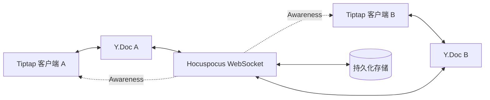

export const metadata = {
  title: '基于 Tiptap + Yjs + Hocuspocus 的企业级多人富文本协同架构实战',
  description: '详解现代协同编辑器全栈架构：从 Tiptap ProseMirror 节点与 Y.Doc 映射，到 Hocuspocus WebSocket 状态分发、实时光标感知与 Webhook 增量持久化。',
  date: '2025-01-26',
  category: '协同架构',
  readingTime: '9 分钟',
  alternates: { canonical: '/posts/tiptap-collaboration' },
  openGraph: {
    type: 'article',
    title: '基于 Tiptap + Yjs + Hocuspocus 的企业级多人富文本协同架构实战',
    description: '详解现代协同编辑器全栈架构：从 Tiptap ProseMirror 节点与 Y.Doc 映射，到 Hocuspocus WebSocket 状态分发、实时光标感知与 Webhook 增量持久化。',
    url: '/posts/tiptap-collaboration',
  },
  twitter: {
    card: 'summary',
    title: '基于 Tiptap + Yjs + Hocuspocus 的企业级多人富文本协同架构实战',
    description: '详解现代协同编辑器全栈架构：从 Tiptap ProseMirror 节点与 Y.Doc 映射，到 Hocuspocus WebSocket 状态分发、实时光标感知与 Webhook 增量持久化。',
  },
}

## 读完你能做什么

- 解释 Tiptap、ProseMirror、Yjs 与 Hocuspocus 各自负责哪一层。
- 接入文档同步与 Awareness 光标，同时避免把在线状态持久化进正文。
- 设计鉴权、断线重连和服务端持久化边界。



正文更新与在线光标是两类数据：Yjs 文档更新需要可靠同步和持久化，Awareness 是短暂状态，用户离线后应自然消失。

在研发类似 Notion、飞书文档的多人实时协作富文本系统时，**Tiptap**（基于 ProseMirror 的 Headless 编辑器框架）配合 **Yjs** 与 **Hocuspocus**，构成了目前生产环境中最成熟、扩展性最强的技术组合。

本文剖析 Tiptap 与 Yjs 的双向绑定机制、Hocuspocus 协同服务端的生命周期钩子，以及高可用数据持久化实践。

---

## 整体架构与数据流

```text
客户端 A (Tiptap)                  客户端 B (Tiptap)
  │                                    ▲
  ▼ Tiptap Transaction                 │ Yjs 远程 Update 自动应用
ProseMirror State                    ProseMirror State
  │                                    ▲
  ▼ 双向绑定                           │ 双向绑定
本地 Y.Doc (CRDT)                    本地 Y.Doc (CRDT)
  │                                    ▲
  ▼ HocuspocusProvider (WebSocket)     │ HocuspocusProvider
  └──────────────► Hocuspocus Server ──┘
                          │
                          ├─► Awareness 广播 (在线状态与协同彩色光标)
                          ├─► 二进制 CRDT 更新分发 (Y.encodeStateAsUpdate)
                          │
                          ▼ Webhook / Redis 扩展
                    后端数据库持久化 (PostgreSQL / S3)
```

---

## 前端集成：Tiptap 协同配置与彩色光标

### 1. 依赖安装

```bash
pnpm add @tiptap/react @tiptap/starter-kit @tiptap/extension-collaboration @tiptap/extension-collaboration-cursor @hocuspocus/provider yjs
```

### 2. 编辑器组件实现

```tsx
// components/CollaborativeTiptap.tsx
'use client';

import React, { useMemo } from 'react';
import { useEditor, EditorContent } from '@tiptap/react';
import StarterKit from '@tiptap/starter-kit';
import Collaboration from '@tiptap/extension-collaboration';
import CollaborationCursor from '@tiptap/extension-collaboration-cursor';
import { HocuspocusProvider } from '@hocuspocus/provider';
import * as Y from 'yjs';

interface Props {
  documentId: string;
  currentUser: { name: string; color: string };
  authToken: string;
}

export function CollaborativeTiptap({ documentId, currentUser, authToken }: Props) {
  // 1. 创建本地 Y.Doc 实例
  const ydoc = useMemo(() => new Y.Doc(), [documentId]);

  // 2. 初始化 Hocuspocus WebSocket Provider
  const provider = useMemo(() => {
    return new HocuspocusProvider({
      url: process.env.NEXT_PUBLIC_COLLAB_WS_URL || 'ws://localhost:1234',
      name: documentId,
      document: ydoc,
      token: authToken,
    });
  }, [documentId, ydoc, authToken]);

  // 3. 配置 Tiptap 编辑器扩展
  const editor = useEditor({
    extensions: [
      StarterKit.configure({
        // ⚠️ 必须禁用默认的本地历史记录，由 Yjs 接管撤销/重做 (UndoManager)
        history: false,
      }),
      Collaboration.configure({
        document: ydoc,
      }),
      CollaborationCursor.configure({
        provider,
        user: currentUser,
      }),
    ],
  });

  return (
    <div className="border rounded-xl p-6 min-h-[400px] shadow-sm">
      <div className="flex items-center justify-between pb-4 mb-4 border-b">
        <span className="text-sm text-gray-500">文档 ID: {documentId}</span>
        <div className="flex items-center gap-2">
          <span className="w-3 h-3 rounded-full" style={{ backgroundColor: currentUser.color }} />
          <span className="text-sm font-medium">{currentUser.name}</span>
        </div>
      </div>
      <EditorContent editor={editor} className="prose max-w-none focus:outline-none" />
    </div>
  );
}
```

---

## 服务端：Hocuspocus Server 扩展与数据落盘

Hocuspocus 提供了丰富的官方扩展（Extensions），支持身份校验、连接多路复用与数据库持久化：

```ts
// server/index.ts
import { Server } from '@hocuspocus/server';
import { Logger } from '@hocuspocus/extension-logger';
import { Database } from '@hocuspocus/extension-database';
import { pool } from './db'; // PostgreSQL 连接池

const server = Server.configure({
  port: 1234,
  extensions: [
    new Logger(),
    // 数据库持久化扩展
    new Database({
      // 1. 初次打开文档时从数据库加载 CRDT 二进制快照
      async fetch(data) {
        const result = await pool.query(
          'SELECT yjs_binary FROM documents WHERE id = $1',
          [data.documentName]
        );
        if (result.rows.length > 0 && result.rows[0].yjs_binary) {
          return new Uint8Array(result.rows[0].yjs_binary);
        }
        return null;
      },
      // 2. 协作者编辑产生增量时，自动去抖（Debounce）存入数据库
      async store(data) {
        const state = data.state; // 获取当前文档的 Yjs 二进制完整快照
        await pool.query(
          'UPDATE documents SET yjs_binary = $1, updated_at = NOW() WHERE id = $2',
          [Buffer.from(state), data.documentName]
        );
      },
    }),
  ],

  // 鉴权钩子
  async onAuthenticate(data) {
    const { token } = data;
    if (!token || !verifyJwt(token)) {
      throw new Error('鉴权未通过');
    }
  },
});

server.listen();
```

---

## 生产环境避坑指南

1. **撤销/重做（Undo/Redo）必须交由 Yjs 管理**：
   若保留 Tiptap 默认的 History 扩展，用户的 `Ctrl+Z` 会误删其他协作者刚刚键入的内容；必须关闭默认 History，由 `Collaboration` 扩展接管专属的本地编辑堆栈。
2. **Awareness（感知状态）的心跳与超时**：
   当用户突然断网或异常关闭标签页时，Awareness 协议会在 30 秒超时后自动清理残留的彩色光标，避免页面出现“僵尸光标”。
3. **数据快照压缩**：
   定期对长篇文档执行 `Y.encodeStateAsUpdate(ydoc)`，合并过往编辑碎片，可让文档加载体积减少 80% 以上。

---

## 官方资料

- [Tiptap：Collaboration](https://tiptap.dev/docs/editor/extensions/functionality/collaboration)

## 自检：把知识变成判断

正文更新与 Awareness 是否分开？断线重连后文档能收敛，离线用户光标又能及时消失吗？

## 总结

* **Tiptap + ProseMirror** 提供了极其灵活的富文本 DOM 渲染与 Schema 扩展机制；
* **Yjs + Hocuspocus** 以零冲突、低延迟的 CRDT 架构接管了复杂的数据分发与落盘；
* 两者结合是目前构建企业级文档协同系统的标准黄金搭档。
