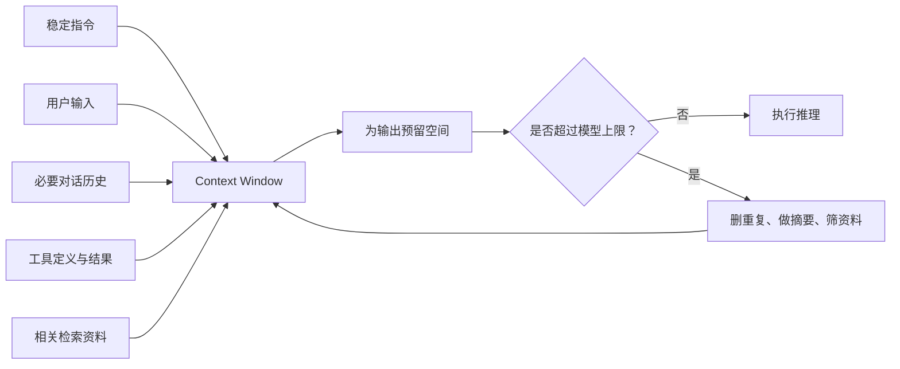

export const metadata = {
  title: 'Token 与 Context：模型究竟看见了什么？',
  description: '通过分词实验和上下文预算，理解 Token 如何影响输入限制、输出空间、成本与提示缓存。',
  date: '2026-08-19',
  category: 'AI 基础',
  readingTime: '8 分钟',
  alternates: { canonical: '/posts/token-and-context' },
  openGraph: { type: 'article', title: 'Token 与 Context：模型究竟看见了什么？', description: '通过分词实验和上下文预算，理解 Token 如何影响输入限制、输出空间、成本与提示缓存。', url: '/posts/token-and-context' },
  twitter: { card: 'summary', title: 'Token 与 Context：模型究竟看见了什么？', description: '通过分词实验和上下文预算，理解 Token 如何影响输入限制、输出空间、成本与提示缓存。' }
}

我们把文字发送给模型时，模型并不是直接按“一个汉字”或“一个单词”阅读。文本会先被编码成 Token；系统指令、历史消息、工具定义、文档和回答，也都要在有限的 Context 中共享空间。

理解这两个概念，能把很多模糊问题变成可以测量的工程问题：为什么请求变贵、为什么长对话开始丢信息、为什么输出空间突然不够，以及为什么只改提示词开头的一小段，缓存收益就下降了。

## 读完你能做什么

- 解释 Token 为什么不等于字符数或单词数。
- 对一次真实模型输入进行准确计数。
- 为输入与输出分配 Context 预算。
- 通过稳定前缀提高 Prompt Caching 的命中机会。

## Token：文字进入模型前的编码单位

Tokenizer 会把文本切成词表中已有的片段，再把每个片段映射成整数。片段可能是一个字符、一个词的一部分、一个完整单词，或者包含前导空格的组合。

因此：

- 同样的字符数，Token 数可能不同；
- 同一句文本，在不同编码或模型上可能不同；
- JSON、Markdown、代码和自然语言的切分方式也可能不同。

OpenAI 的[tiktoken 指南](https://developers.openai.com/cookbook/examples/how_to_count_tokens_with_tiktoken)展示了不同编码对同一文本的切分差异，并提醒空格通常会和后面的词一起编码。

先建立一个最重要的判断：

> Token 是编码结果，不是靠字符数就能稳定换算的自然语言单位。

  
停一下：1000 个汉字一定等于 1000 Token 吗？

  
<strong>答案：</strong>不一定。切分取决于目标模型使用的编码；标点、数字、英文和罕见字符也会改变结果。需要使用目标模型对应的计数方式。

## 实验一：数“实际请求”，不要只数字符串

对一段纯文本，本地 tokenizer 很方便；但真实请求还可能包含消息角色、内容边界、工具定义、图片或文件。OpenAI 的[Token counting 指南](https://developers.openai.com/api/docs/guides/token-counting)说明，服务端计数接口可以接收与 Responses API 相同的输入，并返回该输入的准确 Token 数。

~~~ts
import OpenAI from 'openai'

const client = new OpenAI()

const result = await client.responses.inputTokens.count({
  model: 'gpt-5.6',
  input: [
    {
      role: 'developer',
      content: '只依据用户提供的内容回答；不知道时明确说明。'
    },
    {
      role: 'user',
      content: '请用三句话解释 Token 与 Context 的关系。'
    }
  ]
})

console.log(result.input_tokens)
~~~

这个实验的重点不是记住某次输出的数字，而是保留方法：**构造与生产调用相同的输入，再计数。** 如果生产请求包含工具 schema，就不要只对用户那句话做本地编码后当成总输入。

本地 tokenizer 仍然适合快速比较两个纯文本版本，例如检查删掉重复说明后减少了多少 Token。到了最终预算和账单分析，再用实际请求与 API usage 校准。

## Context：一次推理可使用的工作区

Context window 可以理解为一次模型调用的总工作区。它通常要容纳：

这说明“模型支持很长上下文”不等于“可以把空间全部用来塞输入”。如果没有为输出预留空间，请求可能失败，或者无法生成你需要的完整答案。

可以在应用里显式计算预算：

~~~ts
type ContextBudget = {
  limit: number
  input: number
  reserveOutput: number
}

function inspectBudget(budget: ContextBudget) {
  const remaining =
    budget.limit - budget.input - budget.reserveOutput

  return {
    remaining,
    fits: remaining >= 0
  }
}

const budget = inspectBudget({
  limit: 128_000,
  input: 92_000,
  reserveOutput: 8_000
})

console.log(budget)
~~~

这里的数字只是演示预算关系，不代表某个具体模型的限制。生产代码应从你实际使用的模型配置中读取 limit，并用实际计数替换估算值。

  
主动回忆：输入没有超过 Context 上限，就一定合理吗？

  
<strong>答案：</strong>不一定。还要为输出预留空间，而且大量无关或重复内容会稀释关键信息、增加延迟与成本。能装下只是最低条件。

## 实验二：给上下文做一份预算表

假设一个客服助手需要这些内容：

| 内容 | 用途 | 处理策略 |
| --- | --- | --- |
| 稳定规则 | 定义任务和边界 | 保留，避免重复 |
| 工具定义 | 允许查询订单 | 只提供当前可用工具 |
| 最近对话 | 理解当前问题 | 保留必要轮次 |
| 历史摘要 | 保留长期状态 | 用结构化摘要代替全部原文 |
| 产品资料 | 回答事实问题 | 只选择与当前问题相关的片段 |
| 输出余量 | 生成完整答复 | 提前预留 |

当预算不足时，不要从头到尾机械截断。更合理的顺序通常是：

1. 删除重复、无关内容；
2. 只保留当前任务需要的工具；
3. 把较早对话压缩成可检查的事实摘要；
4. 选择相关资料，而不是附上整份知识库；
5. 保留足够的输出余量。

这就是 Context Engineering 的基本问题：决定哪些信息值得进入这一次推理，而不只是追求把窗口填满。

读图时注意方向：预算不足后的动作不是随便从开头截断，而是回到 Context 入口，重新选择哪些信息有资格进入本次推理。

## Prompt Caching：相同前缀为什么重要

许多生产请求都有很长的稳定开头：系统规则、工具定义和公共资料保持不变，只有末尾的用户问题发生变化。

OpenAI 的[Prompt Caching 指南](https://developers.openai.com/api/docs/guides/prompt-caching)说明，缓存依赖相同的提示前缀。为了提高命中机会，应把稳定内容放在前面，把每次变化的内容放在后面，并从 usage 中观察 cached tokens。

适合缓存的排列：

~~~text
[稳定规则]
[稳定工具定义]
[稳定公共资料]
[对话历史]
[本次用户问题]
~~~

不利于缓存的排列：

~~~text
[每次变化的请求 ID 和时间戳]
[稳定规则]
[稳定工具定义]
[稳定公共资料]
[本次用户问题]
~~~

第二种排列在开头就发生变化，后面即使有大量相同内容，也难以形成同一段连续前缀。不要为了缓存而改变任务语义，但在语义相同的前提下，稳定在前、动态在后通常更合理。

  
停一下：用户 ID 应该放在长篇稳定规则之前吗？

  
<strong>答案：</strong>如果它不影响规则解释，通常放在后面的动态区域更合适。真正的判断标准是语义和数据依赖，而不是为了缓存盲目移动字段。

## 三个容易混淆的问题

### Token 少，就一定更好吗？

不是。删掉必要规则或证据会降低结果质量。目标是减少重复和无关内容，而不是追求最短输入。

### Context 大，就不需要管理历史了吗？

不是。更大的窗口提高容量，却不会自动判断什么最相关，也不会替你为输出预留空间。

### 本地计数和 API usage 为什么可能不同？

你可能只编码了文本，却遗漏消息结构、工具 schema 或其他输入；也可能使用了与目标模型不一致的编码。最终应以目标模型的官方计数方式和实际 usage 为准。

## 练习：为一个文档问答请求做取舍

现在有一份请求：

- 稳定规则：6000 Token
- 工具定义：4000 Token
- 完整历史：30000 Token
- 十份候选文档：70000 Token
- 预期输出：8000 Token
- 假设总预算：100000 Token

请先计算它是否能放下，再写出至少两项调整。

  
查看参考答案

  
总需求是 118000 Token，超过预算 18000。可以把早期对话压缩为事实摘要，并只选择与问题最相关的文档片段。稳定规则和工具定义也应检查是否存在重复，但不能为了缩短输入删掉必要边界。

## 上线前检查清单

- 使用目标模型对应的方式计算真实请求，而不是按字符猜。
- 输入预算包含指令、历史、工具、资料和输出余量。
- 超预算时按相关性整理内容，不做无脑截断。
- 稳定内容在前，动态内容在后。
- 在生产 usage 中记录输入、输出和缓存 Token。
- 模型或请求结构变化后，重新校准预算。

## 自检：预算是否完整

你能否列出一次真实请求中的系统指令、历史消息、工具定义、检索材料、当前输入和预留输出，并解释超出预算时先删哪一项？

## 最后记住

Token 决定输入如何被编码，Context 决定一次推理能使用多少工作区。把二者放在一起，才得到可操作的工程视角：

> 先准确计数，再分配预算；只提供当前任务需要的信息，并为输出留出空间。

继续深入可参考：

- [OpenAI：How to count tokens with tiktoken](https://developers.openai.com/cookbook/examples/how_to_count_tokens_with_tiktoken)
- [OpenAI：Token counting](https://developers.openai.com/api/docs/guides/token-counting)
- [OpenAI：Prompt caching](https://developers.openai.com/api/docs/guides/prompt-caching)
