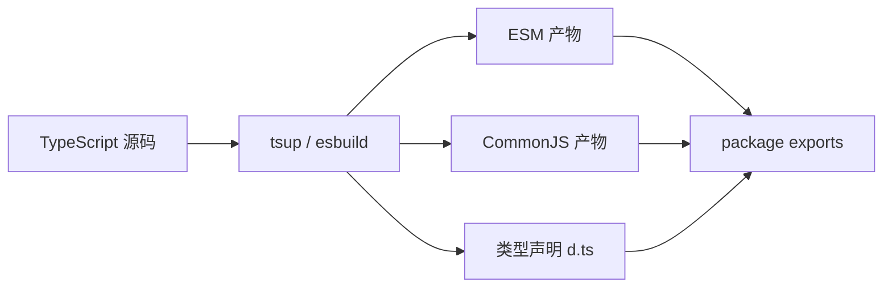

export const metadata = {
  title: '基于 tsup 构建 TypeScript 库：双格式打包与导出配置',
  description: '介绍使用 tsup 打包 TypeScript 库的配置要点，涵盖 ESM 与 CommonJS 双格式输出、.d.ts 类型生成、package.json exports 字段规范与 Monorepo 本地联动。',
  date: '2025-01-26',
  category: '前端工程化',
  readingTime: '8 分钟',
  alternates: { canonical: '/posts/tsup-bundler' },
  openGraph: {
    type: 'article',
    title: '基于 tsup 构建 TypeScript 库：双格式打包与导出配置',
    description: '介绍使用 tsup 打包 TypeScript 库的配置要点，涵盖 ESM 与 CommonJS 双格式输出、.d.ts 类型生成、package.json exports 字段规范与 Monorepo 本地联动。',
    url: '/posts/tsup-bundler', images: ['/og-image.png'] },
  twitter: {
    card: 'summary_large_image',
    title: '基于 tsup 构建 TypeScript 库：双格式打包与导出配置',
    description: '介绍使用 tsup 打包 TypeScript 库的配置要点，涵盖 ESM 与 CommonJS 双格式输出、.d.ts 类型生成、package.json exports 字段规范与 Monorepo 本地联动。', images: ['/og-image.png'] },
}

## 读完你能做什么

- 从使用方环境反推库需要发布 ESM、CJS、类型声明中的哪些产物。
- 配置 tsup 入口、外部依赖与 source map，并写出正确的 `exports`。
- 在真正发布前用打包结果和消费端小项目验证导入路径。



库打包的成功标准不是“命令执行成功”，而是目标消费者能按声明的入口加载代码和类型。格式越多，验证矩阵也越大，只发布确实需要的产物。

在开发 TypeScript 工具库、React 组件库或 Monorepo 内部共享包时，配置 Webpack 或 Rollup 往往需要编写冗长的配置，并处理 Babel/SWC 插件与类型声明插件的配合。

**tsup** 基于 Go 语言编写的 **esbuild** 构建，主打轻量与近乎零配置，能快速完成 TypeScript 源码到 ESM / CommonJS 双格式产物与 `.d.ts` 类型文件的编译。

本文记录为开源项目 [autoform](https://github.com/vantezzen/autoform)（[PR #145](https://github.com/vantezzen/autoform/pull/145)）优化构建链路时使用 tsup 的实践与注意事项。

---

## tsup 的构建机制与特点

```text
传统 Rollup/Webpack 流程:
  TS 源码 -> Babel/TSC 单线程解析 -> AST 转换 -> 插件链 -> 打包 (耗时较长)

tsup 架构:
  TS 源码 ──► esbuild (Go 原生并行编译) ──► 快速产出 ESM/CJS
          └──► 并行触发 tsc 提取类型 ────► 产出 .d.ts 声明文件
```

1. **构建速度更快**：底层由 esbuild 驱动，解析与转译效率明显高于传统 JS 编译器。
2. **双模块格式支持**：直接输出 Modern ESM (`.mjs`) 与 Node.js 兼容的 CommonJS (`.cjs`)。
3. **类型声明生成**：通过 `--dts` 配置调用 TypeScript 编译器提取 `.d.ts`。
4. **增量监听构建**：内置 `--watch` 模式，在 Monorepo 本地联调时支持改动即时重构。

---

## 快速上手与生产级配置文件

### 1. 安装依赖

```bash
pnpm add -D tsup typescript
```

### 2. 编写 `tsup.config.ts`

虽然可以在命令行传递参数，但通过配置文件能沉淀更标准、可复用的构建策略：

```ts
// tsup.config.ts
import { defineConfig } from 'tsup';

export default defineConfig({
  // 入口文件
  entry: ['src/index.ts'],
  // 同时输出 ESM 和 CJS 格式
  format: ['cjs', 'esm'],
  // 自动生成类型声明文件 .d.ts
  dts: true,
  // 开启源码映射，方便调试
  sourcemap: true,
  // 每次构建前清空 dist 目录
  clean: true,
  // 代码压缩（生产发布时开启）
  minify: false,
  // 排除外部依赖，避免把 react 或 lodash 打入产物
  external: ['react', 'react-dom'],
  // 摇树优化 (Tree Shaking)
  treeshaking: true,
});
```

---

## 现代 `package.json` 导出规范（Package Exports）

仅打包出文件还不够，要让 npm 消费者（包括 Vite、Next.js、Node.js CJS/ESM）正确解析你的包，必须配合现代 `exports` 字段：

```json
{
  "name": "@my-org/core-utils",
  "version": "1.0.0",
  "type": "module",
  "main": "./dist/index.js",
  "module": "./dist/index.mjs",
  "types": "./dist/index.d.ts",
  "exports": {
    ".": {
      "types": "./dist/index.d.ts",
      "import": "./dist/index.mjs",
      "require": "./dist/index.js"
    }
  },
  "scripts": {
    "dev": "tsup --watch",
    "build": "tsup"
  },
  "files": [
    "dist"
  ]
}
```

> [!TIP]
> **条件导出顺序原则**：在 `exports` 字段中，`types` 必须排在最前面，否则部分 TypeScript 版本可能无法优先解析类型声明。

---

## Monorepo 内部包协同实践

在 pnpm workspace 或 Turborepo 架构中，公共 UI 组件包或通用工具库常被多个业务应用引用：

```text
apps/
  ├── web-portal/ (Next.js 应用)
packages/
  └── ui-kit/ (使用 tsup 构建)
```

1. 在 `packages/ui-kit` 中启动 `pnpm dev`（即 `tsup --watch`）。
2. 在 `apps/web-portal` 中直接导入 `@my-org/ui-kit`。
3. 当修改 `ui-kit` 中的组件代码时，tsup 增量打包，Vite / Next.js 的 HMR 捕捉到产物变化并更新页面。
4. 这种方式兼顾了模块隔离与本地联调效率。

---

## 官方资料

- [tsup：官方仓库](https://github.com/egoist/tsup)

## 工程经验小结

使用 tsup 打包库时，最容易踩坑的不是编译本身，而是 `package.json` 中的 `exports` 条件导出以及 `peerDependencies` 处理。

如果库依赖了 React 或 Vue，务必将其配置到 `external` 中，避免打包进产物导致消费端出现双重实例或 Context 丢失问题。另外，类型生成阶段依然由 tsc 执行，若项目源码存在类型报错，tsup 构建依然会被打断，不能用它来绕过严格的类型检查。
