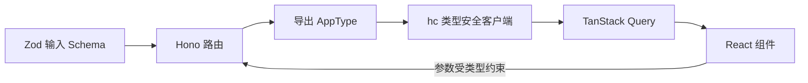

export const metadata = {
  title: 'Next.js 接入 Hono + Zod：端到端类型安全 API 实践',
  description: '探讨在 Next.js App Router 中嵌入 Hono RPC 与 Zod 校验器的方案，实现服务端入参校验、客户端类型自动推导与 React Query 数据集成。',
  date: '2025-01-26',
  category: '全栈开发',
  readingTime: '9 分钟',
  alternates: { canonical: '/posts/type-safe-routing' },
  openGraph: {
    type: 'article',
    title: 'Next.js 接入 Hono + Zod：端到端类型安全 API 实践',
    description: '探讨在 Next.js App Router 中嵌入 Hono RPC 与 Zod 校验器的方案，实现服务端入参校验、客户端类型自动推导与 React Query 数据集成。',
    url: '/posts/type-safe-routing', images: ['/og-image.png'] },
  twitter: {
    card: 'summary_large_image',
    title: 'Next.js 接入 Hono + Zod：端到端类型安全 API 实践',
    description: '探讨在 Next.js App Router 中嵌入 Hono RPC 与 Zod 校验器的方案，实现服务端入参校验、客户端类型自动推导与 React Query 数据集成。', images: ['/og-image.png'] },
}

## 读完你能做什么

- 用 Zod 在请求边界验证运行时数据，用 TypeScript 在编译期推导类型。
- 从 Hono 路由导出类型并通过 `hc` 构建客户端。
- 把 RPC 客户端接入 TanStack Query，同时保留 HTTP 错误处理。



“类型安全”不能替代运行时校验：浏览器、第三方客户端和旧版本都可能发送任意数据。Zod 守住服务端边界，RPC 类型减少受控代码之间的重复声明。

在 Next.js App Router 中开发接口时，常见痛点包括：
1. **路由定义碎片化**：每个端点通常要新建多层文件夹和 `route.ts`；
2. **前后端类型分离**：前端调用时往往依赖手写 URL 字符串与类型断言，后端接口修改后无法第一时间在编译期暴露。

将 **Hono** 作为轻量 API 路由引擎嵌入 Next.js，并配合 **Zod** 与 **Hono RPC (`hc`)**，可以在保留标准 HTTP 语义的同时获得全链路类型推导。

---

## 架构设计：Next.js Catch-All + Hono RPC

```text
前端 React 组件 (或 TanStack Query)
  │
  ▼ hc<AppType> 客户端调用 (享受 IDE 强类型自动补全与入参检查)
HTTP 请求 /api/posts/create
  │
  ▼ Next.js Catch-all: app/api/[[...route]]/route.ts
Hono 路由中心
  │
  ├── zValidator('json', schema) 运行时入参强校验
  ├── 业务 Handler 处理
  └── 返回 c.json(data) 并自动向前端推导响应类型
```

---

## 第一步：依赖安装

```bash
pnpm add hono @hono/zod-validator zod @tanstack/react-query
```

---

## 第二步：在 Next.js 中挂载 Hono 路由

在 `app/api/[[...route]]/route.ts` 中创建统一入口，并使用 Hono 的子路由（`.route()`）模块化组织代码：

```ts
// app/api/[[...route]]/route.ts
import { Hono } from 'hono';
import { handle } from 'hono/vercel';
import { zValidator } from '@hono/zod-validator';
import { z } from 'zod';

const app = new Hono().basePath('/api');

// 1. 定义入参验证 Schema
const createPostSchema = z.object({
  title: z.string().min(3, '标题至少 3 个字符'),
  content: z.string().min(10, '内容至少 10 个字符'),
  tags: z.array(z.string()).default([]),
});

// 2. 链式定义路由（必须链式调用以便 TypeScript 提取 AppType）
const routes = app
  .get('/hello', (c) => {
    return c.json({ message: 'Hello from Type-Safe Hono!' });
  })
  .post('/posts', zValidator('json', createPostSchema), async (c) => {
    // validData 自动获得准确的 TypeScript 类型
    const validData = c.req.valid('json');

    // 模拟数据库保存
    const post = {
      id: crypto.randomUUID(),
      ...validData,
      createdAt: new Date().toISOString(),
    };

    return c.json({ success: true, data: post }, 201);
  });

// 导出 Next.js 请求处理器
export const GET = handle(app);
export const POST = handle(app);
export const PUT = handle(app);
export const DELETE = handle(app);

// 3. 导出整个 API 的类型定义供前端使用
export type AppType = typeof routes;
```

---

## 第三步：前端初始化强类型客户端（`hc`）

在客户端创建 RPC Client 实例，无需任何代码生成步骤（Code-gen），即可直接引用服务端的 `AppType`：

```ts
// lib/rpc-client.ts
import { hc } from 'hono/client';
import type { AppType } from '@/app/api/[[...route]]/route';

// 获得拥有完整路径补全与入参检查的强类型客户端
export const client = hc<AppType>(process.env.NEXT_PUBLIC_APP_URL || 'http://localhost:3000');
```

---

## 第四步：在 React / TanStack Query 中深度集成

Hono 提供了 `InferRequestType` 和 `InferResponseType` 工具类型，可以无缝对接 TanStack Query：

```tsx
// components/CreatePostForm.tsx
'use client';

import { useMutation } from '@tanstack/react-query';
import { client } from '@/lib/rpc-client';
import type { InferRequestType, InferResponseType } from 'hono';

// 提取指定接口的请求与响应类型
type ReqType = InferRequestType<typeof client.api.posts.$post>['json'];
type ResType = InferResponseType<typeof client.api.posts.$post, 201>;

export function CreatePostForm() {
  const mutation = useMutation<ResType, Error, ReqType>({
    mutationFn: async (json) => {
      // client.api.posts.$post 享受完整类型检查，输错字段在 IDE 中直接标红
      const res = await client.api.posts.$post({ json });
      if (!res.ok) {
        throw new Error('创建文章失败');
      }
      return await res.json();
    },
    onSuccess: (data) => {
      console.log('创建成功，返回文章 ID:', data.data.id);
    },
  });

  const handleSubmit = (e: React.FormEvent) => {
    e.preventDefault();
    mutation.mutate({
      title: '端到端类型安全实践',
      content: '本文详细记录了 Hono + Zod 在 Next.js 中的全流程打通...',
      tags: ['TypeScript', 'Next.js', 'Hono'],
    });
  };

  return (
    <form onSubmit={handleSubmit} className="space-y-4">
      <button
        type="submit"
        disabled={mutation.isPending}
        className="px-4 py-2 bg-blue-600 text-white rounded-md hover:bg-blue-700"
      >
        {mutation.isPending ? '提交中...' : '创建文章'}
      </button>
    </form>
  );
}
```

---

## 相比传统方案的核心收益

| 维度 | 传统 Next.js Route Handlers | tRPC | Hono RPC + Zod |
| :--- | :--- | :--- | :--- |
| **路由文件管理** | 目录嵌套深，每个 API 一个文件 | 集中 Router 组织 | 集中或模块化 Sub-routing |
| **类型安全** | ❌ 前端需手动写 interface 强转 | ✅ 全链路类型推导 | ✅ 全链路类型推导 |
| **标准 REST 支持** | ✅ 原生 HTTP | ❌ 默认专有 RPC 协议 | ✅ 标准 HTTP / REST，对外开放 API 零负担 |
| **运行时体积** | 极小 | 较重 | **极轻量（适合 Edge Runtime）** |

---

## 官方资料

- [Hono：RPC](https://hono.dev/docs/guides/rpc)

## 工程经验小结

Hono RPC 的核心优势在于维持标准 HTTP 接口形式的同时，省去了代码生成工具（Code-gen）的额外环节。

但在大型项目中，TypeScript 编译器在推导深度嵌套或超长链式路由时可能会遇到性能瓶颈。建议按业务域合理拆分子路由（Sub-router），避免将数十个接口一次性串联在单条巨大 routes 链上。另外，客户端的 AppType 只保证调用阶段的类型契约，网络故障、非 2xx 状态响应以及异常序列化仍然需要配合统一的 HTTP 错误处理逻辑妥善兜底。
