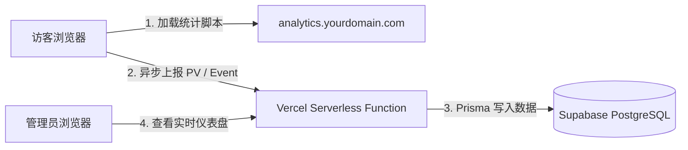
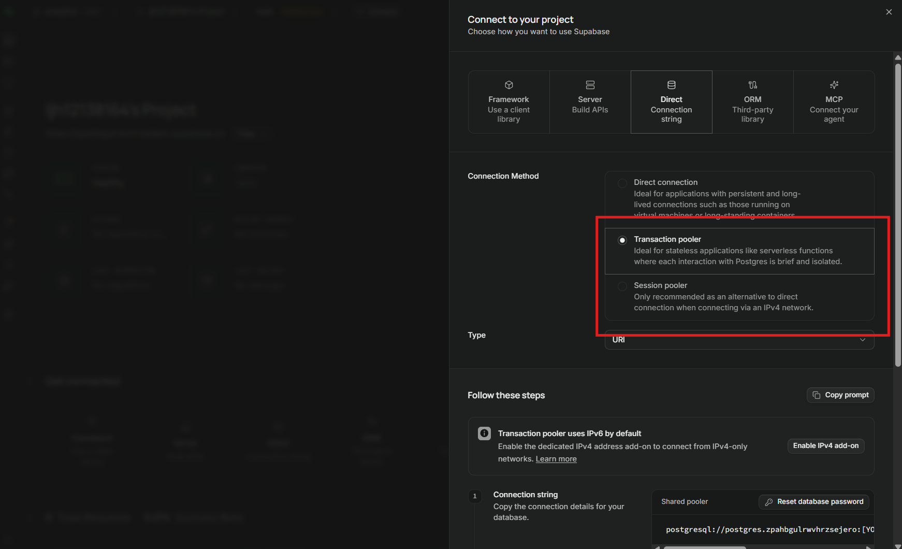
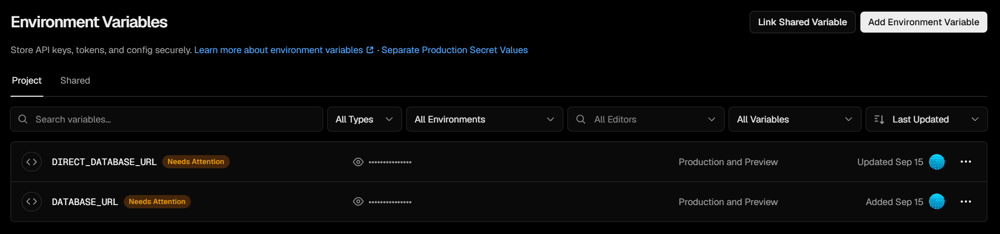
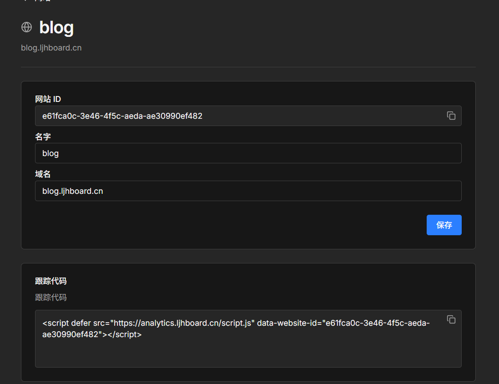

export const metadata = {
  title: '项目接入 Umami 统计：基于 Vercel 与 Supabase 的自建部署实践',
  description: '记录使用 Vercel 托管 Umami、配合 Supabase PostgreSQL 的部署流程，包括数据库连接、环境变量、自定义域名和网站追踪脚本。',
  date: '2026-09-23',
  category: '建站与专题',
  readingTime: '9 分钟',
  alternates: { canonical: '/posts/umami-vercel-supabase' },
  openGraph: {
    type: 'article',
    title: '项目接入 Umami 统计：基于 Vercel 与 Supabase 的自建部署实践',
    description: '记录使用 Vercel 托管 Umami、配合 Supabase PostgreSQL 的部署流程，包括数据库连接、环境变量、自定义域名和网站追踪脚本。',
    url: '/posts/umami-vercel-supabase',
    images: ['/og-image.png'],
  },
  twitter: {
    card: 'summary_large_image',
    title: '项目接入 Umami 统计：基于 Vercel 与 Supabase 的自建部署实践',
    description: '记录使用 Vercel 托管 Umami、配合 Supabase PostgreSQL 的部署流程，包括数据库连接、环境变量、自定义域名和网站追踪脚本。',
    images: ['/og-image.png'],
  },
}

## 读完你能做什么

- 申请并配置 Supabase 免费 PostgreSQL 数据库，规避 Serverless 下的连接池配置陷阱。
- 将 Umami 分析服务部署到 Vercel，绑定独立统计二级域名。
- 在 Umami 中添加网站，获取用于统计访问的追踪脚本。




本文使用 Vercel 托管 Umami、Supabase 存储统计数据，记录这套部署的配置过程。免费方案可以用于起步，但有额度和使用范围限制。

选择访问分析工具时，需要核对脚本加载、数据存储和隐私处理方式：
* **Google Analytics 4 (GA4)**：JavaScript 标签使用第一方 Cookie 区分用户与会话，并非依赖第三方 Cookie。是否需要征求同意，取决于用户所在地区、数据用途和实际配置，不能仅凭 Cookie 类型判断。参见 [GA4 Cookie 使用说明](https://support.google.com/analytics/answer/11397207?hl=zh_CN)。
* **百度统计 / 友盟**：属于第三方统计服务，接入前应核对实际加载的脚本、采集字段和隐私说明。

**Umami** 的访问统计不依赖 Cookie，可以自行部署和管理数据库；使用 Vercel 与 Supabase 时，托管基础设施仍由这两家服务商提供。能否维持免费取决于用量和方案限制，不能保证长期零成本。Vercel Hobby 限个人非商业用途；Supabase Free 目前包含 500 MB 数据库，具体额度以 [Vercel 方案说明](https://vercel.com/docs/plans/hobby)和 [Supabase 定价页](https://supabase.com/pricing)为准。

---

## 步骤一：创建 Supabase PostgreSQL 数据库

Umami 使用 PostgreSQL 存储网站配置与访问事件。先创建 Supabase 项目，再获取部署所需的数据库连接信息：

1. 登录 [Supabase 官网](https://supabase.com) 并新建一个 Project。
2. 填写数据库密码（Database Password），所在地域建议选择与目标受众最近的节点（如 `Northeast Asia (Tokyo)` 或 `Southeast Asia (Singapore)`）。
3. 项目初始化完成后，点击项目中的 **Connect**，获取所需连接模式的连接字符串。

### 连接字符串注意事项


在 Serverless 环境下（如 Vercel），数据库连接处理需要区分**直连**与**连接池（Pooler）**：
* **Direct Connection（端口 5432）**：可用于数据库迁移，但需确认部署环境能连接该地址。不能仅凭端口判断为直连，共享连接池的 Session 模式也使用 5432。
* **Transaction Pooler（端口 6543）**：共享连接池使用 Supavisor，适合 Serverless 的短连接。Transaction 模式不支持预处理语句，客户端需按所用驱动配置兼容参数。

---

## 步骤二：在 Vercel 部署 Umami 实例

Umami 官方提供了对 Vercel 的原生支持，无需手动编写 Dockerfile 或配置 Node.js 运行时：

### 1. 导入代码仓库

访问 [Umami 官方仓库](https://github.com/umami-software/umami)，点击右上角 Fork 到自己的 GitHub 账号；或者直接使用官方提供的一键部署链接导入 Vercel。

### 2. 配置环境变量

在 Vercel 项目设置中的 **Environment Variables** 配置所用 Umami 版本要求的变量。截图中的 `DIRECT_DATABASE_URL` 与 `DATABASE_URL` 用于区分迁移连接和运行时连接，不代表所有版本都只需填写这两项：


### 3. 执行首次构建

点击 **Deploy**，查看依赖安装、数据库初始化和构建日志。数据库初始化命令与表结构取决于所用 Umami 版本，应核对该版本的构建脚本，不能假定 Vercel 会额外自动执行 `prisma migrate deploy`。部署耗时也会随版本和网络环境变化。

---

## 步骤三：初始化后台与绑定自定义域名

### 1. 修改默认管理员凭据

部署完成后，打开 Vercel 分配的域名访问 Umami 登录界面：
* 默认账号：`admin`
* 默认密码：`umami`

**首次登录后必须立即在 Settings -> Profile 中修改密码**，防止被全网扫描器撞库控制。

### 2. 绑定自定义二级域名（关键步骤）

可以绑定自己的二级域名（例如 `analytics.yourdomain.com`），便于管理统计服务地址。能否被广告拦截器拦截取决于具体规则，不能保证自定义域名就能完整采集：

1. 在 Vercel 项目的 **Settings -> Domains** 中添加 `analytics.yourdomain.com`。
2. 在 DNS 解析服务商（如 Cloudflare 或阿里云）处添加 Vercel 项目页面要求的记录，以该项目显示的目标地址为准。
3. 等待 Vercel 完成域名验证并签发 TLS 证书。

### 3. 添加被统计站点

在 Umami 控制台的 **Settings -> Websites** 点击 **Add Website**：
* **Name**：项目名称（如 `我的个人技术博客`）。
* **Domain**：博客正式访问域名（如 `blog.ljhboard.cn`）。

保存后，点击该站点右侧的 **Edit -> Tracking Code**，即可得到包含站点唯一标识（`data-website-id`）的代码段：

```html
<script defer src="https://analytics.yourdomain.com/script.js" data-website-id="8f91c34a-9b12-4e56-8a7c-0123456789ab"></script>
```



## 官方资料

- [Umami 官方文档：快速入门](https://umami.is/docs)
- [Supabase 官方文档：连接池管理](https://supabase.com/docs/guides/database/connecting-to-postgres#connection-pooler)
- [Vercel 官方文档：环境变量配置](https://vercel.com/docs/projects/environment-variables)

## 工程经验小结

这套部署需要持续关注连接数、免费方案限制和追踪脚本的实际加载情况：

1. **连接数耗尽防线**：多个 Serverless 实例各自建立连接池，可能耗尽数据库连接。连接数上限应查看项目实际配置；Prisma 的 `connection_limit` 参数只限制单个客户端连接池，不能代替整个部署的容量评估。使用共享 Transaction Pooler 时，还要核对驱动对预处理语句的兼容设置。
2. **Supabase 免费实例休眠机制**：免费项目在一周不活跃后可能暂停，低流量站点不能把免费实例视为持续可用的保证。以控制台的项目状态和当前方案说明为准。
3. **域名反代与脚本混淆**：Umami 支持通过 `TRACKER_SCRIPT_NAME` 修改追踪脚本文件名。自定义域名或文件名不能保证避开所有拦截规则，应检查浏览器中的实际加载与上报结果。
