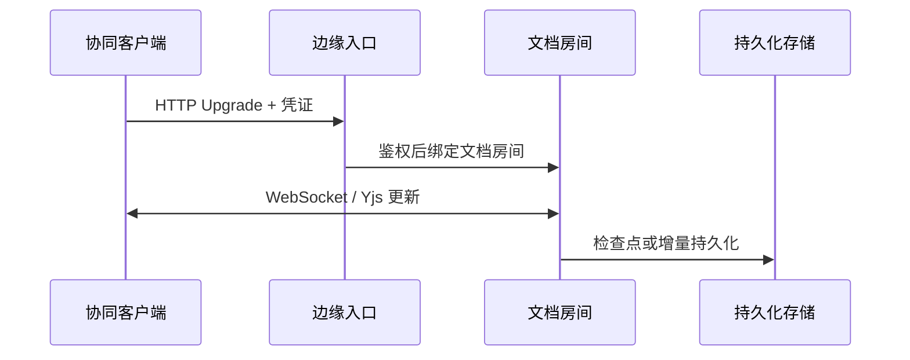

export const metadata = {
  title: '边缘 WebSocket 实时协同：Deno Deploy 与 Hocuspocus',
  description: '探讨在 Deno Deploy 边缘运行环境中接入 Hocuspocus (Yjs) 的 WebSocket 服务架构，包括连接鉴权、状态持久化与多节点路由权衡。',
  date: '2025-02-15',
  category: '全栈与边缘计算',
  readingTime: '8 分钟',
  alternates: { canonical: '/posts/websocket-edge-functions' },
  openGraph: {
    type: 'article',
    title: '边缘 WebSocket 实时协同：Deno Deploy 与 Hocuspocus',
    description: '探讨在 Deno Deploy 边缘运行环境中接入 Hocuspocus (Yjs) 的 WebSocket 服务架构，包括连接鉴权、状态持久化与多节点路由权衡。',
    url: '/posts/websocket-edge-functions', images: ['/og-image.png'] },
  twitter: {
    card: 'summary_large_image',
    title: '边缘 WebSocket 实时协同：Deno Deploy 与 Hocuspocus',
    description: '探讨在 Deno Deploy 边缘运行环境中接入 Hocuspocus (Yjs) 的 WebSocket 服务架构，包括连接鉴权、状态持久化与多节点路由权衡。', images: ['/og-image.png'] },
}

## 读完你能做什么

- 判断目标边缘平台是否支持 WebSocket 升级、长连接和所需 Node.js API。
- 画出连接升级、文档同步、鉴权与持久化的完整链路。
- 识别无状态函数与有状态协同房间之间的架构冲突。



“部署到边缘”不自动解决状态问题。实时协同要求同一文档的连接能够协调；如果平台只提供短生命周期无状态函数，就需要额外的有状态房间或专用协同服务。

在构建类似 Notion 或在线文档的多人实时协同编辑器时，WebSocket 是实现客户端 CRDT / Yjs 状态同步的常见通信方式。

传统方案通常需要运维独立的 Node.js 虚拟机来保持 WebSocket 长连接。借助支持持久 WebSocket 的边缘运行环境（如 Deno Deploy），可以免去固定虚拟机的日常运维，按需运行基于 Hocuspocus 的协同服务。不过将有状态长连接放到无服务器平台，也会带来节点路由与实例状态管理的新权衡。

---

## 边缘 WebSocket 架构拓扑

```text
客户端 (TipTap / BlockSuite / ProseMirror)
  │
  ▼ wss://sync.example.com (全球任播 Anycast 域名)
Deno Deploy 边缘节点 (V8 隔离沙箱)
  │
  ├── Hocuspocus Server (运行 Yjs CRDT 状态合并)
  │     ├── 身份认证与权限钩子 (onAuthenticate)
  │     ├── 实时广播协同光标与文本变更 (Awareness & Update)
  │     └── 定时去抖持久化 (onStoreDocument)
  │
  ▼ Webhook / REST API
后端主数据库 (Supabase PostgreSQL / Redis)
```

---

## 核心实现：在 Deno 环境下构建 Hocuspocus 实例

Deno 原生支持 TypeScript 与标准 Web API（如 `Deno.upgradeWebSocket`），无需额外的编译打包步骤：

```ts
// server.ts (运行于 Deno Deploy)
import { Server } from 'npm:@hocuspocus/server@^2.13.0';
import { Logger } from 'npm:@hocuspocus/extension-logger@^2.13.0';
import { Webhook } from 'npm:@hocuspocus/extension-webhook@^2.13.0';

const server = Server.configure({
  port: 8080,
  extensions: [
    new Logger(),
    // 通过 Webhook 与主业务后端实现持久化解耦
    new Webhook({
      url: Deno.env.get('BACKEND_WEBHOOK_URL') || 'https://api.example.com/api/hocuspocus-hook',
      events: ['onStoreDocument'],
      secret: Deno.env.get('WEBHOOK_SECRET') || 'my-secret-key',
    }),
  ],

  // 1. 鉴权钩子：校验客户端传入的 JWT Token
  async onAuthenticate(data) {
    const { token } = data;
    if (!token) {
      throw new Error('未授权访问');
    }
    // 验证用户身份与文档读写权限
    return {
      user: { id: 'user-123', name: 'Alice' },
    };
  },

  // 2. 状态存储钩子：支持增量与全量快照保存
  async onStoreDocument(data) {
    console.log(`正在持久化文档 [${data.documentName}]...`);
    // 实际生产中可调用云端数据库 REST 接口保存二进制 Yjs Doc
  },
});

// Deno 原生 HTTP 监听
Deno.serve({ port: 8080 }, (req) => {
  return server.handleRequest(req);
});
```

---

## 前端 TipTap 客户端接入配置

在前端 React / Vue 应用中，通过 `@hocuspocus/provider` 与 TipTap 协同扩展无缝连接：

```tsx
import { useEditor, EditorContent } from '@tiptap/react';
import StarterKit from '@tiptap/starter-kit';
import Collaboration from '@tiptap/extension-collaboration';
import CollaborationCursor from '@tiptap/extension-collaboration-cursor';
import { HocuspocusProvider } from '@hocuspocus/provider';
import * as Y from 'yjs';

export function CollaborativeEditor({ docId, user }: { docId: string; user: { name: string; color: string } }) {
  const ydoc = new Y.Doc();

  // 1. 建立与边缘 WebSocket 的持久长连接
  const provider = new HocuspocusProvider({
    url: 'wss://sync.example.com',
    name: docId,
    document: ydoc,
    token: 'jwt-auth-token',
  });

  // 2. 初始化 TipTap 编辑器
  const editor = useEditor({
    extensions: [
      StarterKit.configure({ history: false }), // 必须关闭本地历史，改由 Yjs 接管
      Collaboration.configure({
        document: ydoc,
      }),
      CollaborationCursor.configure({
        provider,
        user,
      }),
    ],
  });

  return (
    <div className="editor-container border rounded-lg p-4">
      <EditorContent editor={editor} />
    </div>
  );
}
```

---

## Deno Deploy 部署流程与域名绑定

1. **关联 GitHub 仓库**：在 Deno Deploy 控制面板新建项目，绑定存放 `server.ts` 的仓库分支。
2. **配置环境变量**：在 Settings -> Environment Variables 中填入 `BACKEND_WEBHOOK_URL` 和 `WEBHOOK_SECRET`。
3. **自定义域名与证书**：
   * 在 DNS 提供商处为 `sync.example.com` 添加 CNAME 记录指向 Deno 提供的专属接入点；
   * Deno Deploy 会全自动签发并续期免费的 TLS 证书，开箱支持全球安全的 `wss://` 连接。

---

## 适用场景与架构边界

* **延迟表现**：边缘节点分布在多个地理区域，能就近响应客户端的 TCP/TLS 握手。
* **按需计费与免运维**：无需为低峰期预留常驻 VPS 算力与配置系统补丁。
* **跨节点协同约束**：在多区域分布式边缘环境下，若不同协作者被路由至不同的物理边缘节点，纯单机内存房间无法自动互通，必须引入集中式中继（如 Redis Pub/Sub）或全局协调实例（如 Cloudflare Durable Objects）来保证同一房间消息汇聚。

---

## 官方资料

- [MDN：WebSocket](https://developer.mozilla.org/docs/Web/API/WebSocket)

## 工程经验小结

边缘 WebSocket 的核心约束在于“协同房间归属”。

如果同一个文档的多个协作者被 Anycast 路由到了不同的物理节点，无状态边缘实例无法直接在内存中同步。此时必须依赖中心化中继（如 Redis Pub/Sub）或支持单实例强一致性的边缘协调层（如 Cloudflare Durable Objects）。在业务规模较小或并发可控的初期阶段，直接指定单区域部署通常是实现成本最低、状态一致性最容易保证的方案。
