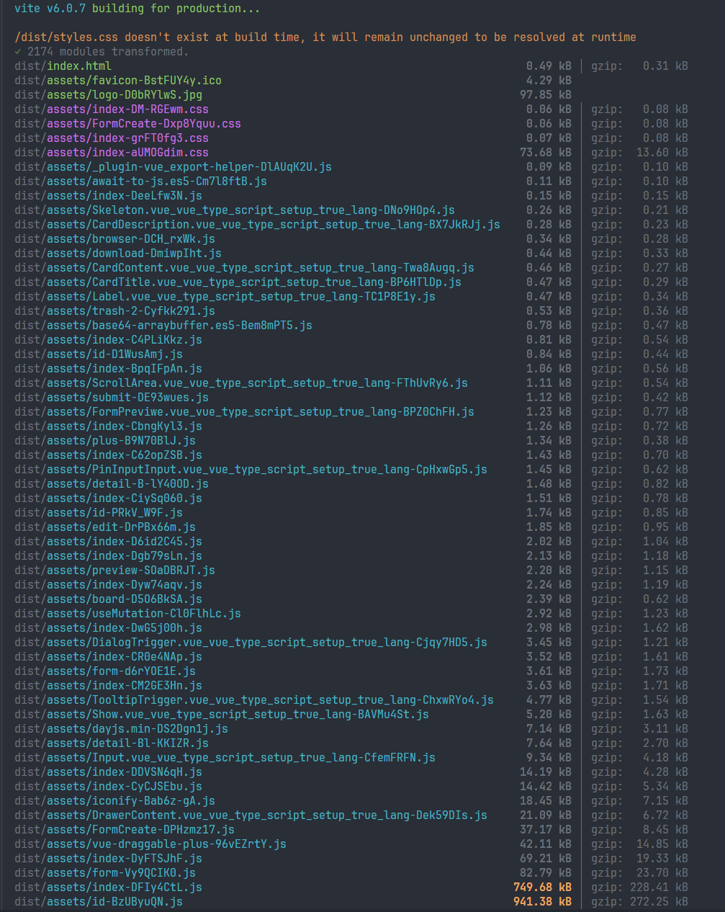
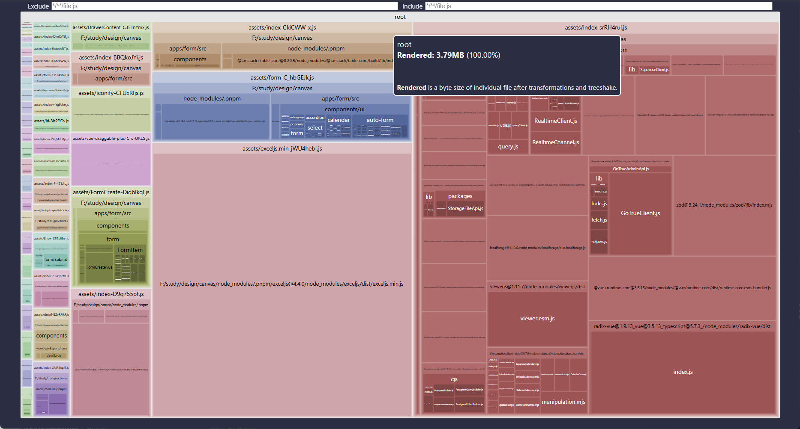
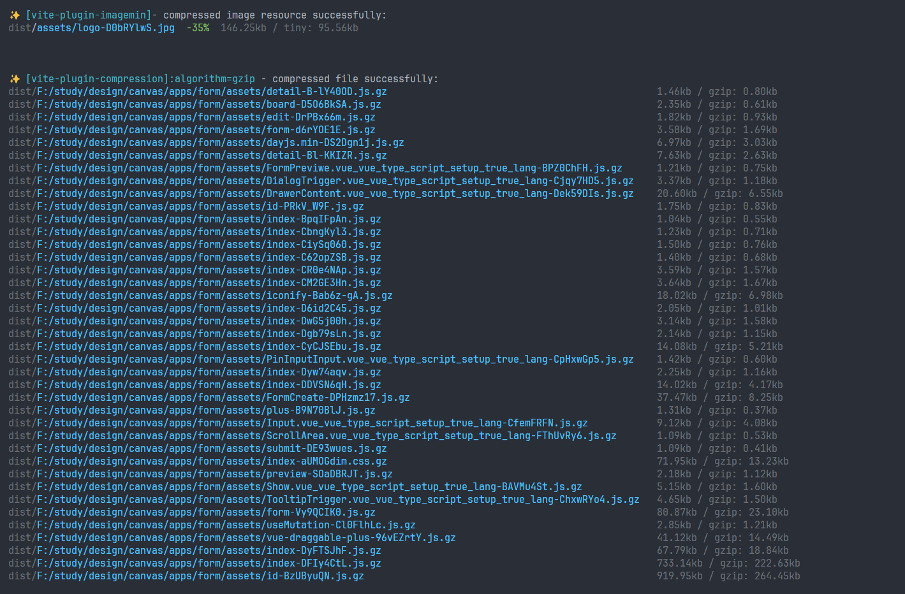
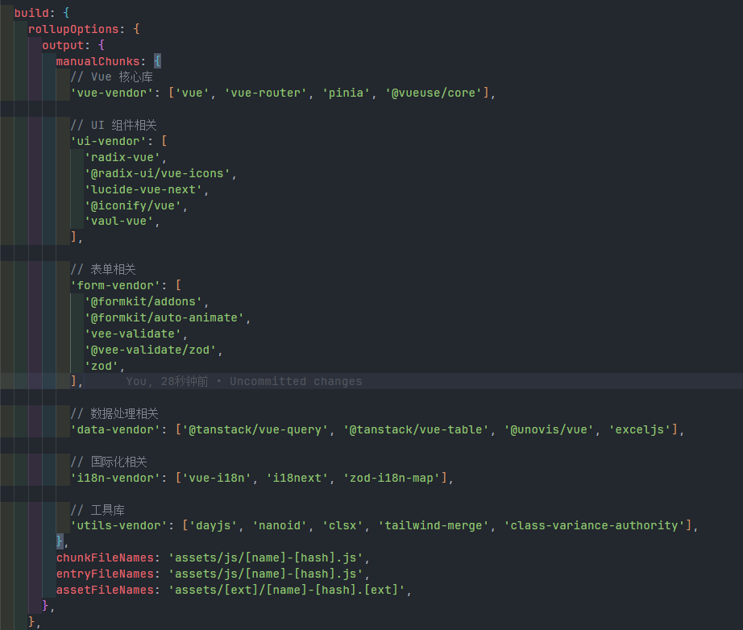
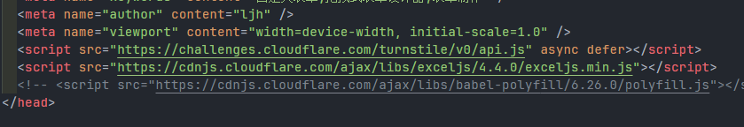
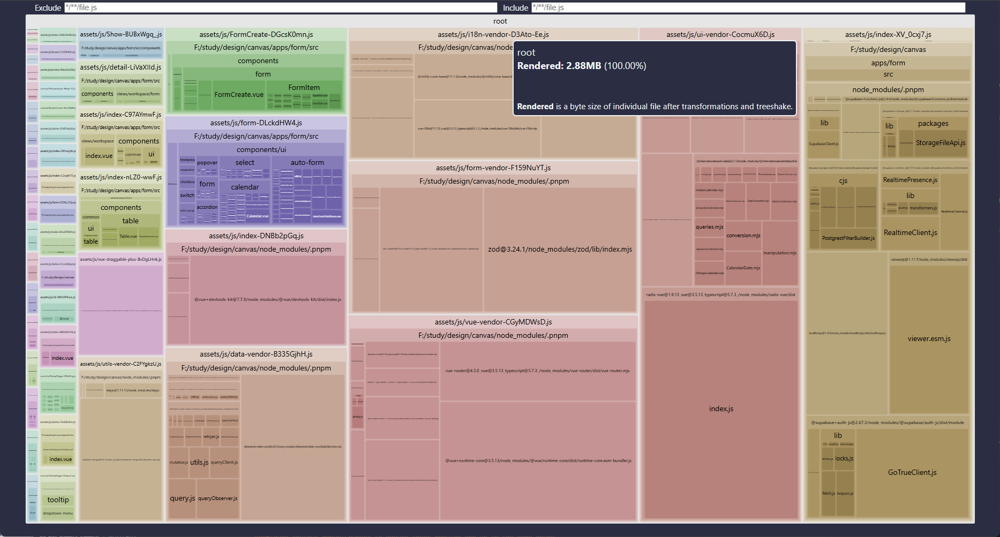
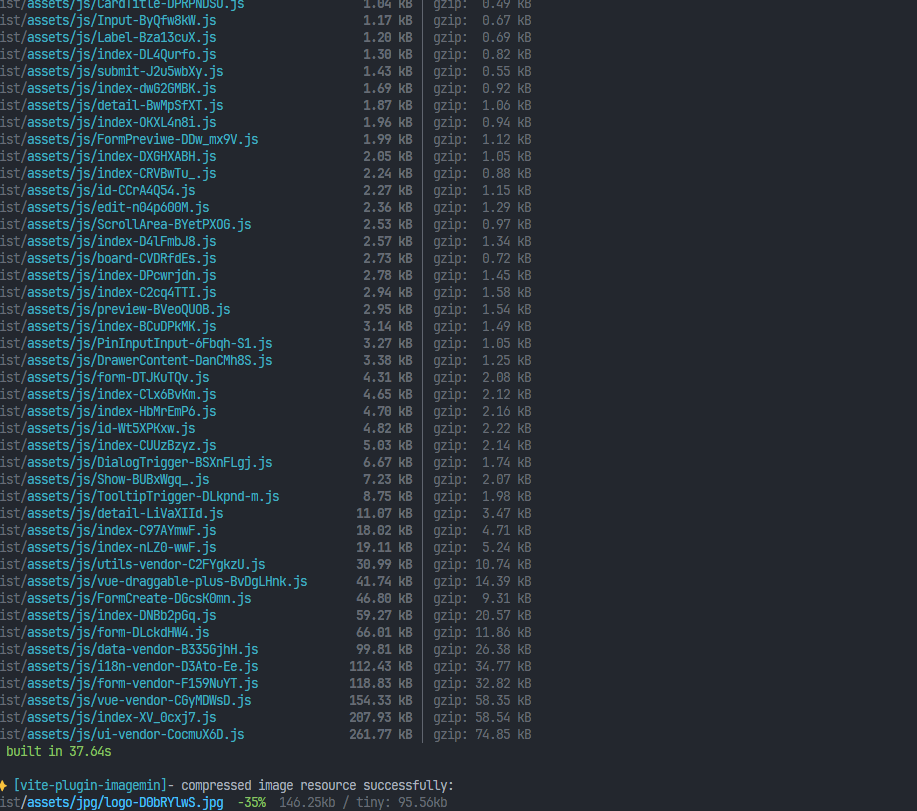

export const metadata = {
  title: "自定义表单",
  description: "自定义表单的优化记录",
  date: "2025-01-31",
  category: "优化记录",
  readingTime: "1 分钟",
  alternates: { canonical: "/优化记录/自定义表单" },
  openGraph: { type: 'article', title: "自定义表单", description: "自定义表单的优化记录", url: "/优化记录/自定义表单" },
  twitter: { card: 'summary', title: "自定义表单", description: "自定义表单的优化记录" }
}

## 自定义表单

### 开始优化form


- 未优化前



- 打包体积



- 打包grip优化和图片的优化



- 对大的文件进行分包处理



- 用excel.js CDN导入



- 对iconify进行预连接

```html
<link rel=preconnect href=https://api.iconify.design>
```


- 打包结果



- 打包的结果分析




